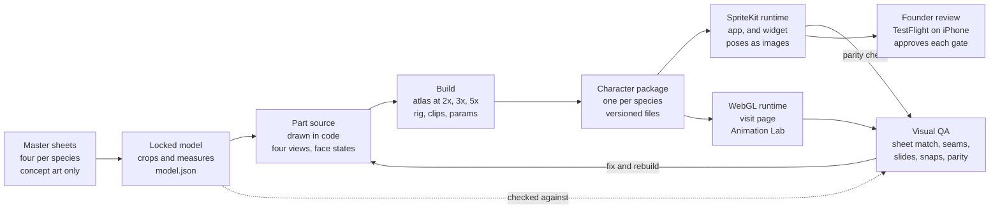
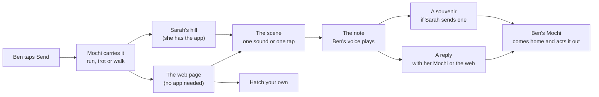
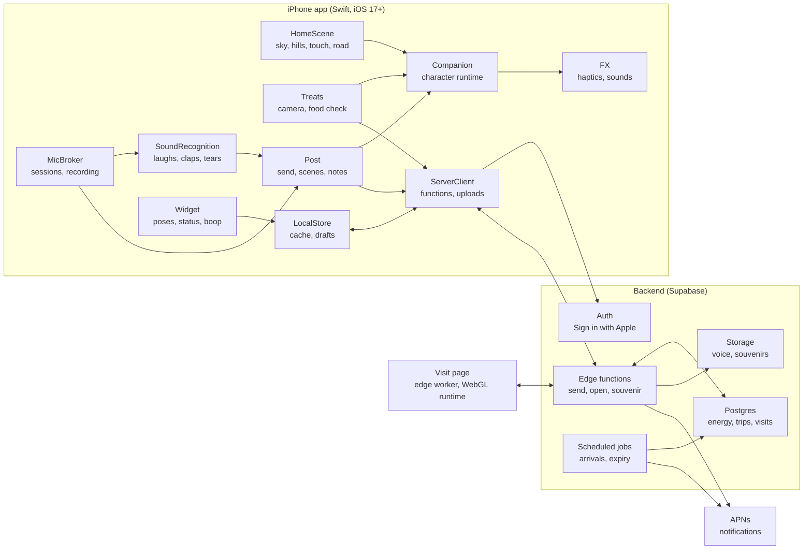

# Huddlings — Design & Architecture

Spec version 3 · Oct 14, 2026 · @beurni

> This Markdown file is the single source of truth for Huddlings v1. It replaces spec version 2 and the Mochi Post spec entirely. Version 3 rebuilds the app around one thing: sending your voice to a friend with your own little pet, which turns the delivery into a short show and brings their reaction home. The companions keep the art direction and the animation method of version 2: four master sheets per species in `characters/reference/`, rebuilt in code as parts on pivots (sections 5 and 5b).

**What changed from version 2**

- **Gone:** ambient listening and Start listening, shared pets and circles, Huddles, the 9:00 recap, moments and cards, the Memories sky, song naming and the playlist, coins, outfits and the outfit collection, Playtime, Sing with Mochi, Watch Together, postcards, trait-driven behaviour and style sets, the adults-only rule. Do not build any of them.
- **Kept:** the four companions, the master sheets, section 5b's parts, pivots, rig, motion rules, visual QA, gates, toolbox and quality loop. Work already done on the dog in M0 (references, the locked model, parts, rig, poses) carries over unchanged; the list of core motions changes a little (section 5b).
- **New:** everyone hatches their own Huddling; Home is a pet you can touch; Mochi Treats (choose a food, find the real one, scan it, Mochi eats it); energy, which sets how fast Mochi travels; Mochi Post with voice notes up to 5 minutes and six delivery scenes; souvenirs, the reaction that comes home; group links; growth by size and keepsakes; a Home Screen widget; a 13+ age gate. Mochi Cam is specified here and built after the beta.

## 1. Status and scope

This document is the complete design of Huddlings v1. Everything in sections 2 to 25 is frozen for v1, and section 24 lists what is deferred. A coding agent builds from this document alone and, where it is silent, adds an open question to `docs/QUESTIONS.md` rather than inventing behaviour (section 24 lists the known ones).

| Item | v1 decision |
| --- | --- |
| Platform | Native iPhone app for the US, iOS 17 or newer, SwiftUI with SpriteKit. Home Screen and Lock Screen widgets. A web page that plays a visit for anyone with its link, no install needed. Android is deferred. |
| Name | The app is Huddlings. The creatures are Huddlings too: a person's dog, kitty, bear or rabbit is their Huddling, and what they send is "a Huddling". Each one has its own name, Mochi by default. This document says Mochi for any person's companion, whatever its name or species. |
| Companion | One per person, chosen at hatch from a name, an emoji and three traits. Drawn as parts in code from its four master sheets and rigged on pivots so it moves like a real small animal (sections 5 and 5b). |
| The core | Record a voice note (or type a line, or send nothing but the scene), choose one of six delivery scenes, send it to a friend or drop a link in a group chat. Mochi carries it; your friend plays the little scene, hears you, and can send their reaction home (sections 9 to 11). |
| Pet life | Touch on Home (section 6), Mochi Treats (section 7), energy (section 8), growth by size and keepsakes (section 12) |
| Microphone | Opens only on a tap: recording a voice note, laughing or clapping in a scene, recording a reply, and Mochi Cam. Never on launch, never in the background, never ambient (section 14). |
| Sound | Voice notes and chosen souvenirs travel only to their recipients and are deleted from the server within a week of being heard, or after a week if nobody opens them (section 9). Nothing else with sound ever leaves the phone. |
| Camera | Mochi Treats checks one chosen food on the phone and keeps no image. Mochi Cam (after the beta) records videos that stay on the phone. |
| Age | 13 and older (section 15). |
| AI | No generative AI. On-device recognition only: sound classes, the chosen food, and optional captions. Scenes, reactions and copy come from rules, templates and authored animation. |
| Money | Free. No purchases, coins, shop or ads in v1. |
| Release | Milestones M0 to M6 with a beta (section 22). Mochi Cam is M7, after the beta. |

The repository starts with this spec, `CLAUDE.md` and the 16 master sheets. Nothing from earlier prototypes is carried over except the dog work done under section 5b.

## 2. Product definition

**Promise:** your own little pet that delivers your voice to the people you love, puts on a show when it gets there, and brings their reaction home.

**One sentence a new person must understand in 20 seconds:** send your voice with Mochi; it arrives at your friend's as a little scene they play with, and their laugh comes back to you.

**The line for the App Store and every share:** Send your voice. Get their laugh back.

### How it works, end to end

1. **Hatch.** After a one-question age check, pick a dog, kitty, bear or rabbit from its name, emoji and three traits. An egg lands on the hills, three taps crack it, your Huddling pops out, and you name it.
2. **Live with it.** Mochi lives on its hill. It answers your touch with its whole body (boop, pat, chin scratch, tickle, hug), sleeps at night, greets you when you come back, and shows how much energy it has by how it acts.
3. **Feed it.** Choose a food from Mochi's collection, find the real one, point the camera at it. The banana pops out of the camera into Mochi's world, and Mochi eats it with a gag of its own. Treats give energy; a food it has never eaten also makes it grow.
4. **Send.** Hold to talk, up to 5 minutes, or type a line. Pick one of six scenes: Giggle, Royal, Secret Agent, Hug, Grumpy or Hungry. Send to a friend, or share a link into any chat.
5. **The trip.** With energy, Mochi runs and your friend has it in seconds. Peckish, it trots (about 15 minutes); hungry, it walks (up to an hour), and everyone it is going to sees when it will arrive. You can watch it on the road and throw it a treat to make it run.
6. **The scene.** Your friend's Mochi spots a visitor on the far hill. Your Mochi arrives and plays the scene: it can't stop giggling, rolls out a red carpet, hides behind a bush, brings a blanket, stomps in under a storm cloud, or nibbles the envelope. One action from your friend (a laugh or a tap, a clap or a tap, the phone to the ear, a hug, a boop, a snack) and your voice plays.
7. **The souvenir.** Your friend can send their reaction home: their real laugh, their applause, a hug. Your Mochi comes back over the hills and acts out what happened. From a group chat, it comes home with a bag of laughs.
8. **Grow.** New treats and souvenirs make Mochi a little bigger, and it keeps little things it earned, like the banana peel hat. Friends see all of it when it visits.

### Who it is for

- People 13 and older in the US who send voice notes and memes to their friends every day: close friends, siblings, couples, and group chats.
- One person can start alone: Home, Treats and the first send through a link need nobody else.
- The person receiving needs nothing. The first thing most people see of Huddlings is someone else's Mochi arriving on a web page.

### Non-goals for v1

- No chat, inbox, threads, history, read receipts, typing indicators or unread counts. A visit is an event, not a conversation.
- No ambient listening. The microphone never opens unless the person taps something that uses it.
- No feeds, profiles, follower counts, friend suggestions, search or public discovery.
- No shared pets or co-ownership. Each Huddling has one owner.
- No coins, shop, purchases, ads, loot or leaderboards.
- No streaks, daily quests, countdown pressure, or notifications that ask anyone to come back, feed Mochi or send something.
- No evolution forms. Mochi grows in size and keepsakes only (section 12).
- No suffering. Mochi can be hungry, tired, grumpy or giggly for a moment, as acting, and always ends happy (rule R3).
- No generative AI, no AI chat, no generated images, sound or video.
- No video upload: Mochi Cam videos stay on the phone until the person saves or shares them.
- No Android app and no iPad layout in v1.

## 3. Hard rules

These apply to every screen, system, web page and line of copy. A pull request that breaks one is wrong even if it works. Section 9 adds the Mochi Post rules (P) and section 13 the Mochi Cam rules (C).

| # | Rule | How it is enforced |
| --- | --- | --- |
| R1 | The microphone opens only on a tap that starts something that uses it. | Only the `MicBroker` module may open the microphone, and only for a session started by its own tap: holding the record button, `Laugh out loud` or `Clap out loud` in a scene, recording a reply, or opening Mochi Cam from its button or the `Film with Mochi` control (M7). Each session closes when its job ends, its screen leaves, the phone locks (except in the Lock Screen camera, section 13), an interruption begins or a permission changes (section 14). Nothing opens it on launch, from a widget, a notification, a link or the background. A UI test walks every screen and fails if `MicBroker` opens a session without its tap. |
| R2 | Sound leaves the phone only as a voice note or a souvenir someone chose to send. | A voice note (up to 5 minutes, replies included) leaves only on Send, goes only to its recipients, and is deleted from the server within a week of being opened, or after a week if nobody opens it (section 9 has the exact schedule). A souvenir sound (up to 6 s) goes home only after the person has heard it and tapped `Send my laugh` or `Send my applause` (section 11). A Mochi Cam video (M7) never goes to Huddlings and leaves the phone only when the person shares it. Everything else the microphone hears is analysed in memory and discarded. A file-system audit and a network capture enforce it (section 23). |
| R3 | Mochi acts out feelings but never suffers, and never loses anything. | Mochi can be hungry, sleepy, grumpy or giggly for a moment, as comic acting, and every scene ends happy. It is never sick, never cries, never shrinks and never loses growth or a keepsake. The Sad (teary), Angry (slanted eyes) and Pout faces on the expression sheets, and drooped ears for sorrow, are never drawn and never used. New acted faces (the huff in Grumpy, the hungry eyes) are drawn new and approved by the founder at a gate. |
| R4 | Nothing rewards loudness, speed or long sessions. | No scores, grades or counts anywhere. How loud or long someone laughs never matters beyond the animation's size. Growth comes only from new foods and souvenirs, with daily caps (section 12). |
| R5 | Tears are comforted, never reported. | If a scene hears crying, it stops gently, the visitor hands over the envelope, nothing goes home, and nothing about it is stored except an anonymous analytics count (section 14). |
| R6 | Huddlings never pretends. | No invented friends, counts, activity or urgency. Every line about a friend describes something that friend did. Energy never drops while the app is unused, so nothing ever implies that Mochi suffered while you were away. |
| R7 | Banned words never appear in product copy, and copy never uses an exclamation mark. | `miss, missed, lonely, forgot, forgotten, dying, dead, die, sad, starving, starve, hurry, last chance, streak, waiting for you`. A lint matches them as whole words, ignoring case, in every user-visible string (the string catalogues, InfoPlist.strings, App Intent and widget titles, notification templates, share text, link previews and the web page) and fails the build. "Hungry", "peckish" and "energy" are allowed everywhere except notifications, where the lint refuses them too, with "feed" and "treat" (section 16). User-written text is never filtered for these words; the safety filter (section 9) is separate. |
| R8 | No generative AI in the product. | Scenes, reactions and copy come from rules, templates and authored animation. On-device recognition is allowed because it only recognises and never creates: Apple's sound classifier, Apple's image classifier for the chosen food, Apple's speech recognition for optional captions, and a small open-source sound classifier in the web page. Character art and motion are written as code during production and approved by the founder (section 5b). The master sheets in `characters/reference/` are concept art made with an image generator: the app never ships their pixels or an automatic trace of them. Sounds are recorded or licensed, never generated. |
| R9 | Taps alone are always enough. | Every scene has a tap path next to its sound path. A typed line, or nothing at all, can replace the voice note. Captions are available for voice notes. Every touch and scene action is also a VoiceOver action. Mochi Treats needs the camera; nothing else in the app depends on it, and energy refills every morning on its own. |
| R10 | Full-screen veils, never sheets or pop-ups. | Overlays are full-screen veils over the sky with text set on them. Choices are large illustrated tiles on a veil. Scenes play in the world, on the hills, never inside a dialog or a card. Apple's own sheets (sharing, Sign in with Apple, permission prompts) are the only exception. |
| R11 | Nothing is sent or shared on its own. | Nothing a person made leaves the phone without a tap on a button that names it: Send, Share, a souvenir button (`Send my laugh`, `Send my applause` and the others in section 11), a reply's Send, or `Report`, which sends the reported item to review. Before a link is shared, the person sees `Anyone with the link can open it and hear it.` The app never reads contacts. |
| R12 | 13 and older. | The age screen is the first screen, before the hatch (section 15). Only the age band is kept, never the birth year. The web page asks a birth year before a reader's first sound path (`Laugh out loud`, `Clap out loud`) or reply, and below 13 it offers only the tap paths and souvenirs without sound. |
| R13 | All four companions are equal. | Every clip, scene, food, keepsake, prop and screen exists for the dog, the kitty, the bear and the rabbit. A few idle acts and reactions are one species' own on purpose (such as `chase_tail` or `bark_back`); each is listed under `speciesOnly` in its `rig.json` with its counterparts for the other three. The rig completeness test (section 23) and visual QA (section 5b) fail the build when any is missing or broken. |
| R14 | Growth is earned, never sold. | Size and keepsakes come only from treats and souvenirs (section 12). Nothing in the app can be bought in v1. |
| R15 | Never a chat. | No inbox, thread, history, read receipt, typing indicator or unread count exists anywhere, and nothing tells a sender whether or when a visit was opened, unless the reader chooses to send something back. A visit disappears from the app once its note is closed. A UI test walks every screen and fails if one appears, and a contract test proves that opening a visit notifies no one. |
| R16 | Mochi always looks alive and never looks broken. | Breathing, blinking and gaze run under every clip and state; postures never cut; visual QA (section 5b) fails the build on any gap, stretched art, sliding paw, snap, twinning or off-model frame; Reduce Motion keeps breathing and blinking. |

## 4. Navigation and screen inventory

There are no tabs. Home is the whole app: Mochi on its hill with its treat jar beside it, the **Send** orb at the bottom right, the gear at the top right, and from M7 the Mochi Cam button at the top left. Every overlay is a full-screen veil (rule R10) dismissed by a down-swipe or an X at the top left, except the note (S4a), which closes only with its X.

| ID | Screen | Entry | Primary action | Exit |
| --- | --- | --- | --- | --- |
| S0a | Age | First launch | The age screen (section 15): Apple's age range where available, otherwise a birth-year wheel; Continue | 13 or older → S0b; under 13 → the stop screen |
| S0b | Hatch | After the age screen | Four tiles (Dog, Kitty, Bear, Rabbit), each with only its name, emoji and three traits; the companion is not shown yet. An egg lands on the hills; three taps crack it; the companion pops out and waves (`hello`); name it (default Mochi) | → S1 |
| S0c | Sign in | The first action that needs the server: sending a visit, a souvenir or a reply. Opening a link visit needs no account | Sign in with Apple; a first name, prefilled from Apple when shared, editable; `By continuing you agree to the Terms: no bullying, threats or sexual content.` | back to the caller |
| S1 | Home | Launch | Mochi alive and touchable (section 6); the treat jar → S2; Send → S3. Visitors arrive here (section 11), even while Mochi is out. While Mochi is on a trip, Home shows the road (section 8) | n/a |
| S2 | Treats | The jar on S1; `Feed it first` or `Throw it a treat` on S3c; `Throw a treat` on the road | Mochi's food collection: found foods in colour with their keepsakes, the others as outlines with a hint (section 7). Tap a food → S2a | X |
| S2a | Find it | A food on S2 | The camera, with the food's outline and `Find {aRealFood}`. On a match the food pops out of the camera into Mochi's world, and Mochi eats it on S1 | X |
| S3 | Send: your message | The Send orb; the envelope beside a friend in S6; Reply on S4a | **Hold to talk** (slide up to lock for long ones; with VoiceOver, one tap starts and another stops); `Type instead`; `Send just the scene`. Mochi holds a tiny microphone up to you while you talk | → S3b |
| S3b | Send: the scene | After S3 | Six large tiles: Giggle (preselected), Royal, Secret Agent, Hug, Grumpy, Hungry. The selected tile plays a 2 s preview of your own Mochi | → S3c |
| S3c | Send: who | After S3b | Friends, most recent first, each with their Huddling's face; `Share a link`; at the bottom, the energy line and **Send** | Send → S1, Mochi sets off |
| S4 | A visitor | A visitor arrived on S1 | The scene plays on the hills, and its one action (a sound or a tap) opens the note (section 10) | → S4a |
| S4a | The note | The end of a scene | A paper veil: the voice note playing (pause, scrub, 1x, 1.5x, 2x, captions), the line, the signature; then the souvenir step; **Reply with {mochi}**, `Save as image`, `Report`; on a reply that came through your link, `Add {name}` | X only, never a down-swipe: the visitor waves and leaves. If the voice has not been played, X asks first |
| S5 | Something came home | A souvenir or a web reply for you, shown on S1 | Your Mochi comes home over the hills and acts out what happened, then plays the sound or the reply (section 11) | the end of the show |
| S6 | Friends | Settings; `See all` in S3c | Friends, most recent first; an envelope button each; hold one for `Remove` or `Block {name}`. With no friends yet: `Share a link. When someone replies with their Huddling, you can add them.` | X |
| S7 | Settings | Gear | Sounds, Vibration, `Open notes right away`, Captions, Friends, `What {mochi} hears`, `Close all my links`, Share anonymous usage, Safety contact, Privacy policy, Terms, Delete everything | X |
| S8 | Mochi Cam (M7) | Camera button on S1 | Full-screen camera, Mochi on its perch in a corner; record up to 15 s (section 13) | X |
| S8a | After recording (M7) | Stop, or 15 s | The clip loops with sound; **Share**, `Save`, `Delete` | any choice; X asks first |
| W1 | Web visit | `https://huddlings.app/p/{token}` | `Meet {visitor}`, the first tap, which lets the page play sound; the visitor on the way or arriving; the scene with tap and sound paths; the note; a souvenir and one reply; `Hatch your own` (section 11) | n/a |
| WG | Widgets | Home Screen and Lock Screen | Mochi's pose and energy, a status line; tap Mochi to boop it (section 6) | n/a |
| X1 | Lock Screen camera (M7) | The `Film with Mochi` control, iOS 18 or newer | The camera with Mochi, ready at once; unlock to share (section 13) | n/a |
| L1 | Animation Lab | Developer and TestFlight builds only: hold the gear for 3 s | Every clip, pose, touch, scene beat, food and posture change, simulators, overlays, the sheet overlay and recording (section 5b); Diagnostics: frame and rig timings, the food recognition runner and the sound fixture runner (section 23) | X |

### Transitions and timing

- Veils fade in over 220 ms and out over 180 ms; the sky stays visible at 3% behind them.
- When Mochi leaves on a trot or a walk, the view glides back over 600 ms to show the far hills and the path, so you can watch it go (section 8). It glides in again when Mochi is home.
- A treat's arrival: the camera view shrinks into a bubble over 400 ms, the bubble pops, and the cartoon food arcs into Mochi's paws.
- First-run hints, shown once and dismissed by any tap: `Boop {mochi}'s nose` on Mochi, `{mochi}'s treats` on the jar after the first touch, and `Send {mochi} to a friend` on the Send orb after the first treat.
- Coming back to Home after two minutes or more away plays Mochi's greeting (section 6).

## 5. Visual and motion design

The look is an open sky with the four companions of the master sheets: a full-screen gradient sky with soft bokeh shapes (blurred trees, blossoms and little castles), sparkles and tiny stars, rolling hills at the bottom, the companion on its perch, and text set directly on the sky. The sky keeps a pastel palette and the companions bring their own warm cream, caramel and brown from their sheets; both share the soft, rounded style. No cards, boxes or bottom sheets anywhere; everything that needs a surface is a veil over the whole sky, and every scene plays on the hills.

### Sky palettes

| Context | Top → bottom gradient | Stars | Notes |
| --- | --- | --- | --- |
| Home, day (06:00–17:59 local) | `#BFE3FF` → `#FFE9D6` | none | Soft clouds drift at 12 px/min |
| Home, evening (18:00–21:59) | `#5A4B8A` → `#FFB19A` | few | Warm hills |
| Home, night (22:00–05:59) | `#1B1740` → `#3E2E6E` | many | Body background `#120D22` to hide the device edges; Mochi's morning starts at 05:00 under the night sky, and the day sky arrives at 06:00 |
| The road (Mochi on a trip) | the Home sky of the hour | as Home | The view is pulled back so the far hills, the path and the horizon show (section 8) |
| Veils (Treats, Send, Settings) | the sky at 3% behind `rgba(255,255,255,0.97)` by day and evening, `rgba(18,13,34,0.97)` at night | n/a | Text in the matching ink |
| The note (S4a) | cream paper `#FFF4E6` at 97% over the sky | n/a | The scene's stamp at the top right |

Each scene tints its envelope and, while it plays, washes the sky with its colour at 12%:

| Scene | Envelope and tint | Accent |
| --- | --- | --- |
| Giggle | sunny yellow `#FFE58A` | bubbles that pop into pink hearts |
| Royal | gold `#F4C542`, with a red seal | a crimson carpet `#C8475A` |
| Secret Agent | a manila folder `#E8C98E` stamped TOP SECRET | dusk blue `#7C8DB5` |
| Hug | blush pink `#FFC2D6`, with a heart seal | a cream blanket `#FFF1DD` |
| Grumpy | storm lilac `#B9A9D6`, turning to sunshine `#FFE9A8` at the end | a small grey rain cloud `#9AA3B5` |
| Hungry | peach `#FFC7A1`, with a bite out of one corner | crumbs |

Text: a rounded sans (Nunito, weights 500 and 700) for the interface; a handwritten accent (Caveat) only for typed lines, signatures and the food collection's labels. Minimum interface text 15 pt; labels on the sky 13 pt. Tap targets 44 pt or larger.

### The four companions

At hatch the person picks one companion from a name, an emoji and three traits (Dog: loyal, playful, heartwarming; Kitty: graceful, curious, full of love; Bear: warm, huggable, always smiling; Rabbit: gentle, pure, full of wonder); the companion is first seen when its egg hatches. All four get every clip, scene, food, keepsake, prop and screen (rule R13).

**The master sheets.** Each companion has four sheets in `characters/reference/<species>/`:

| Sheet | What it shows |
| --- | --- |
| `master.jpg` | the hero illustration; the turnaround (front, side, back, three-quarter); proportions; palette; key features; the simple shape breakdown; a row of expressions |
| `rigging.jpg` | the exploded parts; the pivot guide; a layer order; animation rules; do and avoid |
| `motion.jpg` | key poses (idle and breathing, blink, head tilt left and right, ear twitch or the bear's paw wave, sit, stand); side-view movement poses (walk, run, jump, soft landing, curious lean, happy bounce, envelope carry); a four-frame walk cycle and a four-frame run cycle; animator notes |
| `expressions.jpg` | ten expressions; eye states; mouth states; ear positions; face assemblies |

They set each companion's look, face, proportions, colours, parts and poses. They are concept art made with an image generator: they are never shipped and never animated, and the app never contains their pixels or an automatic trace of them (rule R8). The shipping companions are drawn as parts in code and rigged (section 5b), which also says which sheet wins where they disagree. On a 390 pt wide screen the companion, sitting in its front view on Home, is about 164 pt tall from the ground to the top of its head, ears included (138 pt on screens under 760 pt tall), at the Grown stage (section 12).

**Art style, the brief for the drawn parts (section 5b):** soft chibi plush, exactly as the sheets draw it. An oversized round head (about 60 to 65% of the sitting height, measured per species from its turnaround), a small bean-shaped body, short stub legs with round paws, simple toe lines and no claws, big glossy dark-brown eyes with bright catchlights, a tiny nose and a small mouth, soft pink blush, a thin warm-brown outline (never black), flat fills with one soft shade and one soft highlight, fluffy tufts only where the sheets draw them, and the same blue collar with a gold heart tag on all four. Backgrounds stay dreamy bokeh, never detailed scenery.

**Palettes.** Named in each species' `model.json` (the build carries them into `params.json`) and reused by every part. The collar and the tag share one value across all four companions: `#7DB7E8` and `#F4C542` by default, confirmed by the founder at the dog's Gate A (section 24).

| Colour | Dog | Kitty | Rabbit | Bear |
| --- | --- | --- | --- | --- |
| Main fur | cream `#FFF4E8` | cream `#FDEFDE` | cream `#FFF7EA` | light brown `#E1A97B` |
| Markings | tan `#D9A379`: ears, head and body patches, tail | caramel `#E5B589`: head, body and tail patches | caramel `#E6C49A`: head and body patches, the backs of the ears | caramel `#CF8F61`: shading and the ears' rims |
| Cream areas | none | none | none | `#FEF5E4`: muzzle and belly |
| Pink | `#F7B3A6`: blush, tongue | `#FCCCC2`: inner ears, blush, nose | `#FFC2C7`: inner ears, blush; `#F7A7A7`: nose, cheeks | `#FEBFB6`: blush, inner ears |
| Dark | `#3A2314`: eyes, nose | `#5A4032`: eyes, outline | `#5B3A2E`: eyes | `#432318`: eyes, nose, paw pads |
| Shadow | `#E8DED4` | the fur 8 to 12% darker | the fur 8 to 12% darker | the fur 8 to 12% darker |
| Collar | `#7DB7E8` | `#7DB7E8` | `#7DB7E8` | `#7DB7E8` |
| Heart tag | `#F4C542` | `#F4C542` | `#F4C542` | `#F4C542` |

The dog and rabbit values are their sheets' printed labels. The kitty and bear sheets print no values, so theirs are sampled from their swatches and confirmed at Gate A. The rabbit sheet's lighter collar `#A7C7E8` becomes the collar's highlight, and its gold `#F4C45D` folds into the shared tag colour.

| Companion | Look (from its sheets) | Listening face (while a sound action listens) | Signature idle | Perch on the hills |
| --- | --- | --- | --- | --- |
| Dog | cream puppy with tan droplet ears, a fluffy head tuft, tan patches on the head and back, a curled fluffy tail | ears lift slightly (the expression sheet's Lifted slightly) | tail wag | a patch of grass with a tiny kennel |
| Kitty | cream kitten with caramel patches, upright triangular ears with pink insides and white ear fluff, cheek fluff, three whiskers a side, a curled fluffy tail | ears turn forward (Forward, alert) | slow blink at you, tail-tip curl | a round cushion |
| Rabbit | cream lop-eared bunny: long ears with pink insides, a caramel patch on the head and side, a Y-shaped nose, a cotton tail, small front paws and big hind feet with pink pads | ears lift at the root and swing forward (Perked, partly up) | nose twitch, a soft ear sway | a flower patch with a lantern |
| Bear | light-brown plush teddy with round ears, a cream muzzle and belly, round cheeks and big oval paw pads; sits with its legs forward and waves sitting, walks and runs on four paws, and stands up on its hind legs to carry, hug, celebrate and bounce | round ears turn forward and the head comes up | slow sway, belly pat | a striped rug with a honey pot |

The marking map (exactly which patches sit where, on which side) is locked for each species at Gate A, because the sheets move the patches between panels (section 5b). Each companion has one colourway in v1.

Shared across all four: the glossy eyes that close to happy crescents and glow faintly at night, the small mouth that opens with a tongue when laughing or eating, blush cheeks that deepen a little with each stage (section 12), the blue collar with its gold heart tag (always visible; no prop or keepsake ever hides the tag), the treat jar beside the perch, and prop slots for the envelope, the scenes' props, food and keepsakes (section 5b).

**Rig and runtime:** each companion is a character package built from code: drawn parts in texture atlases, a cut-out rig (parts on pivots, with springs and a few gentle bends), clips and parameters. A SpriteKit runtime plays it in the app, which also renders the widget's poses as images, and a WebGL runtime plays it in the web page and the Animation Lab (section 5b). There is no Spine, Live2D, Rive or game engine, and no whole-body picture is ever bent or warped.

**Motion:** the companions move the way their motion sheets show. Heads and bodies stay rigid and turn on pivots, ears swing softly, the tail wags in a small arc, the heart tag lags a little behind, squash and stretch stay small, and side views carry most of the travel. They always breathe and blink, their eyes lead the head, every jump starts with a crouch, and postures never cut (section 5b).

### Animation vocabulary

Every name exists for all four companions, at every stage, with every prop and keepsake it uses (rule R13). The only exceptions are each species' own idle acts and reactions (such as `chase_tail` or `bark_back`), listed under `speciesOnly` in its `rig.json` with their counterparts for the other three. The names are shared and the motion is adapted per species: the dog wags through `giggle`, the kitty curls its tail around the blanket in Hug, the rabbit's ears flop in `fall_over_laughing`, the bear stands up to hug in `touch_hug`.

| Name | Duration | Loop | Used by |
| --- | --- | --- | --- |
| life layers: breathe, blink, gaze, ear attention, tail mood, weight shift, micro-motion | continuous | yes | under every clip and state (section 5b) |
| `idle_breathe` | 2.6–3.2 s | yes | the default |
| idle acts: `look_left` / `look_right` / `look_up` / `head_tilt` / `ear_flick` / `tail_wag` / `sniff` / `scratch_ear` / `shake` / `play_bow` / `sit_happy` / `stretch_yawn` / `peek_side` / `curious_lean`, plus `chase_tail` (dog), `groom_paw` (kitty), `paw_wave` and `belly_pat` (bear), `nose_twitch` and `ear_shake` (rabbit), and from the Growing stage `happy_roll` (dog), `tail_pounce` (kitty), `belly_drum` (bear) and `binky` (rabbit) | 1.0 to 3.0 s | no | one at random every 4 to 9 s on top of the idle, never twice in a row; never during a touch, a scene or Gentle mode; `curious_lean` is the motion sheets' Curious lean |
| energy accents: `yawn_small` (Peckish); `tummy_rumble`, `eye_jar`, `hungry_flop` (Hungry) | 1.2 to 2.4 s | no | mixed into the idle acts by energy state (section 8) |
| `greet_small` / `greet` / `greet_big` | 0.8 / 1.6 / 4.5 s | no | Mochi's greeting when you come back (section 6) |
| `idle_sleep` | 4.0 s | yes | night on Home (section 6, Mochi's day) |
| `yawn` / `stretch` | 1.8 / 1.5 s | no | falling asleep; waking up |
| `attention` | 0.9 s | no | the start of a sound action: ears up and forward, head lifts; the listening face holds while it listens |
| `hatch` / `hello` | 4.0 / 1.5 s | no | S0b: the egg cracks; Mochi pops out and waves |
| `wave` | 1.5 s | no | visitors arriving and leaving |
| `celebrate` | 2.0 s | no | a new stage, the end of a souvenir show; Grown companions add their signature flourish (section 12) |
| `hop` / `happy_jump` | 1.6 s | no | excitement, the big greeting, a new food |
| `jump` | 1.2 s | no | celebrating, scene accents |
| `spin` | 1.5 s | no | scene accents, celebrating |
| `show_off` | 1.6 s | no | a second tap within 300 ms of the first (section 6): Mochi shows off its keepsake with a proud pose (a happy hop before it has one) |
| `stage_up` | 2.6 s | no | a new stage (section 12) |
| `dizzy` | 1.4 s | no | a big shake of the phone on Home (section 6); never under Reduce Motion |
| `walk` | 0.8 s per cycle | yes | moving on the hills, walking trips; all four walk on four paws, as their motion sheets' four-frame walk cycles show (section 5b, Gaits) |
| `trot` | 0.6 s per cycle | yes | trotting trips: the walk cycle at a quicker tempo with a light bounce (section 5b, Gaits) |
| `run` | 0.45 s per stride (bear 0.55, rabbit 0.5) | yes | running trips; the motion sheets' four-frame run cycles |
| `sit_down` / `lie_down` / `stand_up` / `rise_up` / `drop_down` | 0.5 / 0.7 / 0.8 / 0.5 / 0.4 s | no | every posture change (postures never cut); `rise_up` and `drop_down` go to and from upright |
| `touch_boop` | 0.6 s | no | a tap on the nose: a nose twitch and a happy squint (section 6) |
| `boop_sneeze` | 1.2 s | no | the third boop in a row |
| `boop_back` | 1.4 s | no | the fifth boop in a row: Mochi steps to the glass and boops it back with a paw pad |
| `touch_pat` | 0.8 s | while patting | head pats: eyes close, the head dips into the hand |
| `touch_scratch` | 1.0 s | while scratching | chin scratches, with the species' flourish (the dog's back leg thumps, the kitty purrs, the rabbit's nose twitches, the bear melts sideways) |
| `touch_tickle` | 0.8 s | while tickling | belly and side tickles; becomes `giggle`, then `fall_over_laughing` after 3 s |
| `giggle` / `fall_over_laughing` | 1.2 / 3.5 s | no | tickles; laughs in Mochi Cam |
| `touch_hug` | 2.0 s, then holds | while held | press and hold on the body: Mochi leans in and hugs back (the bear stands up, arms open) |
| `touch_ear` / `touch_tail` / `touch_paw` | 0.6 / 0.8 / 0.7 s | no | a tap on an ear, the tail or a paw |
| `treat_catch` | 0.8 s | no | catches the food arcing out of the camera bubble (section 7) |
| `eat` | 1.0 s per bite, 2 to 4 bites | no | the shared eating set: sniff, bite, chew with happy squints, crumbs; tuned per food size |
| `eat_finish` | 1.4 s | no | a satisfied tummy pat and a lick of the lips |
| food gags: `gag_banana` (wears the peel as a hat) and one per food (section 7) | 1.5 to 3.0 s | no | the first time a food is eaten, and at random after |
| `keepsake_on` | 1.2 s | no | puts on a new keepsake and admires it |
| `mic_hold` | 1.0 s, then holds | while recording | holds a tiny microphone up toward you; nods and perks its ears with your voice's loudness (section 9) |
| `envelope_pickup` / `envelope_drop` | 0.9 / 0.8 s | no | picks up the envelope (the bear stands and hugs it); sets it down |
| `run_away` / `run_toward`, `trot_away` / `trot_toward`, `walk_away` / `walk_toward` | as the gait | yes | journeys seen from behind and from the front once small (section 8) |
| `arrive_stop` | 0.6 s | no | the end of every journey in |
| `road_treat` | 2.0 s | no | eats a treat thrown on the path, then breaks into a run (section 8) |
| `post_fetch` | 6 to 8 s, a sequence | no | runs off and comes home carrying something: a souvenir, a web reply, a bag of laughs |
| scene beats: `<scene>_arrive`, `<scene>_wait`, `<scene>_payoff`, `<scene>_listen` for `giggle`, `royal`, `secret`, `hug`, `grumpy`, `hungry` | arrive 2.5–4.0 s, wait 2.4 s loop, payoff 1.6–3.0 s, listen loop | wait and listen loop | the six scenes (section 10); three variations of each beat per species; the leave beat is `wave`, then `run_away` |
| scene extras: `royal_bow_trip`, `speakers_out`, `speakers_bop`, `secret_reveal`, `secret_poof`, `grumpy_melt`, `hungry_gobble` | 1.0 to 2.6 s; `speakers_bop` loops | bop loops | the payoffs section 10 names: `royal_payoff` plays `royal_bow_trip`, then `speakers_out`; `secret_payoff` is `secret_reveal`; `grumpy_payoff` is `grumpy_melt`; `hungry_payoff` is `hungry_gobble`; `speakers_bop` is Royal's listen loop and `secret_poof` plays as Secret Agent leaves |
| `listen_along` | continuous | yes | while a voice note plays: nods, ear flicks and smiles driven by the voice's loudness (section 14) |
| souvenir shows: `home_laugh`, `home_applause`, `home_wink`, `home_hug`, `home_boop`, `home_rsvp_yes`, `home_rsvp_later`, `home_bag` | 2.0 to 4.0 s | no | what plays when a souvenir comes home (section 11) |
| `come_close` / `idle_gentle` | 1.5 s / 4.0 s loop | gentle loops | crying during a scene (Gentle mode, section 14) |
| Mochi Cam reactions (M7): `bounce_gobble`, `dance_a` / `dance_b` / `dance_c`, `idle_sway`, `idle_hum`, `conduct`, `bow`, `umbrella_open` / `idle_cozy`, `hide_blanket`, `bark_back` / `meow_back` / `growl_back` / `hide_peek`, `ear_wiggle`, `film_strip` | 1.0 to 6.0 s | some loop | Mochi Cam only (section 13); built in M7 |

Screen effects (particles, no character rig): giggle bubbles that pop into hearts, a confetti burst (120 particles, 2.5 s), fanfare sparkles, rain from Grumpy's cloud and a sunshine burst, a puff of smoke for Secret Agent, musical notes from the speakers, crumbs, a grass flick at a running start or stop, and the camera bubble that pops when a treat arrives.

**Props**, drawn in code in the companions' style (thin warm outline, one soft shade, no black) and carried on the rig's prop slots (section 5b): the egg, the envelope in each scene's colour, the TOP SECRET folder, the tiny sunglasses, a tiny microphone, two outdoor speakers, the red carpet, the cushion, the cape, the bush, the storm cloud, the blanket, the four species' snacks, the 12 foods, their 12 keepsakes, the souvenir bag, the thumbs-up flag and the `Next time` sign. Mochi Cam adds the umbrella, the baton and the film strip in M7.

### Accessibility and motion

- `UIAccessibility.isReduceMotionEnabled`: the companion keeps breathing and blinking, its big moves become small versions (section 5b), journeys become short fades, the sky's parallax stops, and particles drop.
- VoiceOver: Mochi is one element whose label reads its state (`Biscuit is sleeping`, `Biscuit is hungry`, `Biscuit is on the way to Sarah, arriving around 9:40 PM`; the `vo.*` strings in section 20). Touches are custom actions (`Boop`, `Pat`, `Scratch chin`, `Tickle`, `Hug`). A visitor is one element whose custom actions are its scene's choices (section 10).
- Captions show the words of a voice note, made on the phone (section 14).
- All colour meaning is doubled by shape or text: each scene has its emoji and name, and energy is said in words.
- Haptics and sounds always have a visual twin, and both can be turned off in Settings.

## 5b. Living companions: parts, pivots and motion

Every companion is an animation-ready cut-out character: separate drawn parts on pivots, assembled exactly as its master sheets show. It sits, walks, runs, hops, eats, blinks and answers your touch like a real small animal, and it stays on-model in every frame. The sheets were made for this kind of rig (their rigging guides list the parts, the pivots and a layer order), so the work is to rebuild them cleanly in code and bring them to life, not to invent the characters.

**The bar:** someone who watches Mochi for a minute believes it is alive, wants to keep watching and touching it, and recognises it at once as the companion on its sheet. Mochi is the product: every visit, scene and treat is only as good as the little creature in it. One great dog comes before four average pets, and the founder judges every gate on his own iPhone.

### The master sheets: how to read them

| Sheet | Use it for | Trust it for |
| --- | --- | --- |
| `master.jpg` | the hero and the turnaround (front, side, back, three-quarter): silhouettes, proportions, faces, markings, palette | the final word on look, proportions and markings |
| `rigging.jpg` | the parts list, the pivot guide, the layer order, the animation rules, do and avoid | which parts exist and how each may move; not for exact pivot positions or the layer order (see the table below) |
| `motion.jpg` | key poses, side-view movement poses, the four-frame walk and run cycles, the animator notes | the poses each clip must hit (the sheet match) |
| `expressions.jpg` | the ten expressions, eye states, mouth states, ear positions, face assemblies | the face library, minus the faces rule R3 forbids |

**Priority when the sheets disagree:** the turnaround on `master.jpg` wins, then the hero illustration, then the rigging parts, then the motion poses, then the expression panels. Every decision goes into the locked model (`model.json`, below) and the species' `DECISIONS.md`, with the sheet crop that settled it.

**Known contradictions, already decided:**

| Where | The sheets say | Do this |
| --- | --- | --- |
| Head pivot | a dot mid-face (dog), at the head's centre (kitty, bear) or at the top of the head (rabbit) | the head turns at the neck: the centre of the head's lower edge, just above the collar |
| Ear and tag pivots | the dog's ear dots partway down its ears and its tag dot mid-tag; the rabbit's tag pivot at the tag's centre | ears turn at their roots; the tag swings from its ring on the collar |
| Leg pivots | dots at the paws on all four sheets, with the dog's front and hind labels swapped | legs turn at the shoulder and the hip, hidden under the body |
| Body pivot | drawn at the collar (kitty, bear) | the body turns at the seat (`body`); the chest has its own pivot at its centre |
| Tail pivot | the rabbit's at the tail's centre | every tail turns at its root |
| Layer lists | the collar above the head (all four); the ears above the head (kitty, rabbit, bear); the head patch below the head (rabbit); the belly patch and paw pads below the body and the hind paws behind it (bear); the tail above the body (kitty, bear); the front paws bottommost (kitty) | follow the art: the chin overlaps the collar; the ears sit behind the head; markings are clipped inside their part; front paws sit in front of the chest; the bear's hind paws are in front of its body when it sits; the tail is behind the body in front views and in front of it in the back view |
| Markings | patches move between panels and between views | one marking map per species, proposed by the agent from the hero and the front turnaround and approved at Gate A |
| Proportions | head about 2/3 (dog), about 65% (kitty), 45% (rabbit), about 60% (bear) | measure the turnaround art, not the labels, and record the numbers in `model.json` |
| The bear's walk | its Walk pose is upright, but its four-frame walk cycle is on four paws | the bear walks on four paws (the cycle); it walks upright only while carrying, and its Walk pose joins Envelope carry as the reference for that upright carry-walk |
| Side views | the turnarounds' side views face left; the motion sheets' side poses face right | keep both: between them the sheets show both sides, and the marking map uses each for its own side |
| Collar and tag colours | dog `#7DB7E8` and `#F4C542`; rabbit `#A7C7E8` and `#F4C45D`; kitty and bear unlabelled | one shared collar `#7DB7E8` and tag `#F4C542` by default, confirmed at the dog's Gate A (section 5) |
| The bear's mouth | a plain curve among the expression sheet's mouth states | the master sheet's teddy mouth: a short line down from the nose into a small smile shaped like ω, on the cream muzzle |
| Faces | Sad (teary eyes), Angry (slanted eyes), Pout (a downturned mouth), drooped ears for sorrow | never drawn and never used (rule R3); Gentle mode uses the tender face (The face, below) |
| Live2D | the dog's rigging sheet names it | not used; both runtimes are our own (section 5) |

### From code to the iPhone

**One package per species, drawn in code from its sheets, plays the same on iPhone and web**



Everything the app shows of a companion comes from its package. The sheets feed a locked model that every render is checked against; failures go back to the source, and each gate ends on the founder's iPhone.

### The character package

Each species ships as one versioned package that both runtimes read: SpriteKit in the iPhone app (which also renders the widget's poses as images), and WebGL in the visit page and the Animation Lab. The source is code, so an ear, an eye size or a proportion is changed in the source and rebuilt, never edited by hand.

| File | Holds | Made by |
| --- | --- | --- |
| `characters/reference/<species>/` | the four master sheets | the founder (concept art) |
| `characters/<species>/ref/` | a crop of every sheet panel at its original size, the cut-out silhouettes, and the measurements behind `model.json` | the agent, by script |
| `characters/<species>/model.json` | the locked model: proportions; landmarks per view (eye centres, nose, mouth corners, ear roots and tips, collar line, tag ring, paw centres, ground line); the palette; outline widths; the marking map | the agent; approved at Gate A |
| `characters/<species>/DECISIONS.md` | every choice made where the sheets disagree or say nothing, each with the crop that settled it | the agent; read by the founder at Gate A |
| `characters/<species>/src/` | part shapes, colours, views, states, pivots and overlaps; the rig; clip sources; species parameters | the agent, in TypeScript |
| `atlas@2x.png`, `atlas@3x.png`, `atlas.json` | every part rasterized with premultiplied alpha on power-of-two pages, 16 px apart with extruded edges; each region's pivot, view and facing | the build script |
| `atlas@5x.png` | the same parts, only for the widget poses and share images the app renders, Mochi Cam exports, and the link-preview images made at build time; loaded on demand | the build script |
| `rig.json` | bones and pivots, limits, draw order per view, springs, bends and their warp grids, stance lock, look-at, the fake turn, slots | the build script |
| `clips/<name>.json` | keyframed bone curves with easing, part states (eyes, mouth, brows, ears, view), events (plant, lift, footstep, effect, key pose, sound, haptic) | the build script |
| `params.json` | personality: timing scale, overshoot, spring frequencies and damping, blink, gaze and breathing ranges, palette, outline | the build script |
| `sounds/`, `haptics/` | the species' little sounds (AAC) and its Core Haptics patterns (AHAP), named by the clip events that play them (section 6) | a sound designer or a licensed library for the sounds; the agent for the patterns |
| `package.json` | species, version, checksum, minimum runtime version | the build script |

The app bundles all four packages (each under 8 MB on disk without its 5x atlas) and loads the person's own companion, plus a visitor's when one arrives. In SpriteKit each part is a sprite from the atlas in a node tree that mirrors the bones; a part that bends (the rabbit's ears, the kitty's tail) is one sprite warped by an `SKWarpGeometryGrid` from its chain of bones, so it never shows a seam. The web runtime draws each part as a textured quad, or a small mesh for the bending parts. Appendix F shows the formats.

### Views

Each species is drawn in the four views of its turnaround:

| View | Used for |
| --- | --- |
| Front | the default: Home, touch, eating, the scenes, faces, widget poses; also the Happy bounce, which all four sheets draw front-on |
| Three-quarter | looking around past 22°, curious moments, turning between front and side, and steps toward or away from the user at full size |
| Side | walking, running, jumping, the curious lean, carrying, most of a journey |
| Back | turns in place at full size (the spin, `chase_tail`, rolls in a tickle); going away on a trip |

- `.L` and `.R` always mean the companion's own left and right; in the front view its left is on the viewer's right.
- Three-quarter and side exist in both facings, each rendered at build time, so the light stays at the top left and each facing shows its own side's markings (a companion facing right shows its right side). Runtime mirroring is used only for parts with no shading and no markings, and only if the texture budget needs it.
- Side and three-quarter views have near and far legs; the far ones sit behind the body and are 6 to 10% darker, as the sheets' side views show.
- The head and the body can be in different views, so a companion running in side view can turn its face to the user.
- A view swaps only inside a blink, a fast move or behind another part, and the swap takes one frame.

### Parts

The dog is the reference species. Every part is a closed shape with its own fill, shading and outline, drawn whole even where another part covers it.

| Part | Dog | Kitty | Rabbit | Bear | Pivot | Moves by |
| --- | --- | --- | --- | --- | --- | --- |
| Ground shadow | yes | yes | yes | yes | under the body | the root's height: it shrinks and softens as Mochi leaves the ground |
| Tail | fluffy curl | curved and fluffy, with a caramel patch | cotton puff | small round stub | the tail's root | spring and mood wag; the kitty's bends gently in three segments |
| Back body | hindquarters | with rump | with hind legs | with rump | hips | the body |
| Hind paws, left and right | round stubs | ovals | big feet with pink pads | big feet with oval pads, facing forward when sitting | the hip, hidden under the body | rotation and the stance lock |
| Front body | chest with the collar base | chest with the collar base | chest | chest with the collar base | chest | breathing |
| Body markings | an optional tan patch | caramel patches | a caramel patch on the side | the cream belly | on their part | clipped overlays |
| Front paws, left and right | stubs with toe lines | ovals, with a pad for a raised paw | small | arms ending in padded paws | the shoulder, hidden under the chest | rotation and the stance lock; they hold props |
| Collar | blue band | same | same | same | the neck | follows the neck |
| Heart tag | gold heart | same | same | same | its ring on the collar | a spring pendulum |
| Ears, left and right | tan droplets | triangles, pink inside, white fluff | long lop ears, pink inside | round, pink inside | the ear's root | a spring swing; the rabbit's bend in three segments |
| Head base | with the head tuft and cheek fluff | with cheek fluff | with a small tuft | with round cheeks | the neck | look-at, tilt, the fake turn |
| Head markings | tan patch | caramel patch | caramel patch | none | on the head | clipped overlays |
| Muzzle | none | none | none | cream oval | on the head | the fake turn |
| Face | eyes, brows, nose, mouth, tongue, blush | eyes, brows, cat nose, mouth, blush, three whiskers a side | eyes with a lash flick, brows, Y-shaped nose, mouth, blush | eyes, brows, nose, teddy mouth, blush | on the head | states, gaze, the fake turn |

- **Overlap:** every part that turns reaches at least 15% of its length under the part that covers it, and its hidden end is rounded, so a turn up to its limit never shows a gap or a corner. Legs may also slide along their own axis into the body by up to 15% of their length, out of sight, which lets the body crouch and land while the paws stay planted.
- **Markings** (patches, the kitty's tail patch, the bear's belly) are overlays clipped to their part. They move with it and can never cross its outline. The bear's muzzle is a face part and moves with the nose.
- **Cast shadows** (the chin on the chest, an ear on the cheek, the head on the ears) belong to the part that casts them, clipped to the part they fall on, so they move with the caster.
- **Front-view draw order, back to front:** ground shadow, the `back` slot (the Royal cape), tail, back body and its markings, hind paws, front body and its markings, collar, heart tag, ears, head base, head markings, face (with the bear's muzzle), the `face` slot, the `head.top` and `head.side` slots, front paws, then `paws.hug`, `paw.prop` and `mouth.prop`. Every marking and slot draws right after its own part. The bear's hind paws come after its front body, because its legs reach forward when it sits. Each view's order lives in `rig.json` and is checked against the turnaround crop. A clip may change the order only at a marked key, for example the head in front of the paws while sniffing the ground.

### Species differences

All four share the rig below; each sets its own rest pose, bone lengths, extra parts and motion feel.

| Species | Ears | Tail | Stance and travel | Extra parts | Motion feel |
| --- | --- | --- | --- | --- | --- |
| Dog | floppy droplets: a rigid swing on a heavy spring | a rigid fluffy curl; wags in a small arc at 1.5 Hz calm, 3.5 Hz happy, 6 Hz excited | four paws; trots; sits with its front paws together | head tuft, brows, a tongue for panting | bouncy and eager: quick starts, 8–10% overshoot |
| Kitty | upright triangles: quick flicks and swivels, never droopy | three segments in a gentle S-curve; a slow sway with a curling tip; curls up beside it when sitting, as the sheets draw it | four paws, light; a soft walk, a pounce | whiskers on springs, cheek and ear fluff | graceful: slow in, slow blinks at the user, sudden playful bursts |
| Rabbit | long lop ears: three segments, very floppy, lagging far behind | a cotton puff that jiggles | four paws; bounds with both hind feet together when it runs; sits up tall | a twitching nose, lash flicks, big hind feet | gentle: nose twitches in bursts at 5–7 Hz, happy twist-jumps, ears that lag far behind |
| Bear | small round ears: rigid, a small wiggle | a round stub that wiggles | sits with its legs forward and waves sitting; walks and runs on four paws; stands up on its hind legs to carry, celebrate and bounce | cream muzzle and belly, paw pads | warm and heavy: 0.85× tempo, bigger sways, slow to settle |

Times in this section are the dog's. The other species scale them by their tempo (the bear's 0.85× makes its moves about 18% longer), except where a species' own time is given, as for the run.

### The rig

| Bone | Parent | Pivot | Drives | Limits and notes |
| --- | --- | --- | --- | --- |
| `root` | none | the ground, under the body's centre | position on the hills, ground contact | never rotates |
| `body` | `root` | the centre of the seat, where the body meets the ground | lean, tip-overs, squash and stretch | rotation ±90° for falls and rolls; scale 0.93–1.07 with the volume kept within 1% |
| `hips` | `body` | the top of the hind legs | back body, hind legs, tail | ±12° |
| `chest` | `body` | the centre of the front body | front body, front legs, neck, breathing | ±10°; breathing scale 1.5–2.5% |
| `neck` | `chest` | the centre of the head's lower edge, just above the collar | head carriage, collar | ±10° |
| `head` | `neck` | the same point | head base, face, ears, look-at | tilt ±18°; yaw ±20° and pitch ±12° through the fake turn; past 22° of yaw the head swaps to its three-quarter view, and back below 18° |
| `ear.L`, `ear.R` | `head` | the ear's root | ear states and springs | swings around the current ear state's rest angle (The face, below): dog ±14°, kitty ±16° with flicks to 22°, bear ±8°; the rabbit has `ear.X.1–3`, up to 15° each and 35° in all |
| `tail` | `hips` | the tail's root | spring and mood wag | dog ±25°, rabbit and bear ±12°; the kitty has `tail.1–3`, up to 15° each |
| `front.L`, `front.R` | `chest` | the shoulder, hidden under the chest | front legs and paws | −60° to +90°; a wave lifts the paw to about 80°; telescopes up to 15%, hidden |
| `hind.L`, `hind.R` | `hips` | the hip, hidden under the back body | hind legs and paws | −45° to +60°; telescopes up to 15%, hidden |
| `collar` | `neck` | the neck | the collar band | rigid |
| `tag` | `collar` | the tag's ring | the heart tag | spring pendulum, ±25°; never scaled or bent |
| `eye.L`, `eye.R` | `head` | the eye's centre | gaze, lids, states | the pupil stays inside the eye; the catchlights stay put |
| `brow.L`, `brow.R` | `head` | the brow's centre | brow states | ±3 pt |
| `mouth` | `head` | under the nose | mouth states, `mouth.prop` | states only |
| `whisker.L.1–3`, `whisker.R.1–3` | `head` | each whisker's root | the kitty's whiskers | springs, ±6° |
| `tuft` | `head` | the tuft's root | the dog's and the rabbit's head tuft (the kitty's ear fluff rides its ear) | spring, ±6° |
| slot bones | head, chest, front paws, mouth | per slot | props and keepsakes | see Props, keepsakes and stages, below |

- **Pivots at the joints:** every pivot sits where a real joint would be, never where a sheet's dot is drawn (the contradictions table).
- **Stance lock (paws never slide):** a clip marks each paw planted or lifted, and a planted paw stays exactly on its plant point. With several paws planted, the solver moves the body first (its height, then its pitch within the limits), then turns each leg about its hip or shoulder, then telescopes it, up to 15% and out of sight; hind paws have priority over front paws. The body's height following the legs gives a natural bob. If a paw still cannot hold its point, the clip must lift it, and QA flags the frame.
- **Look-at:** the eyes reach a target in 40–60 ms. The head follows 100–150 ms later when the target is more than 8° away, covering 60% of the angle; the chest adds 20% after 300 ms. Eyes lead, head follows, body last.
- **The fake turn:** the head has two channels, yaw (±20°) and pitch (±12°), that turn and nod it without a new drawing. At full yaw the face parts (eyes, brows, nose, mouth, blush, the bear's muzzle) slide toward the turn by 6% of the head's width, head markings by 3%, the far eye narrows by 6%, and the ears shift the other way by 3%; full pitch slides the face up or down by 5% of the head's height. Every shift is clipped to the head base (an `SKCropNode` in SpriteKit, a stencil or mask in WebGL), so nothing leaves the head, and the head's outline never changes. Past 22° of yaw the head swaps to its three-quarter view, whose own fake turn covers ±15° around 45°; it swaps back below 18°, so it never flickers between views. This is what makes a cut-out head feel round.
- **Springs:** ears, tail, heart tag, whiskers and tufts are damped springs that feel gravity and their parent's acceleration. They run at a fixed 120 Hz with substeps, so a dropped frame never makes them jump. Starting values (frequency, damping ratio), tuned in the Lab: ears 3 Hz and 0.5 for the dog, 5 Hz and 0.6 for the kitty, 1.8 Hz and 0.45 for the rabbit, 4 Hz and 0.7 for the bear; tails 4 Hz and 0.5 for the dog, 2.5 Hz and 0.55 for the kitty, 6 Hz and 0.6 for the rabbit and the bear; the tag 2.5 Hz and 0.35, so it jiggles a little and settles in under a second; whiskers 6 Hz and 0.4; tufts 5 Hz and 0.5.
- **Bends:** only the rabbit's ears and the kitty's tail bend, as their rigging sheets allow. Each is one sprite on a 2 × 6 warp grid driven by its chain; the kitty's grid follows the tail's curve (source positions along its centre line), and SpriteKit's `subdivisionLevels` is set to match the WebGL mesh, so both runtimes bend it the same way. Heads, bodies, paws, the collar and the tag are never warped.
- **Scale channels:** only these ever scale: the `body` bone's squash and stretch (0.93–1.07, volume kept); the chest's breathing (1.5–2.5%); the root's perspective scale (coming closer, a journey); pupils (up to +15%); the far eye's narrowing in the fake turn (up to 6%); a new face state's 60–90 ms pop (from 90%); and the static stage proportions (Props, keepsakes and stages). Nothing else scales; `rig.json` lists the channels and QA checks them.
- **Draw order:** set per view in `rig.json`; only a turn or a marked key changes it.

### The face

The face is built from parts on the head: each eye (its shape and outline, an iris with a lighter lower half, a pupil, two or three catchlights, and an upper lid for blinks), brows, the nose, the mouth states, the tongue and the blush. A blink is the lid closing over the eye, never a squashed eye: close 50 ms, hold 20, open 70. Pupils grow 10–15% when Mochi is happy or looks at the user.

| Eyes | From the sheets | Used for |
| --- | --- | --- |
| open | Open (normal), Default | idle, listening |
| happy | Happy crescent | happy, content, proud, laughing |
| squeeze | the `> <` eyes of the kitty's and the bear's Excited | excited, giggle fits |
| closed | Closed | sleep, cuddles |
| sleepy | Sleepy half-lid | sleepy, yawning, the tender face |
| wide | Surprised round | surprised, the ear perk |
| wink | Wink | mischievous |
| sparkle | Sparkle (star highlight) | `show_off`, `celebrate`, proud |

A side glance is gaze, not a state: the pupils move and the catchlights stay.

| Mouth | From the sheets | Used for |
| --- | --- | --- |
| smile | Small smile; the kitty's cat smile; the rabbit's Y-shaped neutral; the bear's teddy mouth | rest, idle |
| open | Open happy | happy, excited |
| laugh | Laughing (wide, with the tongue) | laughing, celebrating |
| o | Tiny o, Surprised (small o) | surprised, singing, humming |
| cheeky | Tongue out, Mischievous, Cheeky | mischievous, after a catch |
| yawn | drawn for yawns: a tall o with the tongue low | yawn, stretch |
| pant | the open mouth with the tongue further out | the dog after running or play |
| growl | the bear's small open mouth with raised brows, playful, never cross | `growl_back` (bear only) |

- **Ears** are drawn states, each with its own rest angle, and with its own drawing where the shape changes (the dog's one-perked ear flips over its head): neutral; lifted (the listening tell: the dog's Lifted slightly, the kitty's and the bear's Forward, the rabbit's Perked); one perked (curious, mischievous); relaxed (the kitty's and the bear's Relaxed; sleepy, content); lowered (sleep, and hiding: `hide_blanket`, the rabbit hiding from a bark). A change of state turns the ear to its new rest angle in 100–150 ms, inside a blink or with the pop, and the springs swing around that angle within the rig's limits.
- **Brows:** neutral, raised (curious, surprised), happy. No knitted or slanted brows.
- **Blush:** 0 to 100%; its resting level deepens a little with each stage (section 12) and rises with pats, scratches, hugs and treats.

Face presets are the sheets' face assemblies, used by clips and by `playEmotion`:

| Preset | Eyes | Mouth | Ears | Sheet panel |
| --- | --- | --- | --- | --- |
| neutral | open | smile | neutral | Happy (default), Idle |
| happy | open, pupils larger | open | neutral | Happy |
| excited | squeeze (kitty, bear) or happy | open | lifted | Excited |
| laughing | happy | laugh | neutral, bouncing | Laughing |
| curious | open, glancing up | o or smile | one perked | Curious |
| surprised | wide | o | lifted | Surprised |
| shy | open, looking down | smile, blush at 80% | relaxed | Shy |
| proud | happy, then sparkle | smile | lifted | Proud |
| mischievous | wink | cheeky | one perked | Mischievous |
| content (`calm`) | happy | smile | relaxed | Content |
| sleepy | sleepy, then closed | smile | lowered | Sleepy |
| listening | open, pupils larger | smile | lifted | the ear positions Lifted, Forward and Perked |
| tender (Gentle mode, Hug) | sleepy, with slow blinks | smile | relaxed | Content |
| singing (Mochi Cam's `idle_hum` and `conduct`, M7) | happy or closed | o, opening on the beat | lifted | Laughing, Happy |
| blissful | closed, then happy | smile, blush at 70% | relaxed | Content |
| ticklish | squeeze | laugh | neutral, bouncing | Laughing, Excited |
| hungry | wide, pupils larger, fixed on the food or the jar | o, then the tongue peeking at a corner | lifted | none: drawn new from the Surprised and Happy panels, approved by the founder |
| huffy | closed or half-closed, glancing away, peeking back with a tiny smile every 4–6 s | puffed cheeks, a small pressed mouth | neutral | none: drawn new for Grumpy and approved by the founder; never the sheets' Angry or Pout, and never held more than 6 s without a peek back |
| sly | wink, then side glances | cheeky | one perked | Mischievous |

A face changes only inside a blink, inside a fast move, or with a 60–90 ms pop (the new state scales in from 90%). A still face never cuts.

### Art rules

- **The sheet is the model:** draw from the turnaround and the hero, view by view. Each part's silhouette, the eye size and spacing, the nose and mouth placement, the ear shape and length, the paw size, the tail shape and the markings match the sheet. Add no fur details, markings, toes, claws or shapes the sheets do not show, and drop nothing they do show: whiskers, tufts, pads, the collar and the tag (the sheets' Do and Avoid lists).
- **Measured, not guessed:** proportions and landmarks come from `model.json`, measured from the art; the sheets' printed ratios disagree with their own drawings.
- **Outline:** a warm brown sampled from each sheet's linework, on each part's outer edge only, 1.2–1.8 pt wide at 164 pt height and slightly tapered where it ends; never black, and never on an edge hidden under another part. Inner lines (toe lines, the muzzle line, fur strokes, the kitty's blush hatching) are 0.6–0.9 pt.
- **Shading:** a flat base fill; one soft shade (the fill 8–12% darker, with a blurred edge) away from the light and under overhangs such as the chin over the chest; one soft highlight. Light comes from the top left on every part and view. Soft contact shadows sit where parts overlap.
- **Fur:** tufts only where the sheets draw them: the dog's head tuft, cheeks and chest; the kitty's cheek fluff, ear fluff and chest; the rabbit's head tuft and chest; the tail tips. The bear's whole silhouette carries its plush fuzz: a fine irregular edge generated from the path with a fixed seed, so it never shimmers from frame to frame, and a 3–5% fur-grain texture in its fills.
- **Eyes:** dark brown and glossy, with a lighter lower iris, one large catchlight high on the side toward the nose and one or two small ones, placed as the sheets draw them; the rabbit adds a small lash flick at the outer corner. The catchlights stay fixed to the head while the pupils move, which keeps the gloss believable.
- **Cute geometry:** rounded silhouettes with no corner tighter than a 4 pt radius, except the kitty's ear tips; paws are round stubs with two or three toe lines; pads show only on soles that face the viewer (the bear's and the rabbit's hind feet, a raised paw).
- **Paint at build time:** parts are rasterized once, at build time, so the source may use any gradient, blur, noise texture or blend mode needed to match the sheets' soft painted finish. None of it costs anything at runtime.
- **Turnaround first:** each species is drawn in its four views, with every face state and its marking map, and compared with its sheets before anything moves (Gate A).

Sizes are in points at the companion's 164 pt height (section 5).

### The sheet match

The model is checked automatically on every package build, and by eye at every gate.

| Check | How | Passes when |
| --- | --- | --- |
| Silhouette | the rest pose of each view, rendered at the sheet's size and aligned on the ground line and the head's centre, against the cut-out of the turnaround | IoU at least 0.90 for front and three-quarter, 0.85 for side and back |
| Landmarks | eye centres, nose, mouth corners, ear roots and tips, collar centre, tag ring, paw centres | each within 3% of the head's width of `model.json` |
| Palette | the dominant colour of each region: fur, markings, inner ears, blush, eyes, collar, tag | ΔE2000 of 3 or less against the palette |
| Faces | each face preset beside its expression-sheet panel | the landmark check on eyes and mouth, and the agent's and the founder's eyes |
| Poses | each key pose of the motion sheet (idle, blink, head tilts, ear twitch or paw wave, sit, stand, walk, run, jump, soft landing, curious lean, happy bounce, envelope carry, and the walk and run cycle frames) beside its crop, in the view and facing the sheet draws it (Happy bounce is front-on on all four sheets, Soft landing on the kitty's and the bear's) | IoU at least 0.80 after aligning the ground line and the body's centre, and the founder's approval; for the small cycle frames the IoU is advisory |
| Markings | every frame of every clip, in every view, including mirrored views | no marking pixel outside its part, and each side shows its own patches |

`model.json` records each crop's view, facing, scale, anchors (ground line, head or body centre) and mask (props, motion lines and labels removed), so every comparison is like for like. The numbers are guard rails, not the goal: a render can pass them and still look wrong. The agent looks at every comparison image, and the founder judges the result.

### How motion is built

1. **Postures and transitions.** Postures are sit (the default, front view), stand (on four paws), lie (chin on paws, as the Sleepy panels), sleep (curled) and upright (the bear standing on its hind legs, as its Stand, Envelope carry and Happy bounce poses; the rabbit sitting up tall; the dog and kitty only inside `celebrate` and the happy hops, as their Happy bounce). Every posture change plays a transition clip (`sit_down` 0.5 s, `lie_down` 0.7 s, `stand_up` 0.8 s, `rise_up` 0.5 s to upright, `drop_down` 0.4 s back to all fours); postures never cut.
2. **Pose library first.** Every key pose of the motion sheet and every face preset is built as a named pose (`pose.idle`, `pose.head_tilt_left`, `pose.walk.1`, `pose.run.3`, `face.curious` and so on) and passes the sheet match before any clip uses it.
3. **Clips.** Each motion is keyframes on bones with easing curves, plus part states and events, built pose to pose from the library, then refined with breakdowns, overlap and follow-through. Keys are in milliseconds (in beats for dances), and the runtime evaluates curves continuously at the screen's frame rate.
4. **Blending.** Switching clips blends bone transforms over 150–300 ms; pictures are never cross-faded. A clip is interrupted only at its marked points, or by blending out over 200 ms.
5. **Always-on layers.** Breathing, blinking, gaze, ear attention, tail mood, weight shift, micro-motion and springs run on top of every clip, so nothing ever freezes.
6. **Variation.** Each playback varies timing by up to 8%, amplitude by up to 12% and which side leads. Idles choose weighted variants and never repeat the last one.
7. **Music.** Bops and dances are written in beats and fitted to a tempo from 70 to 160 BPM, default 112: Royal's fanfare and speakers, or the music Mochi Cam hears (section 13). Big hits land on downbeats.
8. **Key pose.** Every clip marks one key pose, used for widget poses, link-preview images, the scene tiles' stills and share images.
9. **Sound and touch.** Clips carry `sound` and `haptic` events on the frames where a paw lands, a bite happens or a speaker booms, so what you hear and feel lands on the frame you see (section 6, Sounds and haptics).

**Gaits**

- **Walk** (all four, side view). The sheet's four walk frames are one step: contact, passing, lift and reach for the dog; contact, passing, lift and the opposite contact for the kitty and the bear; contact, passing, up and contact for the rabbit. Two steps, the second with near and far legs swapped, make one cycle of 0.8 s at tempo 1.0. Diagonal pairs move together (the near front paw with the far hind paw). The body bobs twice per cycle, lowest at contact, and pitches 1–2° forward at each contact; the head bobs half as much; ears and tail trail by 80–120 ms; the tag swings.
- **Trot** (all four, side view). The walk's four frames at 0.6 s per cycle, with a light bounce: the body lifts 2–3 pt between contacts, the head stays steady, and the ears and tail bounce a beat behind. Used for trotting trips (section 8).
- **Run** (side view). The sheet's four run frames are one stride, looping as drawn: gather, push, airborne, land for the dog; push, flight, reach, land for the kitty and the bear; contact, gather, airborne, land for the rabbit. The dog and the kitty gallop, the bear runs with a plush rolling bound, and the rabbit bounds with both hind feet together. 0.45 s per stride (bear 0.55, rabbit 0.5). The body stretches up to 5% in flight and squashes up to 6% on landing.
- **Carrying.** The dog, kitty and rabbit carry the envelope in the mouth on all fours, as their Envelope carry poses show; Secret Agent's folder rides under a front paw for its reveal. The bear stands up (`rise_up`) and walks upright, hugging the item to its chest with both front paws, as its Envelope carry and its upright Walk pose show. Carrying, its upright gait cycles at 0.8 s for a walk, 0.6 s with a light bounce for a trot, and 0.55 s with a bigger, rolling bounce for a run. The head steadies while carrying.
- **Front and back gaits.** The same timing seen from the front and from behind, used only for the far part of a trip (below 35% scale), where a lift and a small forward shift of each leg read clearly.

### Always alive: the life layer

These run under every clip and state, sleep included, so Mochi is never a still picture.

| Behaviour | Rule |
| --- | --- |
| Breathing | the chest scales 1.5–2.5% every 2.6–3.2 s awake and 3.8–4.5 s asleep, and the head rides up 0.5–1 pt with each breath; faster after excitement, back to rest over 4 s |
| Blinking | every 2–6 s at random, 120–160 ms; 15% are double blinks; one blink with every head turn over 20° and every posture change; sleepy blinks take 300 ms; the kitty adds a slow 600 ms blink at the user every 20–40 s |
| Gaze | a new target every 1–4 s: you half the time, your finger while it is on the screen, the treat jar when hungry, a food in its paws, a visitor, or a nearby spot; eyes first, then the head |
| Ears | lifted while a sound action listens (`attention` at its start); each ear twitches on its own every 5–15 s, as the motion sheets' Ear twitch; springs on every move and on the phone's own movement (section 6) |
| Tail | wags or sways by mood at the species' rates |
| Weight | the body shifts 2–4 pt and leans 1–2° every 6–12 s; the dog sometimes lifts a front paw |
| Micro-motion | a slow seeded noise (0.1–0.3 Hz) adds up to 0.6° to the head and 0.3 pt to the body, so no two seconds look the same; seeded, so deterministic renders repeat exactly |
| Idle acts | one every 4–9 s, weighted, never twice in a row: the motion sheets' head tilts, ear twitch and curious lean, plus look around, sniff, scratch an ear, shake, play bow, yawn, sit, lie down; chase tail (dog), groom a paw (kitty), paw wave and belly pat (bear), nose-twitch bursts and an ear shake (rabbit); the energy accents join by state (section 8) |
| Touch | the eyes find the touch on the next frame, then the head; the ears lift; then the touch reaction plays (section 6) |
| Light | a soft tint from the sky's hour on the whole character, at most 12%: warm in the evening, cool at night, so Mochi sits in its scene |
| Time | sleepy late in the evening, asleep at night until touched, a stretch on the first visit of the morning (section 6, Mochi's day) |

### Real and cute: motion rules

- **Pivots, not rubber:** heads, bodies and paws stay rigid and move on pivots, as the rigging sheets ask. Life comes from timing, arcs and overlap, never from bending the art.
- **Anticipation:** every jump, hop or pounce starts with a 120–220 ms crouch, the body squashed 4–6%.
- **Weight:** jumps follow true arcs under constant gravity, the body stretched up to 5% on the way up. Landings follow the sheets' Soft landing: the legs telescope and turn, the body squashes 5–7% for 80–120 ms, and ears, tail and tag overshoot, then settle in 300–500 ms.
- **Arcs and easing:** heads and paws travel on arcs, never straight lines. Every key eases in and out; happy moves overshoot 5–10%, calm ones never do.
- **Overlap:** parts start and stop at different times. The eyes lead the head by 100–150 ms (as in look-at), the tail trails the body by 80–150 ms, ears and tag trail their parent by two to four frames, and left and right sides move 40–120 ms apart.
- **Steady head:** during bounces and trots the head moves 40–60% as much as the body, as real animals keep their heads steady.
- **Size matches the moment:** a light boop gets a nose twitch and a long tickle a fall-over; a bite of a known food is small and a new food's gag is big.
- **Cute timing:** quick to start, soft to finish. Happy moves bounce at 2–3 Hz and calm ones sway at 0.3–0.6 Hz; eyes close to happy crescents on laughs and the tongue shows when happy.
- **Eye contact:** every reaction ends with Mochi looking at you, held with a slow blink (kitty), a wag (dog), a nose twitch (rabbit) or a smile (bear).
- **On-model in motion:** a pose that only works by stretching or bending a part gets a new state or view instead (a paw seen from below, the head in three-quarter view).
- **Never frozen, never broken:** the body is never fully still for more than 1.5 s, even asleep, because breathing never stops. No gap, stretched art, sliding paw, snap or off-model frame ever reaches the screen (Visual QA).

### The 16 core motions

These come first, built on the dog and approved at Gate C. They are what a person meets in the first minute: Home, touch, a treat and a trip. Each lists its beats (anticipation → action → follow-through → settle) and the sheet poses it must hit. Names match the section 5 vocabulary.

| # | Motion | Clip | Plays on | Beats | Length | Sheet poses |
| --- | --- | --- | --- | --- | --- | --- |
| 1 | Breathing | `idle_breathe` (layer) | always | the chest rises and falls; the head rides up a little; ears float | loop, 2.6–3.2 s | Idle / breathing |
| 2 | Blinking | `blink` (layer) | always | lids close, hold, open; sometimes twice | 0.14 s | Blink |
| 3 | Looking around | `look_left`, `look_right`, `look_up` | idle; your finger; a visitor on the horizon | eyes go → the head turns 14° through the fake turn and the chest leans 2.5° → holds 0.6–1.2 s with a blink → comes back | 1.7 s | Side glance; the three-quarter view |
| 4 | Head tilt | `head_tilt` | curiosity; a food it has never seen; the scene picker's preview | eyes up → the head tilts 14–18° and the low ear swings out → holds with a blink → may tilt the other way → settles | 2.6 s | Head tilt (left), Head tilt (right) |
| 5 | Ear perk | `attention` | a sound action starts; a visitor appears; the treat jar opens | the ears swing up to their lifted state in 90 ms and overshoot → the head rises 4 pt → the eyes pop to wide → settles into the listening face | 0.9 s | the ear positions Lifted, Forward, Perked |
| 6 | Tail wag | `tail_wag` | happiness; a pat; a treat | hips counter-sway 1–2° → the tail wags at the mood's rate → ears bob → slows to a stop | 1.6 s | the rigging sheet's tail arc |
| 7 | Boop | `touch_boop`, `boop_sneeze`, `boop_back` | a tap on the nose | eyes find the finger → the nose twitches, a happy squint, a tiny bob back; the third boop in a row: a wind-up, a big sneeze that shakes the ears, an embarrassed little look; the fifth: Mochi steps to the glass and boops it back with a paw pad | 0.6, 1.2, 1.4 s | Blink, Happy, Mischievous |
| 8 | Pat and chin scratch | `touch_pat`, `touch_scratch` | strokes on the head; rubbing under the chin | eyes close to happy crescents → the head dips into the hand (pat) or lifts and tilts toward it (scratch) → ears relax → blush rises → the species' flourish (the dog's leg thump, the kitty's purr, the rabbit's nose twitch, the bear's slow melt sideways) → eyes open slowly after the hand leaves | loops while touched | Content, Happy, Head tilt |
| 9 | Tickle and laugh | `touch_tickle`, `giggle`, `fall_over_laughing` | fast rubbing on the belly or side | wriggles away and back → squeezed eyes, laughing mouth, shoulders shaking at 3–4 Hz → after 3 s tips over onto its back like a plush toy → paws kick → rocks back up, catches its breath and shakes it off | 0.8 s loop, 1.2 s, 3.5 s | Laughing, Excited |
| 10 | Hug | `touch_hug` | press and hold on the body | leans into the hand → a slow blink → the body presses forward, front paws open (the bear stands up, arms wide) → holds with slow breathing → eases back when released | 2.0 s, then holds | Content, Shy |
| 11 | Eating a treat | `treat_catch`, `eat`, `eat_finish`, `gag_banana` | a treat arrives (section 7) | eyes lock on the food arcing in → catches it (paws, or pinned under a front paw for the dog) → a sniff → bites with happy squints and crumbs, chewing with the cheeks → the gag: peels the banana and wears the peel as a hat → a satisfied tummy pat | 0.8 s, 2 to 4 bites of 1.0 s, 1.4 s, 2.0 s | Happy, Excited, Curious lean |
| 12 | Excited hops | `hop`, `happy_jump` | a new food; the big greeting; a souvenir coming home | crouch 150 ms → hop with 0.45 s in the air → a soft landing with a squash → a second, smaller hop → settles | 1.6 s | Happy bounce, Soft landing |
| 13 | Celebrating | `celebrate` | a new stage; the end of a souvenir show | rises on its hind legs (dog, kitty), stands up with its arms high (bear) or a big twist-jump (rabbit) → paws pedal → sparkles at the peak → settles | 2.0 s | Happy bounce, Proud; the bear's Laughing |
| 14 | Funny spin | `spin` | scene accents; celebrating | crouch → turns through the three-quarter, side, back and side views and back to the front, each swap inside the fast part → wobbly landing → a dizzy little head shake | 1.5 s | the turnaround |
| 15 | Walking, trotting and carrying | `walk`, `trot`, `envelope_pickup`, `envelope_drop` | moving on the hills; trotting and walking trips | the walk and trot gaits above, in side view, paws held by the stance lock; the envelope picked up (the bear rises and hugs it), carried with a steady head, set down gently | 0.8 and 0.6 s per cycle; 0.9 and 0.8 s | Walk; Envelope carry; the walk cycle frames |
| 16 | Running | `run`, `arrive_stop` | running trips; the end of every journey in | the run gait above; two shorter strides, a small skid with a grass flick, ears and tail overshoot and settle, a turn to the front view inside the last stride | 0.45 s per stride; 0.6 s | Run; Soft landing; the run cycle frames |

After Gate C, every other name in the section 5 vocabulary is rebuilt on the rig by the same rules, milestone by milestone: Home's and Treats' in Gate D (M1 and M2); the trip, Giggle, Hug, `post_fetch`, `home_laugh` and `home_hug` in M3; the other scenes, the other souvenir shows and `home_bag` in M4; and Mochi Cam's reactions in M7 (section 22).

### The demo (Gate B)

A 30-second scripted sequence, run in the Lab and on the iPhone. The dog sits in its idle (the motion sheet's Idle / breathing) and notices you (eyes, then head). A finger boops its nose: a nose twitch, then a little sneeze. It leans into a pat with its eyes closed. A banana arcs in from the side: it catches it, sniffs it, peels it, eats it with happy squints and wears the peel as a hat. It picks up an envelope, trots a few steps across the hill in side view, sets it down, does a funny little spin, and settles back into a relaxed idle, looking at you. On the iPhone the founder can also boop and pat it himself at any point.

It passes when visual QA and the sheet match are green, its sounds and haptics land on their frames, and the founder, watching and touching it on his iPhone, sees no stiff, off-model or disconnected moment. Until it passes, no other species and nothing that depends on the rig is built.

### Controller API

One interface drives the companion everywhere: Home, Treats, the trip, the six scenes, souvenir shows, the widget pose renderer in the app, Mochi Cam and the Lab. The Swift protocol and its TypeScript twin use the same names.

```swift
protocol CompanionController: AnyObject {
  func play(_ clip: ClipName)                                    // a named clip from the section 5 vocabulary
  func touch(_ gesture: TouchGesture, at point: CGPoint)         // boop, pat, scratch, tickle, hug, ear, tail, paw (section 6)
  func touchEnded()                                              // the hand lifts: touch loops ease out
  func eat(_ food: FoodID, firstTime: Bool)                      // catch, bites, the food's gag, the keepsake (section 7)
  func setEnergy(_ state: EnergyState)                           // full, peckish, hungry: accents and gait (section 8)
  func travel(_ path: TravelPath, speed: TravelSpeed)            // run, trot or walk along a path (section 8)
  func playScene(_ scene: SceneID, beat: SceneBeat)              // arrive, wait, listen, payoff, leave (section 10)
  func listenAlong(level: Float)                                 // a voice's loudness while recording or playing (section 14)
  func playSouvenirShow(_ souvenir: SouvenirKind)                // the nine souvenir kinds of section 17, or a bag (section 11)
  func playReaction(_ sound: SoundClass, intensity: Intensity)   // Mochi Cam only (section 13)
  func playEmotion(_ emotion: EmotionID)                         // happy, curious, proud, sleepy, calm, surprised, blissful
  func transitionTo(_ state: CompanionState)                     // idle, sleeping, listening, visiting(scene), traveling, carrying(prop), gentle
  func setStage(_ stage: StageID)                                // little, growing, grown (section 12); plays stage_up when it changes live
  func setProp(_ prop: PropID?, slot: PropSlot)                  // the envelope, scene props, food, keepsakes
  func lookAt(_ point: CGPoint?, priority: GazePriority)         // a finger, a food, a visitor; nil returns to free gaze
  func feelMotion(_ sample: DeviceMotionSample)                  // the phone's own movement on Home (section 6)
  var events: AsyncStream<CompanionEvent> { get }                // clipStarted, clipEnded, keyPose, effect, footstep, sound, haptic
}
```

- **Priority:** comfort (Gentle mode) > a touch > a scene beat or a souvenir show > eating > a journey > an energy accent > an idle act > idle. A lower request during a higher one waits (one in line at most) or is dropped. A touch interrupts anything below it at the next marked point, within 100 ms. During a scene, touches are the scene's actions (section 10).
- **No restarts:** the same touch within 1 s, or the same sound class inside its cooldown in Mochi Cam (section 13), never restarts a big clip. It extends the current one or adds an accent: an ear flick, a small hop, a faster wag.
- **The Mochi Cam reaction engine maps one to one:** `.play(anim)` calls `play(anim)`; `.setIdle(a)` calls `transitionTo`; `.enterGentle` and `.exitGentle` call `transitionTo(.gentle)` and `transitionTo(.idle)`; `.effect(name)` places particles from the `events` stream.
- **Emotions map to face presets:** `calm` plays the content face; the others play the preset of the same name, with a matching small move.
- **Feedback:** every `sound` and `haptic` event goes to the FX module (section 6), which plays it on the same frame unless Settings turn it off.
- **Deterministic mode:** a seeded random source and a fixed clock, so the same script draws the same frames on both runtimes. Tests, widget poses, link-preview images, scene tiles' stills and Mochi Cam exports use it.

### Props, keepsakes and stages on the rig

| Slot | Rides on | Holds | Notes |
| --- | --- | --- | --- |
| `mouth.prop` | mouth | the envelope (dog, kitty, rabbit), a snack in Hungry | let go in `envelope_drop` and the scenes' payoffs |
| `paws.hug` | both front paws | the envelope for the bear; the blanket in Hug; the cushion in Royal; a food while eating (kitty, bear, rabbit) | the far paw tucks behind the item |
| `paw.prop` | near front paw | the tiny microphone, the TOP SECRET folder; a food pinned for eating (dog) | the paw holds it on its pivot |
| `head.top` | head | hat keepsakes (the banana peel hat, the apple leaf) | between or in front of the ears, per species and view; the kitty's upright ears stay visible |
| `head.side` | the near ear's root | clip keepsakes (the strawberry clip) | follows the ear (the rabbit's first segment) |
| `face` | head | glasses keepsakes (the orange-slice glasses, the coconut shades), worn pushed up above the eyes; Secret Agent's tiny sunglasses, perched low on the nose so the eyes show over them | rides the fake turn with the face; hidden in the back view; in Secret Agent the sunglasses replace a glasses keepsake until `secret_poof` |
| `back` | chest | the Royal cape | a small spring chain behind the body |

- Each species sets every slot's offset, scale and draw position for all four views, and every prop and keepsake is drawn in all four views, in the companions' style.
- Props are small rigs: rigid pieces plus optional springs (the cape, the envelope's paper, the blanket's corners, the speakers' cones pulsing with the voice).
- Scene props that stand on the hills (the carpet, the bush, the speakers, the storm cloud) live in the scene, outside the rig.
- Mochi wears one keepsake at a time, chosen in Treats (section 7). No keepsake or prop ever hides the eyes, the collar or the heart tag.
- **Stages** (section 12) set the overall size and small proportion changes, applied as static scales when the rig loads and never animated except inside `stage_up`. The sheets draw the Grown stage; the earlier stages are small changes to it: Little is drawn at 88% of the Grown height with its head 6% larger, its eyes 4% larger and its tufts fluffier, and Growing at 94% with half those changes. One design per species; there are no evolution forms.
- Visual QA renders every prop and keepsake on every species, in every view it appears in, at every stage, through the clips that use it, before it ships.

### Animation Lab

A developer screen in debug and TestFlight builds (hold the gear for 3 s), and the same Lab in a browser on the WebGL runtime. Motions are made, judged and recorded here.

- Every clip, pose, face preset, layer and posture change on a button; a walker that plays every posture transition; scripted sequences, including the demo.
- A touch pad that sends every gesture at any point on the body, alongside the real touch handling on the device.
- A scene player: any scene, any beat and variation, the sound path and the tap path, with a voice-level simulator for `listen_along`; every souvenir show.
- A treat player: any food, first time or not, with its gag and keepsake.
- An energy and trip player: each energy state's accents, each gait, a journey at any speed, a treat thrown on the road.
- A sound simulator for each Mochi Cam class and intensity (M7), and a device-motion simulator (tilts and shakes).
- Speed from 0.05× to 2×, pause, step one frame, loop and scrub the timeline; curve editors for any bone; motion graphs of any bone's angle, speed and acceleration.
- Overlays: bones, pivots, planted-paw markers, springs, warp grids, part outlines, touch regions, the draw order and the ground line.
- Onion skin (3 frames each way) and the sheet overlay: any sheet crop at 30–70% opacity over the live rig, aligned on the ground line and the head's centre, with a split view and the sheet-match scores.
- A wedge view: up to five variants of a clip side by side, each with its own values for a timing, an overshoot or a spring.
- An eyedropper that shows the ΔE between any pixel and the palette.
- Pickers for species, stage, view, prop, keepsake and the sky's hour; a frame-time and memory readout; on the device, sound and haptic preview.
- **Diagnostics** (TestFlight builds): frame-time and rig-time histograms exported as JSON, the food recognition runner and the sound fixture runner (section 23), so budgets and recognition are measured on the founder's iPhone even when no Mac is near it.
- Record PNG frames, an MP4, a GIF and a contact sheet of any sequence at device resolution.

### Visual QA

An automated suite renders every clip for every species, stage, keepsake and scene on the WebGL runtime with a fixed clock, and the same scripts on the iOS simulator. It runs on every change to a character package and before every TestFlight build; any failure blocks the build.

| Check | Fails when |
| --- | --- |
| Holes and seams | a transparent pixel appears inside the character's silhouette (closing its alpha mask with a 3 px kernel adds pixels) |
| Stretch | a scale channel leaves its range, anything else scales (Scale channels, above), or a warp-grid cell's area changes by more than −25% or +35% |
| Sliding paws | a planted paw drifts more than 0.5 pt from its plant point while it is planted |
| Floating paws | a planted paw is more than 1.5 pt above the ground line |
| Snaps | a bone's angular speed jumps above 4× its 3-frame average without a marked fast key, or a view or state swaps outside a blink, a fast move or an occluder |
| Even spacing | a moving bone keeps a constant speed (within 5%) for more than 6 frames outside a key marked mechanical (the carpet unrolling, the speakers rolling) |
| Twinning | left and right parts (ears, paws, eyes) follow the same curve (correlation above 0.97 at zero lag) for more than 300 ms |
| Straight paths | a paw or the nose travels more than 12 pt in a straight line (less than 2% off it) while not planted |
| Dead holds | the head and both ears are all still for more than 2 s while awake |
| Draw order | a part-ID render pass disagrees with the declared order for the view |
| Face | closed lids leave iris showing, a state is outside the approved sets (no sad, angry, pouting or teary art exists in the atlas), or the eyes cross |
| On-model | the rest pose of any view fails the sheet match, or a marking leaves its part |
| Collar and tag | the collar or the tag is missing, scaled or bent in any frame, or hidden by a prop or keepsake |
| Life | any 1.5 s window, awake or asleep, has no breathing motion, or 8 s pass awake without a blink |
| Touch response | in the touch suite, the eyes have not started toward a touch by the next frame, or its reaction has not started within 100 ms |
| Sound and haptic sync | a `sound` or `haptic` event fires more than one frame away from its marked key |
| Parity | web and simulator frames at the same time differ (SSIM below 0.95 on the character) |
| Approved frames | a motion the founder approved changes (SSIM below 0.98 against its golden contact sheet) without a new approval |
| Performance | a Lab run on a device exceeds a budget below |

Each run produces a contact sheet (8 frames per second), an MP4 per clip, motion graphs and the sheet-match comparison images, plus a failure report with frame numbers. A motion is done only when QA is green, the agent has watched its MP4 and contact sheet and fixed what looked wrong, the fresh reviewers have scored it (The quality loop, below), and the founder has approved it on his iPhone. Its approved contact sheet then becomes its golden in `qa/goldens/`.

### Performance and accessibility

- 60 fps sustained on iPhone 12 and newer, on Home with the sky effects and device motion running and during every scene; up to 120 fps on ProMotion iPhones for touches, eating, journeys and scenes when within budget (`CADisableMinimumFrameDurationOnPhone` set in Info.plist, and `preferredFramesPerSecond` taken from the screen's maximum). Idle Home is capped at 60 fps to save battery.
- Rig, springs and warps use at most 2 ms of CPU per frame on an iPhone 12 for one companion and 3 ms with a visitor, and each character draws from one atlas. Measured, never assumed: `os_signpost` intervals around the rig update, Instruments' Animation Hitches and Time Profiler templates, and XCTest's hitch measurements (`XCTOSSignpostMetric`'s animation metrics; `XCTHitchMetric` on iOS 26 test devices).
- Texture memory stays under 48 MB with a visitor on screen. SpriteKit keeps atlas pages uncompressed (a 2048 × 2048 page is 16 MB, about 21 MB with mipmaps), so each companion's parts sit on as few pages as possible, and props, foods and keepsakes live on their own pages, loaded when needed and released after. Measure it in phase 1 with the test character and record the numbers in `docs/LIMITATIONS.md`. The 5x atlas is loaded only to render widget poses or a share image, or to export a Mochi Cam clip, then released. A package loads in under 300 ms.
- Atlas pages are powers of two, because SpriteKit generates mipmaps only for power-of-two textures, and regions sit 16 px apart with extruded edges. That protects about four mip levels, so below 35% scale (the far part of a trip) the companion switches to a small atlas page drawn for that size, stays smooth and never picks up a neighbour's colour. No pixel snapping.
- A touch reaches the eyes on the next frame and starts its reaction within 100 ms; its sound and haptic land on the reaction's marked frame.
- Low Power Mode: idle at 30 fps, touches, eating and scenes at 60, device motion off.
- Reduce Motion: no spins, jumps, rolls, falls, dances or dizzy; each has a small version (an ear perk, a smile, a tail wag, a gentle sway); journeys become short fades and the sky's parallax stops. Breathing and blinking stay.
- The widget extension never loads SpriteKit or an atlas: the app renders the widget's poses into images in the App Group (section 6).
- Measured on a real iPhone before Gate B and before every release: with Instruments when a Mac and the iPhone are together, and otherwise with the Lab's Diagnostics in a TestFlight build on the founder's iPhone, plus MetricKit.

### Gates

Every species passes four gates in order; nothing moves to the next gate until the founder approves.

| Gate | What is shown | Passes when |
| --- | --- | --- |
| A · Look | the locked model and its marking map; a still of each view (front, three-quarter, side, back) and every face preset, each beside its sheet crop at the same size | the sheet match is green, and the founder recognises the companion from its sheets and approves the look; nothing is animated before this |
| B · Alive | the demo, on the founder's iPhone through TestFlight, where he can also touch it | no stiff, off-model or disconnected moment; sounds and haptics land on their frames; visual QA green |
| C · Core | the 16 core motions, each as an MP4, a contact sheet beside its sheet poses and motion graphs, and on the iPhone with touch | visual QA and the pose matches green; the founder approves each motion and the species' sounds and haptics |
| D · Full set | every other vocabulary name the milestones built so far need, at every stage and with every prop and keepsake | visual QA and the rig completeness test green; the founder approves |

If the dog has not passed Gate A after two rounds of founder feedback, the founder chooses between a third round and an illustrator. The illustrator draws, from the turnarounds and the rigging parts, one layered SVG per view and facing (front, three-quarter both ways, side both ways, back), with one named group per part of the parts table and every face state; the build imports those SVGs in place of the code-drawn shapes, with the same part names and pivots. About one to two weeks per species, and the founder decides whether it covers all four. The rig, the motions, QA and everything after Gate A stay the same.

The dog passes A to C in M0, and D for Home and Treats by the M2 gate. Kitty, bear and rabbit pass A to D in M5, for everything built by then. Each later milestone's clips pass the same gates on all four species before that milestone's gate (section 22).

### The agent's toolbox

Use every tool that makes the companions more faithful, more alive and more polished. Only the runtimes ship in the app; everything else is a production tool. If a tool here is missing from the environment, install it; if it cannot run there, record that in `docs/LIMITATIONS.md` and use the next best.

| Job | Tools | How they are used |
| --- | --- | --- |
| See | Claude Code's image reading, on every sheet, crop, render, contact sheet, graph and comparison | look before drawing, after every render, and before calling anything done; you cannot watch video, so every clip becomes contact sheets and frame strips |
| Prepare the references | Python with Pillow, NumPy, OpenCV and scikit-image; ImageMagick | crop every panel into `ref/`; cut out silhouettes (a flood fill from the page colour with the outline as the wall; a dev-only background remover such as rembg only where that fails); measure landmarks and proportions; sample palettes |
| Study real motion | Muybridge's animal locomotion plates (public domain, on Wikimedia Commons) for the walk, trot and gallop of dogs and cats; slow-motion footage the founder supplies, split into frames with ffmpeg | timing, contact positions and weight shifts for gaits, jumps, landings and eating; for study only, never traced and never shipped |
| Draw | TypeScript that writes SVG; a curve fitter such as paper.js `simplify` or a Schneider fit | parts are hand-placed Bézier paths with few nodes; an automatic trace (potrace, vtracer) may sit underneath as a faint guide while placing them and is never kept as a part |
| Render | the WebGL runtime in headless Chromium through Playwright; resvg or the browser for the atlas; ffmpeg | atlases, frames, MP4s, GIFs and onion skins, in deterministic mode for anything compared |
| Compare | ImageMagick `compare` and `montage`; scikit-image SSIM and IoU; CIEDE2000 | the sheet match, parity, goldens, before and after |
| Measure motion | the runtime's bone dumps plotted with matplotlib; OpenCV optical flow on rendered frames | angle, speed and acceleration graphs show even spacing, twins, snaps and dead holds; optical flow finds pops and jitter the bone data hides, such as a view swap that jumps or a prop that lags |
| Choose by eye | wedge renders: three to five variants of one timing, overshoot or spring value, side by side in one contact sheet and one MP4 | pick the best by looking; record the choice and the losing values in `DECISIONS.md` |
| Animate | the pose library, the Lab's curve editors, springs and seeded noise in the runtime; the twelve principles of animation | pose to pose first, then breakdowns, overlap and life |
| Feel | Core Haptics with AHAP files; a licensed sound library or a sound designer's recordings; CoreMotion | haptics and sounds for touches, bites, landings and the scenes, tied to clip events; the phone's movement feeding the springs; every one auditioned on the iPhone |
| iPhone | Xcode on a Mac or a GitHub Actions macOS runner; `xcrun simctl io booted recordVideo`; XCTest, UI tests and snapshot tests; Instruments (`xctrace`) with the Animation Hitches, Time Profiler and Metal System Trace templates; MetricKit; fastlane or the App Store Connect API for TestFlight, with keys in GitHub secrets only; in a session on a Mac, an Xcode MCP server such as XcodeBuildMCP to build, run, tap and screenshot the simulator | parity renders, touch tests, performance, the founder's builds |
| Review | three fresh Claude Code subagents that have not seen the work, each given the sheets, the MP4, the contact sheets, the graphs and the rubric below, with one lens each: an animation director, a character designer checking the model, and a first-time viewer judging charm | independent scores, where the lowest score on each line counts, and a list of fixes before the founder sees anything |
| Scale out | Claude Code subagents, background tasks and parallel lanes on their own branches | long renders in the background; after the dog's Gate D for Home and Treats, kitty, bear and rabbit run as parallel lanes |
| Repeat the same way | project skills or scripts for each routine: render a clip, make a contact sheet, run the sheet match, run a wedge, ask for a review | every session runs them the same way, and their output lands in `qa/` |
| Guard rails | Claude Code hooks and CI | the copy lint and a fast QA subset run before every commit; the full visual QA, the sheet match and the goldens run on every pull request |

### The quality loop

For every part, pose, motion, sound and haptic:

1. Look at the sheet panels, and the real-motion references, it must match.
2. Build or change it in the source.
3. Render the still or the MP4, a contact sheet, the onion skin, the motion graphs and the sheet comparison.
4. Look at all of them, frame by frame where needed, and write down the three weakest moments.
5. Where a timing, an overshoot or a spring is a judgement call, render a wedge and pick by eye.
6. Run visual QA and the sheet match.
7. Fix, and repeat from step 3 until nothing you can see is wrong.
8. Ask the three fresh reviewers to score it with the rubric; fix everything scored below 4 on any line.
9. Only then send it to the founder, with the evidence. When he approves it, its contact sheet becomes its golden.

| Rubric line (1 to 5; every line must reach 4) | A 5 looks like |
| --- | --- |
| On-model | anyone would say it is the companion on the sheet, in every frame |
| Alive | it breathes, blinks and glances; it is never a still picture |
| Weight | it crouches before jumps, lands softly, and its paws stay planted |
| Arcs and overlap | heads and paws travel on arcs; ears, tail and tag follow a beat later; left and right never move as twins |
| Timing | quick to start, soft to finish; nothing robotic or evenly spaced |
| Face | clear, cute expressions that change at the right moments |
| Response | it answers a touch, a treat or a scene's action at once, in a way that fits it |
| Charm | it makes you smile and want to touch it, feed it and send it again |

### Instructions for the coding agent

Give this brief to the agent that builds the companions. Sections 5 and 5b are its specification, the master sheets are its model, and sections 6 to 13 say where each motion is used.

**Role.** You build Huddlings' companions end to end from their master sheets: the locked model, the art in parts, the rig, the motion, touch, eating, the scenes, sound and haptic feedback, the controller, the Lab, visual QA and the integration into every screen, without an outside animator or illustrator. Make one dog feel alive under your finger before anything else.

**Before you start**

- A repository with `characters/` (source and build, with the 16 sheets in `characters/reference/`), `runtime-web/` (the TypeScript runtime and the Lab), `ios/` (the app and the widget, with the SpriteKit runtime), `server/` (the backend), `web/` (the visit page) and `docs/` (this spec).
- Node 20 or newer and Deno; Python 3.11 or newer with Pillow, NumPy, OpenCV, scikit-image and matplotlib; Playwright with Chromium; ffmpeg; ImageMagick.
- A Mac with current Xcode, or a GitHub Actions macOS runner that builds the app, boots a simulator and records it (`xcrun simctl io booted recordVideo`).
- An Apple Developer account and TestFlight, so the founder can review on his iPhone.

**Phases, in order**

0. Check the environment, read `CLAUDE.md`, this spec and all 16 sheets, create the repository skeleton with `docs/PROGRESS.md`, `QUESTIONS.md`, `LIMITATIONS.md` and `GATES.md`, write `docs/PLAN.md` (each milestone mapped to work, what runs on Linux and what on the macOS runner, the three hardest problems and how to retire each early, and what you need from the founder) and stop for the founder's go-ahead. If dog work under version 2 exists, list what carries over.
1. Set up the package format, both runtimes and CI with the visual QA job. Proof: a test character made of plain shapes dances the same on the web and on the simulator (parity green).
2. Prepare the dog's references: crop every panel, cut out the turnaround silhouettes, measure the landmarks, sample the palette, propose the marking map, and write `model.json` and `DECISIONS.md`.
3. Draw the dog: every part in four views and every face state, by the parts and art rules, until the sheet match is green. Gate A.
4. Rig the dog: pivots, the draw order per view, springs, the stance lock, look-at, the fake turn, postures and transitions, and the life layer. Build the pose library from the motion sheet and pass its pose matches.
5. Animate the demo first, with its first sounds and haptics (Gate B), then the 16 core motions (Gate C).
6. Integrate: the controller API, touch handling and the FX module with their priorities. Home and Treats use them.
7. Finish the dog for Home and Treats (Gate D), then the trip, the scenes and the souvenir shows as their milestones come.
8. Kitty, bear and rabbit: phases 2 to 7 each, reusing the rig and the tools (Gates A to D each).
9. Performance pass on a real iPhone; fix anything over budget.

**Working rules**

- Never animate a flattened image, never ship sheet pixels or a trace of them (rule R8), and never call a motion done because it compiles.
- Look at the sheet before you draw and at your render after every change.
- Add nothing the sheets do not show and drop nothing they do. Where sheets disagree, follow the priority order and record the decision.
- Never draw or use a sad, angry, pouting or teary face, even though the expression sheets show them (rule R3). The acted faces (huffy, hungry) are new drawings the founder approves.
- Pivots, not rubber: keep heads, bodies and paws rigid, and bend only the parts this section allows.
- Watch your own output every round, the MP4, the contact sheet and the graphs. Fix what you see, then rerun QA.
- Judge touch and treats by doing them: a touch reaction or an eating gag is approved on the iPhone, under a finger, not from a render.
- Never let a sound or a haptic play off its frame, and never leave a frame that wants one silent.
- Report with evidence: what passed, what failed (with frame numbers), what you could not do and why.
- Quality over quantity: one excellent scene beats three average ones.
- Keep the section 5 names; every module calls clips by name.
- Change the source and rebuild; never hand-edit a built file.
- If a motion cannot look right with the current parts, add a view, a state or a part, redraw and retry.
- Rule R13: every motion, scene, food, keepsake and prop exists for all four companions before the beta.
- Record every runtime limit you hit (for example SpriteKit's warp-grid resolution) and its workaround in `docs/LIMITATIONS.md`.

**Done, per species:** Gates A to D passed with the founder's approval recorded in `docs/GATES.md`; visual QA, the sheet match, parity, the goldens and rig completeness green; performance budgets met on an iPhone 12; `docs/LIMITATIONS.md` up to date.

**Deliverables**

1. Each species' `ref/`, `model.json` and `DECISIONS.md`, with the scripts that made them.
2. Character source and the build script for the four species.
3. Four character packages, each with its sounds and haptics.
4. The SpriteKit runtime, the controller, touch handling, a SwiftUI view, and the renderer that makes the widget's pose images.
5. The TypeScript runtime, its use in the web page, and the Lab.
6. The visual QA suite, the sheet match and the goldens in CI, with contact sheets, MP4s and graphs per clip.
7. A short guide to adding a part, a motion, a scene, a food, a keepsake and a species.
8. `docs/LIMITATIONS.md`: the known visual limitations, with frames.

## 6. Home: the living pet

Home is the first thing anyone sees and the place they come back to. It must be worth opening with nothing else to do: Mochi is alive, it answers every touch, it eats, it has mornings and nights, and it shows how it feels. Nothing on Home needs the microphone or a friend.

### The scene

- The sky of the hour (section 5), the hills, and Mochi on its perch in the lower middle of the screen.
- The treat jar on the hill to Mochi's right: a little glass jar with a cork, showing the last food Mochi ate. Tap it to open Treats (section 7).
- The Send orb at the bottom right, the gear at the top right, and from M7 the camera at the top left.
- One line on the sky for Mochi's energy when it is Peckish or Hungry (section 8), and nothing when it is Full of beans.
- While Mochi is on a trip, Home becomes the road (section 8), with a small cloud: `On the way to Sarah · 9:40 PM`.
- Visitors from friends arrive from the far hill, and souvenirs come home the same way (section 11).

### Touch

Every part of Mochi can be touched, and each touch gets its own answer. Hit testing uses the drawn outline of each part in the current pose, widened by 6 pt, so touch follows the animated body. The eyes find the finger on the next frame, the head follows, and the reaction starts within 100 ms. While a finger moves anywhere else on Home, Mochi's eyes follow it.

| Gesture | Where | Recognised when | Mochi does |
| --- | --- | --- | --- |
| Boop | the nose (a 22 pt circle around it) | a tap: down and up within 250 ms, moving less than 8 pt | `touch_boop`; the third boop within 6 s plays `boop_sneeze`, the fifth `boop_back` (Mochi steps toward the glass and boops it back with a paw pad); the count resets after 6 s without a boop |
| Pat | the head | a tap, or strokes slower than 300 pt/s | `touch_pat` while it lasts, easing out 0.4 s after the hand leaves |
| Chin scratch | under the chin or muzzle | back-and-forth strokes with 2 direction changes within 1 s | `touch_scratch`, with the species' flourish after 1.5 s: the dog's back leg thumps, the kitty purrs, the rabbit's nose twitches, the bear melts slowly sideways |
| Tickle | the belly or a side | fast back-and-forth: 3 direction changes within 1 s at over 300 pt/s | `touch_tickle` and `giggle`; after 3 s of tickling `fall_over_laughing`, at most once every 6 s |
| Hug | anywhere on the body | a press held for 0.6 s, moving less than 10 pt | `touch_hug`, held while the finger stays; eases back on release |
| Ear | an ear | a tap | `touch_ear`: the ear flicks away and springs back, and the other one perks |
| Tail | the tail | a tap or a stroke | `touch_tail`: a swish (kitty), a burst of wagging (dog), a wiggle (bear, rabbit) |
| Paw | a front paw | a tap | `touch_paw`: lifts the paw and offers it; a second tap claps it like a high five |
| Show-off | anywhere on Mochi | a second tap within 300 ms of the first | the first tap's reaction starts at once, as always; the second blends it into `show_off` within 100 ms: a proud pose with its keepsake, or a happy hop before it has one. Neither tap counts toward the boops |
| Waking | anywhere, while Mochi sleeps | any touch | `stretch`, `yawn`, a sleepy smile, then awake while you are there (Mochi's day, below) |

- Each touch has at least three variants, and the same variant never plays twice in a row.
- Repetition gets funnier, never crosser: Mochi never tires of touch, never refuses one and never looks annoyed (rule R3).
- Touches on a far-away Mochi on the road make it turn and wave from the distance.
- VoiceOver offers every touch as a custom action on Mochi.

### Sounds and haptics

The FX module plays the `sound` and `haptic` events of every clip on the frame they are marked on.

- **Haptics** are Core Haptics patterns (AHAP files in the character package): a crisp tap for a boop; a build-up and a pop for a sneeze; a soft swell with each pat; the kitty's purr as a low continuous rumble; the dog's leg thumps as quick taps; a slow two-beat heartbeat during a hug; a light flutter for tickles; a little crunch with each bite; a soft thud on landings, scaled with the jump; the drum roll and boom in Royal. Phones without haptics simply skip them. Haptics are allowed while the microphone is open (`setAllowHapticsAndSystemSoundsDuringRecording(true)`), so recording and scenes keep theirs.
- **Sounds:** each species has a small voice of non-verbal sounds (a sniff, a happy huff or chirp, a sneeze, a breathy giggle, a yawn, a content sigh, a tummy rumble, munching; the kitty's purr and its little trill; the rabbit's snuffle and foot thump; the bear's soft hum), plus shared sounds (paws on grass, a landing, paper, the camera bubble's pop, the fanfare, sparkles). They are recorded by a sound designer or licensed from a sound library, edited to be soft and short, and never words and never generated (rule R8). The founder approves each species' set at its Gate C.
- Mochi's sounds use the ambient audio session, so they respect the silent switch and mix under the person's own music, mixed quietly, about the level of a keyboard click. Voice notes are different: they play like any voice message, even with the silent switch on (section 14).
- Settings has `Sounds` and `Vibration`, both on by default.

### The phone's movement

- On Home only, while it is on screen, the app reads CoreMotion's device motion at 30 Hz. No permission is needed for it on iPhone, and nothing about it is stored or sent.
- The springs (ears, tail, tag, tufts, whiskers) feel the phone's own acceleration, scaled so a gentle shake swings them visibly and never past their limits.
- Tilting the phone shifts the sky and the far hills by up to 6 pt and 3 pt. Past 15° of tilt, Mochi's eyes glance downhill and it leans 2° to stay upright; it never slides.
- A hard shake (over 2.5 g for 0.3 s) plays `dizzy`, a wobbly head and a happy shake-off, at most once every 30 s.
- Off in Low Power Mode. Under Reduce Motion the parallax and `dizzy` stop and the springs feel the phone at half strength.

### Mochi's day

| Local time | On Home |
| --- | --- |
| 05:00–09:59 | On the first visit of the morning a sleeping Mochi wakes with `stretch` and `yawn`, then greets you; energy has refilled overnight (section 8) |
| 10:00–17:59 | the liveliest idle acts |
| 18:00–21:59 | calmer idle acts, more sitting and lying down |
| 22:00–04:59 | Mochi is asleep on its perch when you arrive (`lie_down`, then `idle_sleep`), breathing slowly. Any touch wakes it gently; it stays awake while you are there and settles back to sleep 60 s after the last touch |

Mochi never needs sleep and never looks tired from being woken. Sleeping is just cozy, and a sleeping Mochi still carries a message if you send one: it wakes, stretches and sets off.

### The greeting

Whenever Home appears after two minutes or more away, Mochi greets you:

| Away for | Greeting |
| --- | --- |
| 2 minutes to 2 hours | `greet_small`: an ear flick and a glance with a wag |
| 2 hours to 2 days | `greet`: notices you, a wave, a wag and a little hop |
| more than 2 days | `greet_big`: runs to the front of the hill, happy hops, a spin, then sits looking at you |

No line ever mentions how long someone was away (rules R3, R6 and R7). A sleeping Mochi greets only once it is woken, and a Mochi on the road greets you when it gets home.

### Energy on Home

Energy (section 8) shows in how Mochi acts, never as a bar:

| State | On Home |
| --- | --- |
| Full of beans | the normal idle, bouncy and quick |
| Peckish | the occasional `yawn_small`, slightly slower idle acts; the line `{mochi} is getting peckish.` |
| Hungry | `tummy_rumble` and `eye_jar` (a glance at the treat jar), each at most once per visit to Home, and once in a while a comic `hungry_flop` onto its back; the line `{mochi} is hungry, so trips are slower. Full of beans again by morning.` |

Hungry is comic, never sad: no tears, no drooping, no shrinking, and Mochi still greets you, plays and carries messages (rule R3). Nothing about energy ever appears in a notification.

### Arrivals

Visitors from friends and souvenirs coming home (section 11) arrive only when Home is calm: no touch in progress, no veil open, no scene playing. One at a time, oldest first, 2 s apart. Your own Mochi notices first: ears up, eyes on the far hill, where a tiny figure appears. If your Mochi is out on a trip, visitors still arrive and wait on the near hill of the road view, and souvenirs wait until it is home (section 11).

### The hatch (S0b)

1. After the age screen (S0a, section 15): four tiles, each with only a name, an emoji and three traits, under `Choose your Huddling` and `It carries your voice to friends and puts on a little show when it gets there.` Before M5 the hatch offers the dog alone.
2. An egg lands on the hills with a soft bounce. `Tap it three times to help your {species} out.` Each tap cracks it a little more, with a haptic.
3. `hatch`: the shell falls away and Mochi pops out, blinks, looks around and finds you; `hello`: a wave.
4. `Give it a name`, default Mochi, up to 20 characters, through the word filter (section 9, Filter; the stricter list for teens).
5. Home, with the hint `Boop {mochi}'s nose`. After the first touch, the jar wiggles with the hint `{mochi}'s treats`: the first treat is a banana already in the jar, so Mochi can eat on day one even without a real banana nearby (section 7, The first treat).

### Widgets

- **Home Screen**, small and medium: Mochi in the pose of the hour on the sky of the hour (asleep at night, and hungry when it is hungry), with one status line. The medium widget adds a `Send` button that opens S3.
- **Lock Screen** (iOS 17): a circular widget with Mochi's face, drawn as a single-tint version because the Lock Screen tints accessory widgets, and a rectangular one with the status line. Lock Screen widgets never show a friend's name, because anyone may see them.
- **Status lines:** `On the way to {name} · {time}`, or `On the way · {time}` for a link and on the Lock Screen; `{sender}'s {visitor} is here` when a visitor waits, naming the oldest when several do (on the Lock Screen `A visitor is here`); `Something came home`; `{mochi} is hungry`; otherwise none.
- **Boop:** tapping Mochi in a Home Screen widget runs an App Intent (iOS 17 interactive widgets) that swaps to the boop pose with a content transition and back to the idle pose on the next timeline entry 3 s later, when the system allows, or at the next refresh otherwise. It changes nothing else and never opens the microphone (rule R1).
- **Poses:** the widget extension cannot run SpriteKit and has a small memory limit (about 30 MB), so the app renders a small set of poses in deterministic mode from the 5x atlas (idle by day, idle in the evening, asleep, happy, hungry, boop, carrying the envelope, waving) as images sized to each widget's pixels, into the shared App Group container, with Mochi's current stage and keepsake. The extension only shows those images. The app re-renders them when the stage or the keepsake changes, at most once a day otherwise.
- **Timeline:** entries at 05:00, 06:00, 18:00 and 22:00 for the sky and Mochi's day, and at the expected arrival time of a trip. A reload whenever a trip, a visitor or a souvenir changes state: from the app when it is active; in the background, from the Notification Service Extension that receives the visible notifications (it writes the new status into the App Group and asks WidgetKit to reload); and on iOS 26, through WidgetKit's push updates as well.

## 7. Mochi Treats

Mochi Treats gives the pet a life of its own between messages, and ties it to the real world. You choose a food from Mochi's collection, find the real one around you, and point the camera at it. When the phone recognises it, the food pops out of the camera into Mochi's world and Mochi eats it, with a gag of its own. Treats give energy (section 8); a food Mochi has never eaten also makes it grow and gives it a keepsake to wear (section 12).

**One sentence:** choose a food, find the real one, scan it, and watch Mochi eat it.

### The collection (S2)

The jar opens a veil with Mochi's collection: twelve foods at launch, six easy and six harder finds. Found foods show in colour with their keepsake; the rest show as outlines with a small hint. Tapping a found food also lets you choose the keepsake Mochi wears.

| Food | Kind | Hint | The gag (first time, then 1 in 3) | Keepsake | Slot |
| --- | --- | --- | --- | --- | --- |
| Banana 🍌 | easy | `Try the fruit bowl` | peels it, eats it, and wears the peel as a hat | Banana peel hat | `head.top` |
| Apple 🍎 | easy | `Crunchy and round` | one enormous crunchy bite, cheeks stuffed, then hides the core behind its back | Apple leaf | `head.top` |
| Orange 🍊 | easy | `Bright and juicy` | a squirt of juice in the eye, a comic blink, then two slices held up like glasses | Orange-slice glasses | `face` |
| Carrot 🥕 | easy | `Crunchy and orange` | nibbles it at cartoon speed from one end to the other (the rabbit twice as fast) | Carrot pin | `head.side` |
| Strawberry 🍓 | easy | `Small, red, sweet` | pops it in whole and its blush goes all the way up | Strawberry clip | `head.side` |
| Grapes 🍇 | easy | `They come in bunches` | tosses grapes up and catches them, and one bounces off its nose | Grape clip | `head.side` |
| Watermelon 🍉 | harder | `A summer find` | a slice as big as itself, eaten across like a typewriter, with a little ding at the end | Watermelon helmet | `head.top` |
| Pineapple 🍍 | harder | `Spiky on top` | the leaves tickle its nose, a sneeze, then it wears the top as a crown | Pineapple crown | `head.top` |
| Avocado 🥑 | harder | `Green, with a big pit` | finds the pit, tries to bite it, then rolls it around like a ball | Avocado beret | `head.top` |
| Broccoli 🥦 | harder | `A tiny tree` | a suspicious sniff, a tiny nibble, surprise that it likes it, a happy wiggle | Broccoli sprig | `head.side` |
| Pumpkin 🎃 | harder | `Look for it in the fall` | rolls it, peeks inside, wears it for a moment and pops back out | Pumpkin cap | `head.top` |
| Coconut 🥥 | harder | `Brown, round and hard to crack` | knocks on it, sips through a tiny straw, and gets a milk mustache | Coconut shades | `face` |

- Each food is a cartoon prop drawn in code in all four views, plus one gag clip per species. The bites and chewing come from one shared eating set per species (`treat_catch`, `eat`, `eat_finish`), so adding a food later is a small job: a prop, a gag, a keepsake and an outline.
- Before the beta, every food passes the recognition test (Technical, below). A food that fails is replaced from the reserve list: lemon, pear, peach, cherry, corn, mushroom, tomato, kiwi, mango, cucumber.
- Hints never mention money, shops or brands.
- Each food also defines the forms its strings need, so none reads wrongly: `{aFood}` (a banana, an apple, grapes), `{aRealFood}` (a real banana, real grapes) and `{Food}` (Banana, Grapes). Keepsakes that are plural (the orange-slice glasses, the coconut shades) use `Wear them` and `Take them off`.

### Finding a food (S2a)

1. Tap a food, found or not. The camera opens full screen (the back camera), with the food's outline drawn softly in the middle and `Find {aRealFood}` above it. The first time, iOS asks for the camera (`NSCameraUsageDescription`, section 19). A small torch button helps in low light. If the camera is turned off for Huddlings, the veil says `Huddlings needs the camera to find foods. No picture is kept.` with a link to Settings, and `Feed it first`, `Throw it a treat` and `Throw a treat` are hidden until it is on.
2. Point the camera at the food. Recognition runs on the phone, four times a second.
3. **A match:** a soft chime and a haptic, `{Food} found`. The camera view shrinks into a bubble over 400 ms, the bubble pops, and the cartoon food arcs out of it onto the hill. Mochi catches it (`treat_catch`) and eats it (`eat`, two to four bites by the food's size, then `eat_finish`). The first time, the gag plays and Mochi puts on the new keepsake (`keepsake_on`), with `New keepsake: {keepsake}`; it can be changed in the collection.
4. **A different food from the collection:** `That looks like {aFood}. Feed that instead?` (naming the other food) with `Yes` and `Keep looking`. Yes switches the target and counts as a match for that food.
5. **Nothing yet after 20 s:** `Can't spot it yet. Try more light, or get a little closer.` with `Try another food`. The camera keeps looking until X.
6. Closing the camera at any time returns to Home with nothing changed.
7. Opened from `Feed it first` on S3c, the treat plays on Home as usual, then the send flow reopens at S3c with the recording, the scene and the friend kept, and the energy line updated.

### What a treat does

| Treat | Energy | Growth | Keepsake |
| --- | --- | --- | --- |
| A food Mochi has never eaten | +35 (section 8) | +3 growth points (section 12) | the food's keepsake, put on at once |
| A food it has eaten before | +35 | none | none |
| After the 10th treat of the day | none; Mochi still eats and enjoys it | a new food still gives its 3 points | a new food still gives its keepsake |

- Energy never goes above 100. A day runs from 05:00 to 04:59 in the person's time zone, for this limit and every other daily limit. Once the day's 10 treats are counted, `Feed it first`, `Throw it a treat` and `Throw a treat` are hidden until the morning, because a treat would no longer change the speed.
- Treats are never needed: energy refills every morning on its own, and nothing in the app asks for, reminds about or counts down to a treat (rules R3 and R6). Mochi only shows it is hungry on Home, in the send flow and on the widget (sections 6 and 8).
- Mochi eats happily every time, at any energy, at any hour; at night a sleeping Mochi wakes for a treat and goes back to sleep after.

### The first treat

A new Mochi has one banana in its jar from the start, so the first session can end with Mochi eating even without a real banana nearby. Tapping the jar the first time offers `{mochi}'s first treat` and plays the whole moment (the catch, the bites, the peel hat). This banana gives energy but does not count as finding a banana: the banana in the collection stays an outline until a real one is scanned, which then adds the growth points and keeps the peel hat. It reaches the server as a first treat, never as a found food, and the server remembers that it has been given, so a reinstall never brings it back. The jar's hint then becomes `Find a real banana for {mochi}`.

### Throwing a treat on the road

While Mochi is trotting or walking to a friend, the road cloud on Home offers `Throw a treat`. It opens the same collection and camera; on a match the food flies off toward the far path, Mochi stops, eats it (`road_treat`) and breaks into a run, and the envelope arrives within a minute (section 8). It counts as a treat in every way.

### Technical

- **Recognition:** Apple's Vision framework, `VNClassifyImageRequest` with its revision pinned (`VNClassifyImageRequestRevision2`, iOS 17), so an Xcode update cannot change the labels and scores under the tuned thresholds. It runs on frames from an `AVCaptureVideoDataOutput` at 4 Hz on a background queue. Each food maps to one or more of the classifier's labels, checked against `supportedIdentifiers()` by a simulator test in CI; a food whose label is missing goes to the reserve list.
- **A match:** Vision's labels form a hierarchy and are scored independently (a banana also scores as fruit and as food), so rank means little. The chosen food matches when the highest confidence among its own labels is 0.6 or higher in 3 of the last 4 frames (about one second). **A different food:** among the twelve foods' labels only, another food scores highest, at 0.7 or higher, in 3 of 4 frames, while the chosen food stays below 0.3.
- **Thresholds** live in the remote-configurable configuration (Appendix A) and are tuned on the recognition test.
- **The recognition test,** run on real iPhones before the beta and on every threshold change: at least 50 real photos and short videos per food (whole and cut, in a hand, in a bowl, in daylight and lamplight, different ripeness), plus a negative set of everyday objects and look-alikes (a tennis ball for an orange, a red ball for an apple, plastic fruit). A food passes when at least 90% of its positives match within 3 s and at most 3% of negatives match it.
- **If the built-in classifier is too weak for a food,** the fallback is a small image classifier trained with Create ML on photos the team takes or licenses, shipped as a Core ML model. It recognises and never generates (rule R8).
- **Pictures of food on another screen will match.** That is accepted: a treat only gives energy, growth comes once per food, and nothing can be won (section 12).
- **Privacy:** camera frames are processed in memory and never written to disk, never uploaded, never kept. Only the food's id, the time and how it was fed are stored (section 17). Recognition works offline; the treat syncs to the server later with the time it was eaten.
- **Accessibility:** VoiceOver reads `Find {aRealFood}. Point the camera at it.` and announces the match. Treats need the camera; nothing else in the app depends on them (rule R9).
- **The web page has no treats.**

## 8. Energy and the trip

Mochi carries every message itself, so how fast it gets there depends on how much energy it has. Energy turns feeding into something that matters, makes a burst of sends feel like real effort for a small creature, and gives the person a reason to throw a treat. It never punishes absence: energy only drops when Mochi carries something.

### Energy

| Rule | Value |
| --- | --- |
| Range | 0 to 100; a new Mochi starts at 100 |
| Cost | 15 for each delivery, taken when Mochi leaves; the speed is chosen from the energy before the cost is taken |
| A treat | +35, counted for at most 10 treats a day, a day running from 05:00 to 04:59 in the person's time zone (section 7) |
| Morning refill | back to 100 at 05:00 in the person's time zone every day (the server keeps the time zone, section 17); a Mochi on a trip at 05:00 refills when it gets home |
| While the app is unused | nothing changes: energy never drops on its own |
| During the day | no slow refill by default; `energy.regenPerHour` in the configuration (Appendix A) is the first setting to raise if the beta shows people stuck |
| Free | souvenirs and web replies coming home cost nothing and always run; a group link costs one delivery however many people open it |

The state is what the person sees, in words and behaviour, never as a number or a bar:

| State | Energy | On Home (section 6) | How Mochi travels |
| --- | --- | --- | --- |
| Full of beans | 40 to 100 | the normal, bouncy idle | runs: the message arrives right away |
| Peckish | 15 to 39 | the occasional yawn; `{mochi} is getting peckish.` | trots: about 15 minutes |
| Hungry | 0 to 14 | a tummy rumble, a glance at the jar, a comic flop once in a while; `{mochi} is hungry, so trips are slower. Full of beans again by morning.` | walks: about an hour, never longer |

From a full tank that is five runs (at 100, 85, 70, 55 and 40), then a trot (at 25), then walks until a treat or the next morning. Energy and every trip are kept on the server, so the time Mochi arrives is the same on every phone and the web page.

### Leaving

1. On Send, the send flow's energy line has already told the person how Mochi will go (section 9): `{mochi} will run there now.`, `{mochi} will trot. Arrives around 9:25 PM.`, or `{mochi} is hungry, so this one walks. Arrives around 9:40 PM.` with `Feed it first`.
2. The envelope appears in front of Mochi with a sparkle and a light haptic. Mochi picks it up (`envelope_pickup`; the bear stands and hugs it) and sets off toward the hills in side view.
3. **Running:** it runs up the path, glances back once, disappears behind the middle hill, comes over it and melts into the haze near the horizon. After at most 1.5 s out of sight, a tiny figure without the envelope runs back and is home on its perch, all within 8 s. The visit reaches the friend within a few seconds: the server marks a running visit arrived and sends its notification itself, without waiting for a scheduled job (section 18).
4. **Trotting or walking:** the view glides back over 600 ms to show the far hills and the path: Home becomes the road. Mochi travels the path at its gait for the whole trip, getting smaller as it goes, and passes over the horizon at the arrival time. Then it runs home in under 8 s.
5. Mochi carries one envelope at a time. A message sent while it is out waits on the hill as `Next up` (at most 3) and leaves when Mochi is home, at the speed its energy then allows. The send flow says so before Send (section 9).

### The road

While Mochi is trotting or walking, Home shows:

- The pulled-back view with the path from the perch to a gap in the far hills, and Mochi on it at the point its elapsed time says, so reopening the app finds it further along.
- A small cloud: `On the way to {name} · {time}` (`On the way · {time}` for a link). Tapping it shows the arrival time and offers `Throw a treat`, and for a link `Close this link` (section 9).
- Touching the distant Mochi makes it turn and wave.
- **Throw a treat:** the collection and camera open (section 7). On a match the food arcs out toward the path, lands in front of Mochi, and Mochi eats it (`road_treat`) and breaks into a run. The trip is re-timed so the envelope arrives within 60 s, and the cloud updates.
- Visitors arriving while Mochi is out wait on the near hill and can be opened at once (section 11).

### The friend's side during a trip

- **In the app:** if Sarah opens Huddlings while Biscuit is on its way to her, a tiny figure is coming over her far hill with `{sender}'s {visitor} is on the way · {time}`. There is no notification until it arrives.
- **On the web:** the page shows the visitor walking toward the reader from far away with `{sender}'s {visitor} is on the way · arrives around {time}` and `Open this link again then.`, moving as the time passes, and plays the arrival when it gets there (section 11). The share text of a trotting or walking link says when it arrives (section 9).
- **Arrival:** the server marks the visit arrived at its time and sends the arrival notification (section 16). Between 22:00 and 08:00 in the recipient's time zone, it arrives as a passive notification, with no sound and no vibration.

### The journey's look

Leaving and arriving must look like a real little animal going over the hills and coming back from far away: never a slide off the edge of the screen and never a pop.

- **Depth:** the hills are three layers, near (Mochi's perch, depth 0), middle (0.45) and far (0.8), under a horizon line at depth 1. They are drawn inside the companion's SpriteKit scene so a companion can pass between them; the web page draws the same three layers in WebGL. A travel path is a smooth curve on the ground from the perch, around and over the middle hill, to a gap in the far hills, one per screen size class. Arrivals use the mirrored path.
- **Perspective:** a companion's scale is the height of its feet below the horizon divided by the perch's height below the horizon, down to 6% at the horizon. The gait keeps its rhythm while its stride shrinks with the scale, so paws never slide at any size.
- **Sideways first:** most of a trip is seen from the side, the view the motion sheets draw best. A companion turns to the back view only behind the middle hill's crest, when it is already small, and is at most 35% of its size whenever it is seen from behind or in front. A turn happens inside a stride's fast part (section 5b). The head can stay turned toward you while the body goes away, so it can glance back over its shoulder.
- **Fading little by little:** distance is 1 minus the scale. From 0.35 the companion's colours blend toward the horizon haze (the bottom colour of the sky gradient), up to 60% at the horizon, and its contrast softens; the ground shadow is gone by 0.7. Opacity stays full until 0.80, then eases to zero at 0.94, the horizon, so it melts into the haze. At night the faint eye glow fades last.
- **Footsteps** come from the clips' footstep events, their volume following the scale, and the silent switch is respected.
- **Small sizes:** below 35% scale the companion draws from its small atlas page (section 5b, Performance), so a tiny companion stays smooth with no shimmer.
- **Reduce Motion:** no journeys. Leaving, Mochi takes three steps toward the hills and fades out over 0.8 s; on a long trip the road view stays still with Mochi's position updated every minute; arriving, a visitor fades in a few steps away and walks to its spot.
- **VoiceOver** announces `{mochi} is on the way to {name}, arriving around {time}.` when Mochi leaves on a trot or a walk, and `{mochi} is home.` when it returns.

### Edge cases

- Sending needs the server. Offline, Send is replaced by `{mochi} needs the internet to carry this. Your message is saved on this phone.` and the recording is kept on the phone until the person sends or deletes it.
- If the recipient blocks the sender, removes them as a friend or deletes their account during a trip, the trip runs on and Mochi comes home as usual; the visit is dropped at its arrival, and the sender is not told (section 11).
- If the sender deletes their account during a trip, the visit is cancelled.
- If the app is closed, nothing about a trip changes: it is timed on the server.

## 9. Mochi Post: sending

Mochi Post is the heart of the app. A person records a voice note (or types a line, or sends nothing but the scene), chooses how Mochi delivers it, and sends it to a friend or into a group chat through a link. Mochi carries it there (section 8) and plays the scene (section 10), and the reaction can come home (section 11). It must never turn into a chat app.

### Rules

These apply to everything in Mochi Post, on top of R1 to R16. A pull request that breaks one is wrong even if it works.

| # | Rule | How it is enforced |
| --- | --- | --- |
| P1 | A visit is an event, not a conversation. | No screen lists visits. No inbox, thread, history, read receipt, typing indicator or unread count exists anywhere (rule R15). A visit disappears from the app when its note closes. |
| P2 | Every visit can be sent with taps alone. | `Send just the scene` sends a scene with no voice and no line; a typed line can replace the voice (rule R9). |
| P3 | Limits are per day and reveal nothing. | At most 3 visits a day to the same friend, 5 new links a day and 30 visits a day in all (Limits, below); the server enforces them. No limit ever depends on whether a visit was opened (rule R15). |
| P4 | Typed words are short and plain. | A line is 200 characters at most. Links, email addresses, phone numbers and social handles are refused. The word filter runs in the app and again on the server, on lines and on every name. |
| P5 | A visit changes nothing about Mochi but its energy. | Sending uses energy (section 8). Growth comes only from souvenirs that come home and from new foods (section 12). No visit creates a record anyone can browse. |
| P6 | Mochi is always somewhere you can see it. | On its perch, on the road, or coming home. On a running trip it is out of sight for at most 1.5 s and home within 8 s (section 8). |
| P7 | Mochi never speaks words. | The voice in a visit is the sender's own recording. A line appears on paper, signed by the person who wrote it. No speech bubble ever shows user words. |
| P8 | Feelings are acted and end happy. | Grumpy melts into a grin; Hungry gets its snack; every scene ends with the visitor smiling at the reader (rule R3). |
| P9 | No nudges. | No notification, badge, timer or repeated hint ever asks anyone to send, reply, feed Mochi or come back, and there are no suggestions or auto-replies. The flows only offer what can be done next, and nothing is sent without its tap (rule R11). |
| P10 | Safety ships with the feature. | Report with the audio attached, block, the filter, limits, closing a link and expiry are in the first release of Mochi Post, never later. |
| P11 | All four companions carry, perform and receive every scene. | The rig completeness test covers every scene beat, souvenir show and prop for every species and stage (rule R13). |
| P12 | Sound travels only as a voice note or a souvenir. | The sender's voice note, a reply's voice, and a souvenir sound the receiver chose to send are the only audio that ever leaves a phone (rule R2). |
| P13 | A scene never locks a message. | Every scene has a tap path, and `Open notes right away` in Settings skips the scenes entirely; the web page always offers the tap path (section 10). |
| P14 | A scene listens only on its tap, briefly, and never judges. | The microphone opens only on `Laugh out loud` or `Clap out loud`, for at most 15 s, and listens for one kind of sound, and for crying only to stop gently (rule R5). How loud or how well never matters (rules R1 and R4). |
| P15 | A souvenir goes home only on a tap, after hearing it. | The receiver plays their captured sound back and taps `Send my laugh` or `Send my applause`, or sends only the souvenir without sound, or nothing. Crying ends a scene and sends nothing (rule R5). |
| P16 | Scenes are a fixed set. | Six scenes, authored and animated. The sender never writes the ask, and speech is never an ask, so no scene can embarrass or pressure anyone. |

### The send flow

**S3, your message.** Mochi sits at the top holding a tiny microphone (`mic_hold`). Under it:

- **Hold to talk**, a large round button. Recording starts once the press lasts 150 ms and stops on release. Sliding up to the lock keeps it recording hands-free, with a `Stop` button. With VoiceOver on, the button is `Record`, a tap starts and another stops, and VoiceOver's own announcements pause while it records.
- The screen stays awake while recording, so Auto-Lock never cuts a long note short.
- A red ring and a timer counting up (`0:42`) show the whole time. A recording can last 5 minutes; at 4:30 the timer turns gold with `30 seconds left`, and at 5:00 it stops by itself. Anything shorter than 1 s is discarded with `Hold a little longer to record.`
- While you talk, Mochi listens along: it nods on the beats of your voice, perks an ear at the loud bits and settles in the pauses (`listen_along`, driven by loudness only; section 14).
- After stopping: play, pause and scrub through it, `Redo` or `Delete`.
- `Type instead` opens a line of up to 200 characters, shown in the handwritten face as it is typed, with the placeholder `A few words` (`A few words for {name}` when the friend is already chosen). A visit can carry a voice note, a line, both, or neither.
- `Send just the scene` goes straight on with nothing recorded or typed.
- The first hold asks for the microphone (section 19). If it is denied: `Huddlings needs the microphone to record. You can type instead.` with a link to Settings.
- A call, locking the phone or leaving the app stops the recording and keeps what was recorded as a draft, which S3 offers next time. One draft is kept on the phone, with complete file protection, until it is sent or deleted, and for 7 days at most.

**S3b, the scene.** Six large tiles, each with its emoji, its name and one line:

| Tile | Line |
| --- | --- |
| Giggle 😂 | For something funny |
| Royal 👑 | For big news and birthdays |
| Secret Agent 🕵️ | For a secret or a surprise |
| Hug 🫂 | For a hard day, or just because |
| Grumpy 😤 | For playful grumbles |
| Hungry 🍔 | For "let's eat" |

The selected tile plays a 2 s preview of your own Mochi in that scene; the others show its key pose. Giggle is selected the first time, and the last scene used after that. Before M4, only Giggle and Hug are offered (section 22).

**S3c, who.** Friends, most recent first, each with their Huddling's face and name, and a `Share a link` row at the top.

- A friend you have already sent 3 visits to today is dimmed, with `{mochi} can carry more to {name} tomorrow.` (rule P3).
- With no friends yet, the list shows `Share a link. When someone replies with their Huddling, you can add them.`
- Choosing `Share a link` shows `Anyone with the link can open it and hear it.` above Send.
- At the bottom, the energy line (section 8) and **Send**:

| Situation | Energy line |
| --- | --- |
| Full of beans | `{mochi} will run there now.` |
| Peckish | `{mochi} will trot. Arrives around {time}.` |
| Hungry | `{mochi} is hungry, so this one walks. Arrives around {time}.` with `Feed it first` |
| Mochi out on a trip | `{mochi} is out delivering. This one leaves when it's back, around {time}.` with `Throw it a treat` |
| Three already waiting | Send is replaced by `{mochi} can carry more once it's home.` |

- **Send** to a friend returns to Home, where Mochi picks up the envelope and leaves (section 8).
- **Send** with a link creates the visit as pending (section 11) and opens the share sheet with the link and the text `{mochi} is bringing you something from {sender}.`, followed by ` It gets there around {time}.` when Mochi will trot or walk, or is out and the link will wait in Next up. When the share completes, the app calls `start_link` (retrying until it lands, even after a relaunch): Mochi leaves if it is home, and the link joins Next up if it is out. Energy is taken when Mochi actually leaves, as for any visit. Cancelling the share sheet deletes the visit and its upload (`cancel_visit`) and takes no energy.
- The first Send asks for sign-in (S0c, section 15).

### Links

- A link visit lives at `https://huddlings.app/p/{token}`, with a 22-character token from 128 random bits. On a phone with Huddlings installed, the universal link opens the app.
- Anyone with the link can open it, and many people can: a link dropped in a group chat plays the scene for everyone who taps it, each on their own phone. Up to 30 openers can send a souvenir home and up to 20 can reply, one each (section 11).
- The sender can close a link from its road cloud while Mochi carries it, from the souvenir show when something comes back, or every link at once from Settings (`Close all my links`). A closed link stops opening for everyone, its voice note is deleted at once, and nothing more can come back through it; replies already sent still arrive (section 11).
- **The link preview** in a messaging app shows an image made at build time (1200 × 630) of the sender's species in the scene's key pose, the title `{sender} sent you a Huddling`, and a line that teases the scene. The visit page's edge worker writes these tags into the page for each link (section 18). It never shows the voice note, the line, or any name but the sender's first name and their Huddling's name.

| Scene | Preview line |
| --- | --- |
| Giggle | `{visitor} can't stop giggling.` |
| Royal | `{visitor} has royal news for you.` |
| Secret Agent | `{visitor} has a top-secret message for you.` |
| Hug | `{visitor} brought you a hug.` |
| Grumpy | `{visitor} stomped over with something.` |
| Hungry | `{visitor} is hungry and has something for you.` |

### The voice note

- Recorded as AAC-LC, mono, 24 kHz, about 32 kbit/s, in an `.m4a` file: about 240 KB a minute, 1.2 MB at 5 minutes.
- Uploaded on Send through a signed upload URL to private storage (section 18). The bucket refuses files over 2 MB or of another type; after the upload, the server reads the file itself to check its type, codec and duration (5:05 at most, 2:05 for a reply from the web) and deletes anything else.
- Downloaded whole to the recipient's phone or page through a short-lived signed URL (5 minutes), never a public address, and played from there.
- Deleted from the server 7 days after a direct visit is opened (7 days after it arrived if it is never opened), and 7 days after a link visit was sent, or at once when its link is closed; earlier if the visit is removed after a report. Files are deleted through the storage API by a scheduled job, so no file outlives its row (section 18).
- Never transcribed on the server, never analysed, never used for anything but playing it to its recipients. Captions are made on the recipient's phone (section 14).

### Limits

Launch-test settings, overridable by the server (Appendix A). A day runs from 05:00 to 04:59 in the sender's time zone.

| Limit | Value | When it is reached |
| --- | --- | --- |
| Visits to the same friend | 3 a day | that friend is dimmed in S3c: `{mochi} can carry more to {name} tomorrow.` |
| New links | 5 a day | `Share a link` is dimmed: `{mochi} can share more links tomorrow.` |
| Visits per sender | 30 a day | Send is replaced by `{mochi} can carry more tomorrow.` |
| Next up while Mochi is out | 3 | Send is replaced by `{mochi} can carry more once it's home.` |
| Voice note | 5:00 in the app; 2:00 for a reply from the web | recording stops |
| Line | 200 characters | the field stops accepting text |
| Souvenir sound | 6 s | the clip is cut to the loudest 6 s |
| Souvenirs per link | 30 | the souvenir step is skipped for later openers |
| Replies per link | 20, one per person | the reply button is hidden for later openers |
| Web requests | 20 a minute per device key and 60 a minute per IP on the visit functions, counted in Postgres | refused with `{visitor} needs a short rest. Try again in a minute.` |

### Filter

- Links (any URL, a bare domain, anything starting with `www.`), email addresses, phone numbers and social handles (an @ followed by a name) are refused in the app and on the server: `{mochi} can't carry links or contact details.` (on the web page, `{visitor} can't carry links or contact details.`).
- A word list of slurs, threats and explicit sexual terms is refused the same way: `{mochi} can't carry that word.` (on the web page, `{visitor} can't carry that word.`). Everyday swearing is allowed. The list is a maintained open-source list plus the founder's additions, shipped in the app and on the server, with a stricter list for people aged 13 to 17 (section 15): a teen's own text must pass it, and a line that passes the general list but not the teen list is hidden from teen recipients, whose visit still arrives with its voice and scene.
- The filter normalises before matching: case, accents, look-alike characters, and letters split by spaces or symbols.
- Lines, Huddling names, first names and names typed on the web all pass through it. Voice notes cannot be filtered; reporting covers them (below).

### Report, block and close

- `Report` on the note (S4a), on the web page, and on any souvenir or web reply that comes home, offers `Spam`, `Hurtful` and `Something else`. The visit or souvenir disappears for the reporter at once, a copy of its audio goes to the review queue with it, and the reporter sees `Thanks. It's gone. We'll look at it within a day.`
- `Block {name}` (from the report flow, or by holding a friend in S6), after a full-screen veil with one question, `Block {name}? They won't be told.`, and `Block` and `Cancel`: no visits or links from that person reach the blocker again, the friendship is removed, anything from them still on its way never arrives, and their visitors already waiting on the blocker's hill leave at once. The blocked person is not told.
- For web openers, who have no account, the sender can `Close this link` and report what came back; the server also rate-limits by device key and IP.
- Review: by hand during the beta, every report within 24 hours. Upheld: deleted for everyone. Dismissed: it stays hidden only from the reporter. One upheld report for a threat or sexual content, or three upheld reports from different people within 30 days, pause the sender's Mochi Post (`Mochi Post is paused for your account after reports about something you sent. Questions: {safetyEmail}`) until the founder reviews it.
- A contact address for safety reports (`{safetyEmail}`, safety@huddlings.app) is on the web page and in Settings, with the Terms and the Privacy policy.

## 10. The six scenes

A scene is how Mochi delivers. It is a short show in the world, about 8 to 12 seconds before the voice plays: the visitor arrives, waits with a little problem, the reader does one thing (a sound or a tap), and the payoff hands over the envelope. Then the voice plays while the visitor listens along, and the reaction can go home. Each scene is understood at a glance, asks for exactly one action, and ends with a payoff and a smile.

### Every scene's beats

| Beat | What happens |
| --- | --- |
| Arrive | The visitor comes over the far hill (section 8, The journey's look) and arrives its scene's way, 2.5 to 4 s. In the app, the reader's own Mochi notices first and watches it come. |
| Wait | A loop showing the scene's little problem. After 2 s the scene's line and its choices fade in above the visitor. |
| Action | The reader does one thing: the sound path (`Laugh out loud` or `Clap out loud`, which opens the microphone for at most 15 s) or the tap path. Hug, Secret Agent, Grumpy and Hungry have no sound path. |
| Payoff | The release, 1.6 to 3.0 s, ending with the envelope in the reader's hands. The note veil opens (S4a). |
| Listen | The voice note plays (section 11) while the visitor sits at the bottom edge of the note and listens along (`<scene>_listen`, `listen_along`). |
| Souvenir | After the voice ends, or at once if there is no voice, the souvenir step (section 11). |
| Leave | When the note closes: `wave`, then `run_away`: the visitor goes home the way it came. |

- **Variation:** each beat has three versions per species, picked at random and never the same twice in a row for the same reader, so the fifth Giggle someone receives still surprises them.
- **Without a sound path or a tap:** if the reader does nothing for 20 s, the scene keeps waiting with small accents (a peek, a fidget); it never times out and never ends on its own.
- **If the sound path hears nothing for 15 s:** the microphone closes, the visitor tilts its head, and the choices come back. Nothing fails and nothing is counted.
- **Quiet while listening:** while a sound path's microphone is open, the scene's own sounds (snorts, giggles, sparkles, fanfare) are silent and only seen, and any detection that overlaps a sound the app is playing is ignored, so a scene can never pass on its own sounds (section 14).
- **If the microphone is denied** in the app or on the web, the sound path disappears and the tap path stays.
- **`Open notes right away`** (Settings) skips the scenes: the visitor arrives, waits holding the envelope, and a tap opens the note.
- **The first time** a person receives each scene, a small `How it works` under the choices explains it in one line; it never appears again for that scene.
- **VoiceOver:** the visitor is one element, labelled `{visitor}, {sender}'s {species}, is here with a {scene} delivery.`, with the scene's choices as custom actions.
- **Reduce Motion:** no rolls, trips, spins or stomps; each payoff becomes a happy wiggle and the envelope opening; props appear with fades.
- **On the web** the same scenes play with the same choices; the sound paths need the browser's microphone and are skipped silently if the browser has none (section 11).

### Giggle 😂

For something funny.

| Beat | What happens |
| --- | --- |
| Arrive | Runs in, skids to a stop, clamps its mouth shut; its cheeks puff up |
| Wait | Trembling with suppressed giggles, tiny snorts escaping, ears bouncing; a glowing giggle bubble wobbles above its head. `{visitor} brought something from {sender}, but it can't stop giggling.` |
| Choices | `Laugh out loud` (the sound path) and `Tickle it` (the tap path) |
| Sound path | `attention`; the microphone opens with `{visitor} is listening for a laugh. You choose later if {sender} hears it.`; every burst of laughter makes the visitor shake harder; it passes when the laugh is recognised (about 1.5 s, section 14) |
| Tap path | tickle its tummy (the Home tickle gesture), or tap its tummy three times |
| Payoff | `giggle_payoff`: it bursts out laughing and tips over like a plush toy, the bubble pops into pink hearts, and the envelope drops into the reader's hands |
| Listening | normal playback through the loudspeaker; the visitor giggles softly now and then |
| Souvenir | the reader's laugh, if the sound path caught one, or a Giggle Bubble |

### Royal 👑

For big news and birthdays.

| Beat | What happens |
| --- | --- |
| Arrive | A tiny fanfare; a red carpet unrolls from the far hill to the front; the visitor walks down it in a little cape, chin high, the envelope on a cushion |
| Wait | Poses at the end of the carpet, glancing at the reader. `{visitor} would love some applause.` |
| Choices | `Clap out loud` (the sound path) and `Tap to clap` (the tap path) |
| Sound path | the microphone opens; each clap makes a sparkle; it passes on applause or three claps within 2 s (section 14) |
| Tap path | three taps on the screen, each a clap sound with sparkles |
| Payoff | `royal_bow_trip`: a grand bow, a trip over its own cape, a quick look around while it straightens the cape as if nothing happened; then `speakers_out`: two big outdoor speakers roll onto the carpet |
| Listening | the voice booms through the loudspeaker (or the headphones, when connected) at the phone's own volume, never forced louder; the speaker cones pulse with the voice; the visitor bops between them (`speakers_bop`) with musical notes |
| Souvenir | the reader's applause, if the sound path caught it, or a Clap Spark |

### Secret Agent 🕵️

For a secret or a surprise.

| Beat | What happens |
| --- | --- |
| Arrive | Tiptoes in from the side in tiny sunglasses perched on its nose, dives behind a bush, peeks out left and right |
| Wait | Waves the reader closer from behind the bush, a TOP SECRET folder under its paw. `{visitor} has a top-secret message. Hold your phone to your ear.` |
| Choices | holding the phone to the ear (the proximity sensor) is the action; `Play on speaker` is the tap path |
| Payoff | `secret_reveal`: reveals the folder dramatically and mimes holding a phone to its ear |
| Listening | through the earpiece, like a phone call, with the screen off against the cheek (proximity monitoring); lowering the phone pauses it and raising it resumes; headphones play it directly. With no voice note, the line appears on the paper as usual and the ear step is skipped |
| After | `secret_poof`: the folder self-destructs in a puff of smoke, and the visitor blinks out of a sooty face and grins |
| Souvenir | a wink: no sound, just the folder stamped `Mission complete` |
| Web | no proximity sensor: `Put on headphones or hold your phone close, then tap Play quietly.` |

### Hug 🫂

For a hard day, or just because.

| Beat | What happens |
| --- | --- |
| Arrive | Walks the last stretch slowly, whatever its trip speed, carrying a little blanket; sits close and looks up with the tender face |
| Wait | Holds out the blanket, slow blinks. `{visitor} brought you a hug from {sender}. Press and hold to hug back.` |
| Choice | press and hold the visitor for 1.5 s; there is no sound path, because a hard moment should never ask anyone to perform |
| Payoff | `hug_payoff`: it hugs back and wraps the blanket around (the bear stands up, arms wide), with a slow heartbeat haptic |
| Listening | the voice fades in over 2 s; the visitor leans its head against the glass and blinks slowly |
| Souvenir | the reader's hug: their hold, felt by the sender as the same heartbeat when Mochi comes home |

### Grumpy 😤

For playful grumbles ("you ate my fries").

| Beat | What happens |
| --- | --- |
| Arrive | Stomps in with puffed cheeks and crossed paws, a small storm cloud following it and raining on its head |
| Wait | The huffy face (section 5b); turns its back with a little huff and peeks over its shoulder with a tiny smile every 4–6 s. `{visitor} is a little grumpy. A boop might help.` |
| Choice | boop or pat it; there is no sound path |
| Payoff | `grumpy_melt`: the cloud bursts into sunshine and confetti, the visitor melts into a grin, uncrosses its paws and hands over the envelope |
| Listening | normal playback; the visitor sways happily |
| Souvenir | the reader's make-up boop |
| Always comic | no slanted eyes, no teeth, no stomping toward the reader, no threatening pose; after 20 s without a touch it softens on its own, peeking with a tiny smile, so it never stays grumpy (rule R3) |

### Hungry 🍔

For "let's eat".

| Beat | What happens |
| --- | --- |
| Arrive | Sniffs its way in with its nose up, tummy rumbling (a sound and a haptic) |
| Wait | Nibbles the envelope's corner and looks at the reader hopefully; a snack appears on the grass near the reader: a biscuit (dog), a fish cracker (kitty), a carrot (rabbit), a honey pot (bear). `{visitor} is hungry. Give it a snack.` |
| Choice | drag the snack to the visitor, or tap it; there is no sound path |
| Payoff | `hungry_gobble`: gobbles the snack, pats its tummy, and hands over the slightly chewed envelope |
| Listening | normal playback; the visitor licks its lips and nods along |
| Souvenir | the reader's answer: `I'm in` or `Not this time` |

The snack in Hungry is part of the scene, not a treat: it gives the visitor no energy and is never the camera flow of section 7.

## 11. Receiving, souvenirs and what comes home

### Life of a visit

**One visit, from Send to deletion: a friend in the app, or anyone with a link**



| State | Enters when | Leaves when |
| --- | --- | --- |
| pending | a link visit is created and the share sheet opens | the share completes (`start_link`) → traveling if Mochi is home, next up if it is out; the share is cancelled, or 60 minutes pass without `start_link` → deleted, with no energy taken |
| next up | Send (or a shared link) while Mochi is out on a trip | Mochi is home → traveling, and its energy is taken then; the sender closes a link → deleted, with no energy taken. The recipient's block, a removed friendship or a deleted account changes nothing the sender can see: it leaves as usual and is dropped at its arrival |
| traveling | Mochi leaves (section 8) | the arrival time → arrived (a link visit → open to many); the sender closes a link → closed, and the trip runs on. The recipient's block, a removed friendship or a deleted account changes nothing the sender can see: the trip runs on and Mochi comes home as usual, and the visit is dropped at its arrival |
| arrived | the arrival time (direct visits) | its note is opened → opened; 7 days pass → deleted |
| opened | the note is opened on S4a (direct visits) | 7 days after opening → deleted |
| open to many | a link visit arrives | 7 days after sending → deleted; the sender closes it → closed |
| closed | the sender taps `Close this link` (section 9) | the voice note is deleted at once and the page shows `This Huddling isn't available.`; souvenirs and replies already sent still come home; the row is deleted 7 days after sending |
| a web reply | `reply_visit` creates it already arrived, and its notification goes out at once | its note is opened → opened; 7 days pass → deleted. Closing the link it came through keeps it |

A report hides the item from the reporter at once, through the report itself, whatever the state. If the review upholds it, the item is deleted for everyone; if not, it stays hidden only from the reporter (section 9).

### In the app

- A friend's visit arrives with a notification (section 16) and waits on the hill until it is opened, up to 7 days.
- Before a visitor appears, the app downloads its voice note to the phone (complete file protection, deleted when the note closes), so the scene never ends in silence. Offline, the visitor waits on the far hill with `{visitor} needs the internet to hand this over.`
- It arrives only when Home is calm (section 6). The first time you see it, it plays its arrival; after that it sits in its scene's wait loop.
- **While your Mochi is out on a trip,** visitors still arrive. They wait on the near hill of the road view; tapping one glides the view back to the hill, the scene plays with your perch empty, and the road view returns when the note closes.
- Up to three visitors can wait on your hill together, each in its own scene's loop, like friends' pets hanging out. Only the one in front shows its line and its choices; tapping another brings it to the front. A fourth waits out of sight (its notification went out on arrival, like any other) and appears when one has been opened. No number or count is ever shown (rule R15).
- The scene plays as section 10 describes, and its payoff opens the note.
- A link visit opened in the app needs no account. Someone new to Huddlings goes through the age screen and the hatch first, and the visit is kept for them until they reach Home. A sender who opens their own link sees it as a preview, with no souvenir and no reply, and it never counts as an opener.
- A link visit opened in the app before it arrives shows its figure coming over the far hill (section 8) and arrives when the time comes. Opening a link again after its note closed shows the note again, without the scene, until the visit expires or is closed, as on the web; someone who reported it sees `This Huddling isn't available.`

### The note (S4a)

A full-screen paper veil (cream `#FFF4E6` at 97%), with the scene's stamp at the top right and `From {sender}` at the top.

- **The voice note,** when there is one: a large play and pause button, a scrub bar with the elapsed and total time, speed (1×, 1.5×, 2×), and `Show words`. It starts by itself after the payoff, except in Secret Agent, which waits for the ear (section 10), after Gentle mode (section 14), and in a reply that came from the web, which waits for a tap on `Play`. It can be replayed as often as the reader likes while the note is open.
- **How it plays:** like any voice message, through the playback audio session, so it plays even with the silent switch on, at the phone's volume. Every voice fades in over 1 s (Hug over 2 s). Royal plays on the loudspeaker and Secret Agent through the earpiece; headphones, when connected, always win (section 14). The screen stays awake while a voice plays; locking the phone pauses it.
- **Captions** (`Show words`): made on the reader's phone by Apple's speech recognition with on-device recognition required, never sent anywhere. Off by default; the choice is remembered (Settings, Captions). Where on-device recognition is not available: `Captions aren't available on this phone.` If speech recognition is turned off for Huddlings: `Captions need speech recognition. Turn it on in Settings.`
- **The line,** when there is one, in the handwritten face (Caveat, 30 pt), written on at 40 ms per character; Reduce Motion shows it whole.
- **The signature** `— {sender}` at the bottom right, and the visitor at the bottom edge, listening along.
- **Actions:** **Reply with {mochi}** (primary) opens S3 with the sender chosen and their scene preselected; `Save as image` saves the paper and the visitor's key pose, never the sound (it asks for add-only Photos access the first time); `Report` (small, bottom left). On a reply that came through your link from someone who is not your friend yet, `Add {name}` sits beside them (section 15). A reply that came from the web offers only `Save as image`, `Report` and `Close this link`.
- **Closing:** only the X closes the note; a down-swipe does nothing. If the voice has not been played, the X asks first, on a full-screen veil with one question: `Close this note? It can't be opened again.` with `Close` and `Keep it`. The note survives locking, calls, leaving the app and a relaunch, and stays until its X. Then the visitor waves and goes home over the hills while your own Mochi watches and waves back. The visit is then gone from the app (rule P1), and the server deletes it on the schedule above.
- Opening a note tells the sender nothing (rule R15).

### Souvenirs

A souvenir is the reader's reaction, carried home by the sender's own Mochi. It is offered once the voice ends (or after the payoff when there is no voice), in a small row above the note's actions, under `{visitor} can carry something home to {sender}.`

| Scene | With a sound caught on the sound path | Without sound |
| --- | --- | --- |
| Giggle | `Play` the laugh, then `Send my laugh` | `Just send a Giggle Bubble` |
| Royal | `Play` the applause, then `Send my applause` | `Just send a Clap Spark` |
| Secret Agent | none | `Send a wink` |
| Hug | none | `Send my hug` |
| Grumpy | none | `Send a make-up boop` |
| Hungry | none | `I'm in` or `Not this time` |

- **The sound** is what the sound path heard (section 14, The souvenir clip), at most 6 s. It stays in memory only, never on disk, until the reader taps `Send my laugh` or `Send my applause` (it is then encoded and uploaded) or the note closes (it is then discarded). The reader always hears it before sending (rule P15).
- One souvenir per visit per person; the row disappears after one is sent or the note closes.
- A souvenir always travels home free and at a run (section 8); a link's souvenirs come home together when their bag closes (below).
- On the web, a reader who has answered 13 or older can add `Your name (optional)` to a souvenir, and the page remembers it for that visit's reply; otherwise the souvenir says `Someone`.
- On the web, the page asks for the reader's birth year once, before a sound path or a reply. Under 13, only the tap paths and the souvenirs without sound are offered: no reply and no name (section 15).

### Replies

- **In the app:** `Reply with {mochi}` opens the send flow (section 9) with the sender already chosen. The reply is a new visit carried by the replier's own Mochi, using the replier's energy. A reply to a link visit from someone who is not your friend yet goes to that sender as a single visit, and only the sender's tap on `Add {name}` on its note makes the two of you friends (section 15).
- **On the web,** for readers 13 and older: `Reply with {visitor}` opens a veil with **Hold to talk** (up to 2 minutes; the browser asks for the microphone), `Type instead` (200 characters), the six scene tiles, and `Your name (optional)` (30 characters, filtered, no contact details). On Send, the visitor picks up the reply, glances back once and runs off into the distance; the page shows `{visitor} is on the way back to {sender}.` and `Hatch your own`. One reply per person per visit.
- A web reply comes home free and at a run. On the sender's Home, their own Mochi fetches it (`post_fetch`), then performs the reply's scene itself, and its note opens: the voice waits for a tap on `Play`, and it is signed `— {name}, via your link`, or `— someone with your link` without a name.

### The web page (W1)

1. **Opening.** The link opens `/p/{token}`, served by the visit page's edge worker, which writes the link-preview tags into the page (section 18). A preview fetch never counts as an open. On a phone with Huddlings installed, the universal link opens the app instead (In the app, above).
2. **Meet the visitor.** The page draws the sky for the reader's local time and the three hill layers at once, loads the visitor's web bundle (section 18), and shows one button, `Meet {visitor}`. Safari on the iPhone plays no sound before a tap, so this first tap starts the page's audio, and then the visit begins.
3. **Still on the way:** the visitor is far away, walking or trotting toward the reader, with `{sender}'s {visitor} is on the way · arrives around {time}` and `Open this link again then.` If the page stays open, the visitor arrives when the time comes. A link visit that is still pending or in Next up shows the same, with the time it is expected.
4. **Arrived:** the visitor comes all the way to the front and plays its scene, with the same beats and choices as in the app (section 10).
5. **Sound paths on the web:** tapping `Laugh out loud` or `Clap out loud` asks the birth year the first time (section 15), then the browser asks for the microphone. Laughs are recognised by a small open-source sound classifier running in the browser (section 14, Recognition on the web), fetched in the background when a Giggle or Royal visitor appears; claps use onset detection with no model at all. The microphone is released before the payoff, so the voice plays at full volume. The sound never leaves the browser unless it is sent as a souvenir.
6. **The note:** the same paper layout. The voice is downloaded whole, then plays from memory with pause, scrub and speed; Secret Agent asks for headphones, and `Play quietly` lowers the page's own volume (section 10). There are no captions on the web, because the browser's speech recognition can send audio to a server. A line that fails the teen word list (section 9) stays hidden unless the reader has said they are 18 or older.
7. **Then:** the souvenir row, `Reply with {visitor}` once, and under them `Hatch your own`. It goes through `/h/{token}`, a redirect that counts the tap and sends the reader on: to the TestFlight public link during the beta, and to the App Store through a campaign link (`ct=post`) after launch.
8. **Group links:** every new opener gets the full arrival and scene on their own phone, and can send one souvenir and one reply, within the per-link limits (section 9). A reader who opens the link again sees the note without the scene until the visit expires or is closed.
9. **Gone:** an expired or closed visit, one deleted after an upheld report, or one this browser reported shows `This Huddling isn't available.` and `Hatch your own`.
10. **No account, no cookies, no trackers.** The page sets no cookies and loads no third-party scripts. A random device key in the page's local storage limits each browser to one souvenir and one reply per visit; it is sent with the page's calls only to enforce those limits and the rate limits, and it is stored only with the visit and deleted with it (section 17).
11. **Budget** on an iPhone 12 in Safari over a slow 4G connection: the sky and hills within 1 s, the visitor on the horizon within 2 s of `Meet {visitor}`, 60 fps for the journey and the scene.
12. **Fallback** without WebGL: the visitor's key pose holding the envelope as an image; a tap opens the note and the voice plays.
13. **Accessibility:** the visitor is a button with the label from section 10, and `prefers-reduced-motion` follows the Reduce Motion rules.
14. **In-app browsers** (Instagram, Snapchat, Messenger and others open links inside themselves): the page works there; where the microphone is not available, the sound paths are hidden and a small `Open in Safari` link is offered.

### What comes home (S5)

When a souvenir or a web reply arrives for you, your Mochi fetches it once it is home and Home is calm: it perks up at something on the far hill, runs off (`post_fetch`), and comes back carrying it. If it is out on a trip, the show waits until it is home; at night the show wakes it first (`stretch`), and it settles back to sleep after. Then it acts out what happened:

| What came home | The show | The line |
| --- | --- | --- |
| A laugh | `home_laugh`: re-enacts the giggle fit, rolls out the speakers, and the laugh plays | `{name} laughed.` |
| A Giggle Bubble | `home_laugh` without sound: a bubble pops into hearts | `{name} sent a Giggle Bubble.` |
| Applause or a Clap Spark | `home_applause`: takes a deep bow to the applause, or to a shower of sparks | `{name} applauded.` |
| A wink | `home_wink`: shows the folder stamped `Mission complete` and winks | `{name} got the secret.` |
| A hug | `home_hug`: hugs the glass with the slow heartbeat | `{name} hugged back.` |
| A make-up boop | `home_boop`: boops the glass | `{name} made up with {mochi}.` |
| I'm in, or Not this time | `home_rsvp_yes`: a little flag with a thumbs-up and a happy hop; or `home_rsvp_later`: a little shrug and a `Next time` sign | `{name} is in.` or `{name} can't make it this time.` |
| Several from a group link | `home_bag`: empties a bag of souvenirs one after another, the laughs and applause playing as a laugh track with the names floating by | `{names} sent something back.` |
| A web reply | `post_fetch`, then your own Mochi performs the reply's scene and the note opens | the reply's signature |

- **Names.** A souvenir from a link opener who gave no name says `Someone`. In `{names}`, up to three given names are listed, then `and others`; a bag with no names at all says `Your link brought something back.`
- **Bags.** A bag opens with a link's first souvenir and closes 30 minutes later; its one notification goes out when it closes (section 16), and later souvenirs start a new bag. A bag holding a single souvenir plays that souvenir's own show and line.
- Each souvenir adds a little growth (section 12).
- The end of the show offers `Report` and, for a link, `Close this link`, both small.
- When the show has played, the app marks it shown (`mark_shown`), which starts the souvenirs' deletion clock (section 17). Then it is gone: nothing is kept to look at later (rule P1).

## 12. Growth

Mochi grows a little from two things: new foods it eats alone with you, and the reactions your friends send home. Growth is visible, permanent and cheap to build: one design per species, three sizes, and keepsakes. There are no evolution forms, because each form would be a new character design for every species and would mean re-animating every scene.

### Growth points

| Source | Points | Limit |
| --- | --- | --- |
| A food Mochi has never eaten (section 7) | 3 | once per food: 36 from the twelve launch foods |
| A souvenir that comes home (section 11) | 1 | counted for at most 3 souvenirs a day |

Points are kept on the server, only ever go up, and are never shown as a number or a bar (rule R4). The person sees Mochi's size, its keepsakes and the foods it has found.

### Stages

| Stage | Points | Size and look |
| --- | --- | --- |
| Little | 0 to 11 | 88% of the Grown height, the head 6% larger, the eyes 4% larger, the tufts fluffier, the blush a little lighter |
| Growing | 12 to 35 | 94% of the Grown height, with half of Little's changes; one new idle act per species from here on: the dog's `happy_roll`, the kitty's `tail_pounce`, the rabbit's `binky`, the bear's `belly_drum` |
| Grown | 36 and up | the proportions of the master sheets; a signature flourish per species added to `celebrate` (before Grown, `celebrate` plays without it) |

- A stage change plays `stage_up` on Home the next time it is calm, with `{mochi} grew a little.` (Growing) or `{mochi} is all grown up.` (Grown).
- Stages are static scales applied when the rig loads (section 5b, Props, keepsakes and stages); nothing about the rig, the parts or the scenes changes between stages.
- Mochi never shrinks and never loses a stage, whatever happens: friends removed, blocks, reports, nothing (rule R3).

### Keepsakes

- Each food gives one keepsake the first time Mochi eats it (section 7): a hat, a clip or a pair of glasses (worn pushed up above the eyes), drawn in code in all four views.
- Mochi wears one keepsake at a time. A new one goes on at once (`keepsake_on`); the person can change it in the collection, or take it off.
- Keepsakes never hide the eyes, the collar or the heart tag, and are never lost.

### What friends see

- A visitor carries a snapshot of its owner's Mochi taken at Send: species, name, stage and worn keepsake. A Growing Mochi in a pineapple crown arrives as exactly that.
- Friends in S6 show their Huddling's face with its keepsake, updated whenever a visit or souvenir arrives from them.
- Nothing compares one Mochi with another: no rankings, no counts, no lists of who has what.

## 13. Mochi Cam (M7, after the beta)

> Mochi Cam is built in milestone M7, after the beta decision (section 22). Do not build any of it before the founder says so. Its Lock Screen capture starts with a one-week feasibility spike.

### What it is

Mochi Cam is a camera with Mochi in it. The person opens it on purpose and records a short video of real life, and their Mochi sits in a corner of the frame on its little perch, reacting to what it hears. The video belongs to the person: it stays on their phone until they save or share it, and Huddlings never receives it.

**One sentence:** film a moment, and Mochi reacts to it in the video.

| Item | Decision |
| --- | --- |
| Clip | up to 15 s, portrait 1080 × 1920, 30 fps, with sound |
| Mochi | on its perch in a corner of the frame, about 30% of the frame's height, wearing its keepsake, reacting through the reaction engine below |
| After recording | Share, Save or Delete; nothing happens automatically |
| Storage | on the phone only; no video ever goes to Huddlings' servers |
| Lock Screen | a `Film with Mochi` control on iOS 18 or newer opens the camera without unlocking, if the spike passes |

Why it matters: nobody needs to understand the app to enjoy a video of a little pet dancing while their friends sing, so this is the feature most likely to be seen by people outside it. Every shared clip carries the small Huddlings mark and a link.

### Rules

These add to R1 to R16 and the P rules.

| # | Rule | How it is enforced |
| --- | --- | --- |
| C1 | Only the record button records. | Opening the camera never records. Recording starts on the button and stops on the button or at 15 s, with a red dot and a timer on screen the whole time. |
| C2 | Nothing is saved or sent on its own. | After recording, the person chooses Share, Save or Delete, and leaving without choosing asks first. No automatic save to Photos, upload or share. |
| C3 | No video reaches Huddlings. | Videos never go to Huddlings' servers. The temporary copy is deleted after Share, Save or Delete, after an interruption, and at the next launch. |
| C4 | One microphone. | One capture session feeds both the recording and the sound recognition (rule R1); opening the camera is the tap that starts it, and closing the camera ends it. |
| C5 | One simple camera. | Record, stop, flip the camera, move Mochi to another corner. No filters, effects, music, editing or settings. |
| C6 | Mochi is the same Mochi. | The same life layer, the same keepsake, and the reactions below with their budgets (rules R4, R13 and R16). |
| C7 | People come first. | The first time, the camera asks people to get permission from everyone they film. If it hears crying, Mochi comforts (Gentle mode). Huddlings never says that Mochi records on its own. |

### Screens

| ID | Screen | Entry | Primary action | Exit |
| --- | --- | --- | --- | --- |
| S8 | Mochi Cam | The camera button at the top left of Home | Full-screen camera; Mochi on its perch in the bottom-left corner (drag it to any corner); the record button at the bottom; flip camera at the top right; X at the top left | X |
| S8a | After recording | Stop, or 15 s | The clip loops with sound; **Share**, `Save`, `Delete` | any choice; X asks before deleting |
| X1 | Lock Screen camera | The `Film with Mochi` control (iOS 18 or newer) | The camera with Mochi, ready at once; record; unlock to finish in S8a | n/a |

### How it works

1. **The first time:** a veil reads `Mochi Cam films video with sound. Ask everyone you film first. Your video stays on your phone until you save or share it.` with `Got it`. Then iOS asks for the camera, and for the microphone if it hasn't already.
2. **The camera (S8):** the preview fills the screen. Mochi sits on a small version of its perch (the dog's grass patch, the kitty's cushion, the bear's rug, the rabbit's flower patch) with its keepsake on. Its ears are up and it already reacts to the room, so people see it working before they record.
3. **Recording:** the record button becomes a ring that fills over 15 s, with a red dot and `REC 0:07` at the top. A tap stops early.
4. **Mochi reacts live:** any sudden sound gets an ear twitch and a look toward it within 150 ms, from the loudness alone; once a sound is recognised, after about 1.5 s, the real reaction plays (the table below). While the camera is open, Mochi's own sounds never play through the speaker, where the microphone would hear them; they are mixed into the exported clip on their frames instead.
5. **Getting the video ready:** on Stop, Mochi holds up a tiny film strip (`film_strip`) while a ring fills: `{mochi} is getting your video ready`. The saved clip is redrawn with every reaction moved to the moment its sound started, so it is perfectly in sync even though the live view lagged a little.
6. **After recording (S8a):** the clip loops with sound. **Share** opens the share sheet with the video, the text `Made with {mochi} on Huddlings` and a link; `Save` saves it to Photos (add-only access, asked the first time), with `Saved to Photos`; `Delete` removes it at once. X asks `Delete this video?` with `Delete` and `Keep it`.
7. **Interruptions:** a call, locking the phone, leaving the app or a serious thermal warning stops recording at once. If the app is still in memory, what was recorded so far opens in S8a; otherwise it is deleted, and any leftover temporary file is deleted at the next launch.

### Mochi's reactions in the camera

The reaction engine is a pure, testable state machine: sound events in, animation and effect commands out (section 14 makes the sound events). It never reads the microphone itself and never touches the network.

| Class | small | medium | big | Cooldown (small / medium / big) |
| --- | --- | --- | --- | --- |
| LAUGH | `giggle` + 1 bubble | `bounce_gobble` + 3 bubbles | `fall_over_laughing` + confetti | 8 s / 20 s / 60 s |
| MUSIC | `dance_a` (6 s, fitted to the tempo), then `idle_sway` | same | same | a new dance only after a 2 min gap; `spin` every 90 s |
| SING | `conduct`, then `idle_hum` with notes | same | same | 60 s |
| CHEER | `bow` | `bow` | `bow` + confetti | 30 s |
| RAIN | `umbrella_open`, then `idle_cozy` with drops | same | same | none |
| THUNDER | `hide_blanket` | same | same | 20 s |
| DOG | `peek_side` | same | same | 45 s |
| CAT | `head_tilt` | same | same | 45 s |
| WHISTLE | `ear_wiggle` | same | same | 30 s |
| SNORE | `yawn`, then `idle_sleep` | same | same | none |
| TEARS | Gentle mode: `come_close`, then `idle_gentle` | same | same | none |

| Event | Dog | Kitty | Rabbit | Bear |
| --- | --- | --- | --- | --- |
| DOG (a dog barks) | `bark_back` with a tail wag | ears swivel toward the bark, then `peek_side` | `hide_peek`: hides behind its perch, ears down, then peeks | `growl_back`, playful, then `peek_side` |
| CAT (a cat meows) | `head_tilt`, curious | `meow_back` with a slow blink | `head_tilt` | `head_tilt`, round ears up |
| MUSIC, first dance | tail-wagging dance | tail-swishing dance | hop dance | stomp-and-sway dance |

- **Budget:** in one clip each class gets at most one big reaction, and at most four reactions of any size per 2 minutes of camera time; beyond that, reactions shrink to an ear twitch.
- **Priority** when sounds overlap: TEARS > LAUGH > CHEER > SING > MUSIC > THUNDER > DOG > CAT > RAIN > WHISTLE > SNORE.
- **Gentle mode** suppresses every other reaction while crying lasts and for 120 s after; music keeps a soft `idle_sway`.

### How the video is made

- **Capture:** `AVCaptureSession` with a video data output and an audio data output, with `automaticallyConfiguresApplicationAudioSession` off so the audio coordinator stays in charge (section 14). The audio sample buffers feed both the writer and the sound recognition (rule C4). `AVAssetWriter` writes the camera video and the sound to a temporary file, without Mochi.
- **Live preview:** the companion runtime draws Mochi in a SpriteKit view over the camera preview, driven by the controller as on Home.
- **Timeline:** while recording, the app logs every ear-twitch onset and every recognised sound with its true start time, in memory (Appendix E).
- **Export:** after Stop, Mochi is redrawn in the runtime's deterministic mode from the timeline, each reaction starting 150 ms after its sound began, like a pet noticing. It is composited over the camera frames with Metal, the small Huddlings mark goes in the corner opposite Mochi, and the original sound is kept, with Mochi's own sounds mixed in on their frames. Output: 1080 × 1920, 30 fps, HEVC, at most 15 s, ready within 10 s on an iPhone 12.
- **Files:** temporary files live in the app's temporary folder with complete file protection and are deleted as rule C3 says.

### The Lock Screen camera (iOS 18 or newer)

- A `Film with Mochi` control (a WidgetKit control using `CameraCaptureIntent`) on the Lock Screen, in Control Center or on the Action button opens a Locked Camera Capture extension.
- The extension must show the viewfinder at once. It cannot use the network, shared app-group containers or shared preferences while the phone is locked, so it bundles the runtime and the character packages it needs, and receives Mochi's species, name, stage and keepsake through the capture intent's small app context, which the app updates whenever they change.
- It records the camera video, the sound and the timeline into its session content directory. When the person unlocks, the app receives the session content, makes the export as above, and opens S8a.
- **The spike (one week, first in M7):** prove that the extension can capture sound, run the sound recognition and the runtime within its limits, and hand the session content to the app. If any of it fails, Mochi Cam ships without the Lock Screen camera, and the finding goes into `docs/LIMITATIONS.md`.

### Copy, analytics and acceptance

The `cam.*` strings are in section 20, the `cam_*` events in section 21, and the M7 acceptance criteria in section 22.

## 14. The microphone and sound

The microphone serves four moments, each started by its own tap, and nothing else. Everything the app hears outside a voice note or a chosen souvenir is analysed in memory and discarded.

### Sound sessions

| Session | Started by | Lasts at most | What it does with the sound | Ends on |
| --- | --- | --- | --- | --- |
| Recording a voice note (S3) | holding the record button | 5 minutes | writes the voice note file; drives Mochi's `listen_along` from loudness | release, Stop, 5:00, a call, locking, leaving the screen |
| Recording a web reply (W1) | holding the record button in the page | 2 minutes | the browser records the reply file | the same |
| A scene's sound path (S4, W1) | `Laugh out loud` or `Clap out loud` | 15 s per try | recognises one kind of sound; keeps the last 8 s in memory for the souvenir | the souvenir clip is complete (below), 15 s pass, crying, leaving the scene |
| Mochi Cam (S8, M7) | opening the camera | while the camera is open | recognition for reactions; writes the video's sound track (section 13) | closing the camera, locking, leaving the app |

- **One owner.** Only the `MicBroker` module opens the microphone, for one session at a time. Each session shows its own sign while it listens (the red ring, the scene's listening line, the REC dot) on top of the system's indicator.
- **Never in the background.** Every session closes when its screen leaves, the app goes to the background, the phone locks, an interruption begins or a permission changes (rule R1).
- **The earpiece is not the microphone.** Secret Agent uses the `.playAndRecord` category only because the earpiece needs it; it starts no input, and `MicBroker` stays closed. A device test checks that no microphone indicator appears.

### Audio sessions

| Moment | `AVAudioSession` |
| --- | --- |
| Recording, scenes' sound paths, Mochi Cam | `.playAndRecord`, options `.defaultToSpeaker` and `.allowBluetoothHFP` (named `.allowBluetooth` before the iOS 26 SDK), so AirPods can be used to record |
| Playing a voice note | `.playback`, so it plays like any voice message even with the silent switch on, on the loudspeaker unless headphones are connected (which suits Royal). After a sound path, the session switches to `.playback` before the payoff, so the voice never plays quietly from the earpiece |
| Secret Agent | `.playAndRecord` with the output routed to the earpiece (`overrideOutputAudioPort(.none)`) and proximity monitoring on; headphones take over when connected |
| Mochi's own sounds and effects | `.ambient`, which mixes with other audio and respects the silent switch |

An `AudioCoordinator` switches between them; only one is active at a time, and the person's own music keeps playing under Mochi's sounds. A session that ends is deactivated with `.notifyOthersOnDeactivation`, so music paused by a recording or a voice note resumes.

### Recognising a laugh, applause and crying (the app)

- Apple's SoundAnalysis with the built-in classifier (`SNClassifySoundRequest(classifierIdentifier: .version1)`), a 1.0 s window with 0.5 overlap (a result every 0.5 s), through `SNAudioStreamAnalyzer`.

| Internal class | Built-in labels | Starts when | Used by |
| --- | --- | --- | --- |
| LAUGH | laughter, giggling, snicker, belly_laugh, chuckle_chortle, baby_laughter | the smoothed confidence is 0.45 or more for 2 windows in a row (about 1.5 s from the first sound) | Giggle's sound path; Mochi Cam |
| CHEER | applause, cheering, and any clapping label the classifier exposes | 0.50 or more for 2 windows | Royal's sound path; Mochi Cam |
| CLAPS | (the onset detector, below) | three claps within 2 s | Royal's sound path |
| TEARS | crying_sobbing, baby_crying | 0.60 or more for 2 windows | Gentle mode, everywhere |
| MUSIC, SING, RAIN, THUNDER, DOG, CAT, WHISTLE, SNORE | the label groups from the Mochi Cam reaction table (section 13), enumerated at build time from `knownClassifications` | the thresholds in Appendix A | Mochi Cam only |

- Each class takes the highest confidence of its labels in every window, smoothed with an exponential moving average (alpha 0.5). Thresholds live in the remote-configurable configuration (Appendix A) and are tuned on the fixtures in section 23.
- **The onset detector** finds claps without any model: spectral flux on 10 ms frames, an adaptive threshold 2.5 times the running median, and a transient shorter than 30 ms.
- **Mochi's own sounds never count.** While a sound path listens, the scene's sounds are silent (section 10), and any window that overlaps a sound the app is playing is ignored. A fixture of the scenes' own sounds alone must never pass (section 23).
- **Speech is never an input.** Mochi never reacts to talking, and how loud or how well someone laughs never matters beyond the size of the animation (rule R4).
- **Pitch, voices and words** are never analysed to identify anyone. No voiceprint is ever made.

### The souvenir clip

While a sound path listens, the last 8 s of audio are kept in a ring buffer in memory. When the sound is recognised, the microphone stays open until 1.2 s of quiet, or until the clip would pass 6 s, so the laugh is caught whole; then it closes. The clip runs from 0.5 s before the first window that qualified (for CLAPS, from the first clap) to that moment, is trimmed to its loudest 6 s, and is held in memory for the souvenir step (section 11). If the reader does not send it, or the note closes, the buffer is zeroed and released. Nothing is written to disk unless the reader taps `Send my laugh` or `Send my applause`; the clip is then encoded like a voice note and uploaded. The web page does the same, keeping its ring buffer in an `AudioWorklet` and encoding the clip as MP3 only on that tap.

### Gentle mode

If TEARS starts while a sound path listens:

1. The microphone closes at once, and the scene stops.
2. The visitor comes close (`come_close`), its face tender, and gently hands over the envelope.
3. The note opens, but the voice does not start on its own: it waits for the reader's tap.
4. The souvenir row is not shown, and nothing goes home (rule R5).
5. Only an anonymous count is kept (`gentle_entered`, section 21).

The same applies in Mochi Cam, where Mochi comforts and every other reaction is held back while crying lasts and for 120 s after.

### Listening along

`listen_along` makes Mochi react to a voice without understanding it, from loudness alone:

- The level is measured every 20 ms (the microphone while recording, the decoded voice while playing).
- A nod when the level rises 6 dB above its 1 s median, at most every 350 ms; an ear perk on a rise of 12 dB; a soft settle after 1.2 s of quiet.
- At 1.5× and 2× playback, the nods follow the faster voice.
- On the web, the same rules run on the page's audio.

### Recording and formats

- **The app** records with `AVAudioRecorder` to AAC-LC, mono, 24 kHz, about 32 kbit/s, in `.m4a`.
- **The web page** records with `MediaRecorder` only where `MediaRecorder.isTypeSupported('audio/mp4;codecs=mp4a.40.2')` is true (Safari), asking for one channel at 48 kbit/s. Elsewhere it records PCM with an `AudioWorklet` and encodes MP3 at 48 kbit/s with a small WebAssembly encoder, because iPhones cannot reliably play the WebM and Opus that other browsers record. Where the browser supports it, the page sets `navigator.audioSession.type` to `play-and-record` before recording and back to `playback` after, and it stops every microphone track as soon as it is done, because an open microphone makes iPhone Safari play everything quietly.
- **The server** accepts only AAC in MP4 and MP3: the bucket limits the size and the declared type, and after the upload a function reads the file itself (its codec and duration) and deletes anything else (section 9).
- **Playback** in the app uses `AVAudioPlayer` on the downloaded file, with `enableRate` for 1.5× and 2×, keeping the pitch. The page downloads the file whole into memory and plays it through an audio element with `playbackRate` and `preservesPitch`, routed through Web Audio: a gain node for `Play quietly` (an audio element's own volume cannot be changed on the iPhone) and an analyser for `listen_along`.

### Captions

- `Show words` on the note transcribes the voice note on the reader's phone with Apple's speech recognition (`SFSpeechRecognizer`, `requiresOnDeviceRecognition = true`), English (US) at launch. The first use asks for speech recognition permission (section 19).
- The transcript lives in memory while the note is open and is never stored or sent.
- Where on-device recognition is not available, captions are not offered: `Captions aren't available on this phone.` If speech recognition is turned off for Huddlings: `Captions need speech recognition. Turn it on in Settings.`
- The web page has no captions.

### Recognition on the web

- A small open-source sound classifier: MediaPipe Tasks Audio's audio classifier with its YAMNet model (about 4 MB, run with WebAssembly), whose classes include laughter, applause, clapping and crying. It is fetched in the background when a Giggle or Royal visitor appears, never on page load, and cached by the browser. The page resamples the microphone to 16 kHz for it. If it is not ready within 3 s of the tap, the sound path quietly gives way to the tap path.
- Its scores differ from Apple's, so it has its own thresholds (`sound.web` in Appendix A), tuned on the same fixtures.
- Claps also use the onset detector, which needs no model.
- If the model cannot load or the browser has no microphone, the sound path is hidden and the tap path stays.

## 15. Friends, sign-in, links and age

### Sign-in (S0c)

- Hatching, Home, touch and Treats work without an account, and so does opening a link visit. Sign in with Apple is asked the first time the person sends a visit, a souvenir or a reply. A direct visit can only reach someone who has signed in.
- The only things asked: Sign in with Apple, then a first name (prefilled from Apple when shared, editable, 30 characters at most, through the word filter). Huddlings does not request the email address; in M3's first week, prove that Supabase's Apple sign-in works with the name scope alone.
- The sign-in screen says `By continuing you agree to the Terms: no bullying, threats or sexual content.`, with links to the Terms and the Privacy policy.
- On sign-in, the app calls `register` with the first name, the age band, the time zone and the local Mochi (species, name, energy, growth, foods, keepsakes). If the Apple ID already has a Mochi on the server (a reinstall or a new phone), the server's Mochi wins and replaces the local one, so nothing earned is ever lost (rule R3).
- At sign-in the app also sends Apple's authorization code; the server exchanges it for a refresh token and keeps it encrypted, so `Delete everything` can revoke it with Apple, as Apple requires. At launch the app checks the Apple ID's credential state and signs out if it was revoked.
- The app sends its time zone (an IANA name such as `America/Chicago`) and its push token with `set_device` at sign-in and whenever either changes.

### Friends

- Two people become friends in one way: someone opens the other's link visit in the app and replies with their own Mochi, and the sender taps `Add {name}` on that reply's note. Each has said yes, one by replying and the other by adding. The pair is mutual.
- There is no search, no username, no friend suggestion, no contact upload and no profile. The only way to reach someone new is a link (section 9).
- S6 lists friends, most recent first, each with their Huddling's face, its keepsake and their first name, and an envelope button that opens the send flow. Up to 150 friends; at the limit, `Add {name}` says `Remove a friend first to add {name}.`
- Holding a friend offers `Remove` (silent, for both) and `Block {name}` (section 9, Report, block and close).
- Friends never see anything of each other but what a visit or a souvenir carries.

### Links

- A visit link is `https://huddlings.app/p/{token}`: a 22-character token from 128 random bits, one per visit, never guessable, resolved only through the server's functions.
- Universal links are registered for `/p/*`, so on a phone with Huddlings the link opens the app and the visit arrives on Home (section 11, In the app).
- A link works until its visit expires (7 days after sending), until the sender closes it, or until a report against it is upheld.

### Age

Huddlings is for people 13 and older. Below 13, US law (COPPA) treats a child's voice recording as personal information that needs verifiable parental consent, which v1 does not do.

**The age screen (S0a), the first screen, before the hatch:**

1. On iOS 26 or newer, the app first asks through Apple's Declared Age Range API (`AgeRangeService`, with age gates at 13 and 18; the app needs its entitlement) for the person's age range. If the person shares it, that range is used. Before the beta, check Apple's current documentation for the eligibility and regulatory checks added in later iOS 26 releases, and follow counsel's answer (section 24) on what to do when someone declines in a place where Apple's range is required.
2. Otherwise, or on iOS 17 and 18, a neutral birth-year wheel: `What year were you born?`, with no year preselected and no hint about the right answer.
3. **13 to 17** continues as a teen; **18 and older** continues as an adult.
4. **Under 13:** `Huddlings is for people 13 and older.` The app stops there, creates no account and sends nothing but one `age_result` event with no device or user id, and keeps a flag on the phone that does not allow another try for 24 hours.
5. Only the age band (teen or adult) is kept, on the phone and on the server. The birth year is never stored.
6. Once a year, the app asks a teen the age question again (on iOS 26, Apple's age range is checked again at launch once a month), so a teen account becomes an adult one in time.

**Teens (13 to 17):** the same app, with the stricter word list on everything they type and on lines they receive (section 9), no discovery of any kind (as for everyone), `Only add people you know.` under `Add {name}`, and Report and Block on every screen that shows someone else's content.

**On the web page,** before a reader's first sound path or reply, the page asks `What year were you born?` once. It keeps only the band, in the page's local storage and with that browser's opener row on the server (section 17). Under 13, the page offers only the tap paths and the souvenirs without sound: no reply, no name and no microphone.

**State app store laws:** several US states (Texas, Utah and Louisiana, with California from 2027) now require app stores to verify age and get parental consent for minors, and require apps to respect the store's age information. Texas's law became enforceable in mid-2026. Apple's Declared Age Range API and its parental consent tools are the route for apps. Counsel must confirm before launch exactly what Huddlings has to do for teens in those states; until then, the age screen uses Apple's age range wherever it is available, and section 24 holds the open question.

## 16. Notifications

Only these exist. Anything else is out, including reminders, energy or hunger alerts, re-engagement, read receipts, and anything that asks someone to send, feed or come back (rules R6, R15 and P9).

| Notification | Type | When | Copy |
| --- | --- | --- | --- |
| A visitor arrived | push | a direct visit (a friend's, or a reply through your link) arrives at the end of its trip | `{visitor} is here with something from {sender}` |
| Something came home | push | a web reply arrives, or a souvenir or a bag of them comes home (a bag's one notification goes out when it closes, section 11) | `Something came home from {name}`, or `Something came home from your link` |

- Between 22:00 and 08:00 in the recipient's time zone, pushes arrive as passive notifications: no sound and no vibration.
- Notifications are asked for after the first send or the first opened visit, whichever comes first (`Want a heads-up when a Huddling visits or something comes home?`), never at launch.
- A typed line, a voice note's words, or anything a souvenir carries never appears in a notification; only first names and Huddling names do. The copy lint also refuses hungry, peckish, energy, feed and treat in notification templates (rule R7).
- Push payloads carry the visit or souvenir id and the copy above, nothing else.
- The server sends pushes to APNs directly over HTTP/2 from an edge function, with a token-based key kept in the server's secrets; prove it in M3's first week. Every notification passes through a Notification Service Extension, which also updates the widget (section 6).

## 17. Data model

Identifiers are UUIDv4. Times are stored in UTC, and each user's time zone (an IANA name) is stored so the server applies the morning refill, daily limits and quiet hours in local time. Energy, trips, growth and every visit are kept on the server so all phones and the web page agree; the phone keeps a cache.

| Entity | Fields | Stored | Notes |
| --- | --- | --- | --- |
| User | id, appleUserId, firstName, ageBand (teen, adult), timeZone, appleRefreshToken (encrypted), createdAt, postPausedAt, deletedAt | server + phone (no token on the phone) | no email, no birth year |
| Device | userId, apnsToken, environment, updatedAt | server | one row per phone; deleted with the account |
| Mochi | userId, species (dog, kitty, bear, rabbit), name, energy, energyAt, stage, growthPoints, souvenirPointsDay, souvenirPointsDate, foodsFound[], keepsakeWorn, firstTreatUsed (bool), hatchedAt | server + phone | energy is recomputed on read: the morning refill and any configured regeneration since `energyAt` |
| Treat | id, userId, foodId, source (scan, firstTreat, road), firstTime (bool), countsForEnergy (bool), at | server | no image, ever; kept 30 days for the daily limits, then deleted (Mochi keeps the foods found and the growth) |
| Trip | id, userId, visitId (emptied if the visit is dropped), speed (run, trot, walk), departAt, arriveAt, homeAt, treatThrownAt, status (nextUp, traveling, home) | server | arrival times come from the server only; deleted 7 days after Mochi is home |
| Visit | id, kind (direct, link, webReply), senderUserId (null for a webReply), senderLabel (a webReply's name, if given), recipientUserId (direct and webReply), token (link), scene, line (200), voice { path, mime, durationMs, bytes } or null, snapshot { species, name, stage, keepsake }, replyToVisitId, status (pending, nextUp, traveling, arrived, opened, open, closed), createdAt, arriveAt, openedAt, expiresAt | server; the recipient's phone until the note closes | deleted with its voice file on the schedule in section 11; `openedAt` is never readable by the sender (rule R15) |
| LinkOpener | visitId, deviceKey, firstOpenedAt, souvenirSent (bool), replied (bool), ageBand | server | one row per browser or phone per link visit; deleted with the visit |
| Souvenir | id, visitId, fromUserId or fromDeviceKey, fromLabel, kind (laugh, giggleBubble, applause, clapSpark, wink, hug, makeupBoop, rsvpYes, rsvpLater), sound { path, durationMs } or null, bagId, createdAt, shownAt | server; the sender's phone until shown | deleted 7 days after it is shown, or 7 days after it was sent if never shown |
| Bag | id, visitId, opensAt, closesAt, notifiedAt | server | gathers a link's souvenirs for 30 minutes (section 11); deleted with its souvenirs |
| Friend | userA, userB (ordered), createdAt, lastVisitAt | server | mutual; made only by `add_friend`; removed by either; deleted with either account |
| Block | userId, blockedUserId, createdAt | server | the blocked person is never told |
| Report | id, target (visit, souvenir, webReply), targetId, reporterUserId or reporterDeviceKey, reason (spam, hurtful, other), audioCopyPath, createdAt, status (open, upheld, dismissed), reviewedAt | server | hides the target from the reporter at once; kept 30 days after review, with its audio copy |
| FileToDelete | bucket, path, dueAt | server | the queue the `expire` job empties through the storage API |
| RateLimit | key (device key or IP), function, minute, count | server | kept for an hour |
| Draft | the recording, the line, the scene | phone only | one at most; deleted when sent or after 7 days |
| Settings | sounds, vibration, openNotesRightAway, captions, shareAnonymousUsage, lastScene, notificationsAsked, hintsSeen, scenesExplained, under13Until | phone only | |

- A snapshot is taken at Send, so a keepsake or stage change never alters a visit already on its way.
- Analytics events carry no content (section 21).

## 18. System architecture

The app is local-first for everything that is only Mochi's life on the phone (touch, the look of Home, drafts) and server-first for everything two people must agree on (energy, trips, visits, souvenirs). Sound and camera frames stay on the phone except a voice note or a souvenir the person chose to send. The backend is deliberately small, so one developer can run it.

**Sound and camera stay on the phone; only voice notes, chosen souvenirs and small records reach the backend**



The microphone and the camera feed only on-device modules; ServerClient uploads a voice note or a souvenir sound only after Send, `Send my laugh` or `Send my applause`; everything else the backend holds is a small record.

### iOS modules

| Module | Responsibility | Depends on | Tests |
| --- | --- | --- | --- |
| HomeScene | the sky, hills and perch; touch recognition; device motion; arrivals; the road view | SpriteKit, CoreMotion, Companion | UI tests, snapshot tests |
| Companion | the character runtime: packages, the cut-out rig, clips, faces, life layer, props and the controller API (section 5b) | SpriteKit | deterministic renders, visual QA, parity with the web runtime |
| FX | Core Haptics patterns and Mochi's sounds, on their frames | Core Haptics, AVFoundation | event timing tests |
| Treats | the collection, the camera, the food check, the pop into Mochi's world | AVFoundation, Vision, Companion | the recognition test, unit tests |
| Energy | the energy state and trips as the server reports them; the energy line; Next up | ServerClient | unit tests with a fake clock |
| MicBroker | the only module that opens the microphone; sessions; recording | AVFoundation | UI tests (no microphone without its tap), device tests |
| SoundRecognition | SoundAnalysis classes, the onset detector, the ring buffer, Gentle mode | MicBroker, SoundAnalysis | the fixture suite (section 23) |
| AudioCoordinator | audio sessions, routing, the earpiece and proximity | AVFoundation | device tests |
| Post | the send flow, the scene director, the note and playback, captions, souvenirs, replies, souvenir shows | Companion, MicBroker, SoundRecognition, Speech, ServerClient | unit tests, UI tests, two-phone tests |
| LocalStore | SwiftData cache, the draft, settings | SwiftData | unit tests |
| ServerClient | Supabase calls, signed uploads and downloads, retries | Supabase SDK | contract tests against a local Supabase |
| Widget | timelines, showing the pose images the app renders (Companion draws them into the App Group), the boop intent; never SpriteKit | WidgetKit, AppIntents | snapshot tests |
| NotificationService | the Notification Service Extension: shows each notification and updates the widget's status | UserNotifications, WidgetKit | unit tests |
| CamCapture (M7) | capture, the timeline, the export, the Lock Screen extension | AVFoundation, Metal, LockedCameraCapture | fixture and device tests |
| App | navigation, age, the hatch, sign-in, settings, analytics, the Lab and its Diagnostics (TestFlight builds) | all | UI tests |

- State flows one way: modules publish values through `AsyncStream`, and the App layer owns an `@Observable` app model.
- The pure engines (the gesture classifier, the scene director's state machine, the energy and trip arithmetic, the souvenir rules, the Mochi Cam reaction engine) use no Apple framework, so they are tested on Linux too. The scene director and the energy arithmetic also have TypeScript twins for the web page, with shared test vectors.
- The Xcode project is generated from a text file (XcodeGen or similar), never edited by hand.

### Backend (Supabase)

- **Auth:** Sign in with Apple only, with the name scope; the authorization code is exchanged for a refresh token, kept encrypted so the account can be revoked with Apple on deletion (section 15).
- **Postgres:** the tables of section 17 (Appendix B). Clients never touch tables directly: row-level security denies every direct read and write, and the app and the page reach data only through the edge functions, which also hide what a client must not see (a visit's content before it arrives, `openedAt` from its sender, a souvenir from anyone but the visit's sender).
- **One transaction per change:** each state change (a send, a treat, a souvenir, a reply, a report, a block) is one Postgres function (`security definer`), called by its edge function, that locks the sender's Mochi row, and a link visit's row, with `select … for update`, so double taps and two phones can never break a limit.
- **Storage:** private `voice` and `souvenir` buckets, each with a file size limit (2 MB for voice, 1 MB for souvenirs) and allowed types (`audio/mp4`, `audio/mpeg`). Uploads go through signed upload URLs (Supabase keeps them valid for 2 hours); `prepare_upload` also queues the path in `files_to_delete`, due in 2 hours, and the entry is removed when a visit, souvenir or reply takes the file, so an abandoned upload is deleted. After each upload a function checks the file itself (section 9). Downloads go through signed URLs that expire in 5 minutes. Deleting a row never leaves its file behind: triggers put each file's path in `files_to_delete`, and the `expire` job deletes them through the storage API. `close_link` and `close_all_links` delete the voice through the storage API in the same call, and queue it only if that call fails.
- **Edge functions (Deno):** `register`, `set_device`, `get_state`, `feed`, `set_keepsake`, `prepare_upload`, `create_visit`, `start_link`, `cancel_visit`, `throw_treat`, `resolve_visit`, `fetch_visit`, `open_visit`, `send_souvenir`, `mark_shown`, `reply_visit`, `add_friend`, `close_link`, `close_all_links`, `report`, `block_user`, `remove_friend`, `delete_account`, and the internal `send_push` and `preview` (Appendix C).
- **Scheduled jobs:** `arrivals` every 5 seconds, using pg_cron's schedules in seconds (traveling visits whose time has come become arrived and their notifications go out, Next up visits leave when Mochi is home, bags close, and pending link visits older than 60 minutes are deleted); `expire` every hour (visits, souvenirs, trips, treats and reports past their time are deleted, and `files_to_delete` is emptied). Nothing waits for a job: `create_visit` marks a running visit arrived and sends its notification itself, and every read treats a visit whose `arriveAt` has passed as arrived.
- **Push:** APNs over HTTP/2 with token-based authentication, from `send_push`; passive interruption level at night (section 16).
- **Limits:** every function checks sign-in where needed, the pause flag, the section 9 limits and the filter, and rate-limits web calls by device key and IP, counted in the `rate_limits` table.

### The visit page

- A small site at `huddlings.app` on an edge host (Cloudflare Workers or similar). Its edge worker serves `/p/{token}` with that visit's link-preview tags (title, description and image, from `preview`) written into the page, the universal-link association file (`apple-app-site-association`), the `/h/{token}` redirect that counts `Hatch your own`, and the static bundles. Supabase's functions cannot serve web pages without a custom domain, so the page does not come from them.
- Safari on the iPhone plays nothing before a tap, so the first tap (`Meet {visitor}`) creates the page's one `AudioContext`, and every voice and sound goes through it.
- It uses the TypeScript character runtime (section 5b) and the scene director's TypeScript twin, so the visit plays as in the app.
- **Web bundle** per species, made by the character build: the @2x atlas as WebP, `rig.json`, `params.json`, and only the clips the page uses (journeys, the six scenes, souvenir step reactions). At most 1.5 MB transferred, cached by checksum on the CDN. A small low-resolution atlas (about 64 KB) loads first and draws the far part of the journey; the full atlas replaces it before the visitor reaches a third of its size.
- **Link-preview images:** one per species and scene, made at build time in deterministic mode (section 9, Links).
- **Recording:** `MediaRecorder` or the WebAssembly MP3 encoder (section 14). **Recognition:** the small classifier, fetched in the background when a Giggle or Royal visitor appears, and the onset detector.
- **No tracking:** no analytics scripts, no cookies; the functions count anonymous events (section 21).

## 19. Privacy, safety and legal

Trust is the product. Anyone must be able to answer "what does Huddlings hear and see?" in one sentence: Huddlings only listens when you tap, deletes voice notes within a week of being heard (or after a week, unheard), and only looks through the camera to spot the one food you chose.

### Permissions, asked when first needed

| Permission | Asked when | Text |
| --- | --- | --- |
| Microphone (`NSMicrophoneUsageDescription`) | the first hold to record, or the first `Laugh out loud` or `Clap out loud` | `Huddlings uses the microphone only when you tap to record, laugh or clap. Nothing leaves your phone unless you send it.` |
| Camera (`NSCameraUsageDescription`) | the first treat | `Huddlings uses the camera only to spot the treat you chose for your Huddling. No picture is kept.` From M7: `Huddlings uses the camera to spot the treat you chose for your Huddling, and to film with Mochi Cam when you open it. No picture is kept unless you save or share a video.` |
| Photos, add only (`NSPhotoLibraryAddUsageDescription`) | the first `Save as image` | `Huddlings saves to Photos only when you tap a Save button.` |
| Speech recognition (`NSSpeechRecognitionUsageDescription`) | the first `Show words` | `Huddlings turns a voice note into captions on your phone when you tap Show words. Nothing is sent anywhere.` |
| Notifications | after the first send or the first opened visit | the section 16 question |

**Capabilities:** App Groups (the widget's images and status), Associated Domains (`applinks:huddlings.app`), Sign in with Apple, Push Notifications, the Declared Age Range entitlement, the widget extension, a Notification Service Extension, and in M7 the Locked Camera Capture extension. No background modes: the app never runs in the background.

### What is stored, and for how long

| Data | Stored where | Leaves the phone | Retention |
| --- | --- | --- | --- |
| Sound heard during a sound path | memory only | never, unless sent as a souvenir | discarded at the end of the scene |
| A voice note | the sender's phone until sent; private storage | to the recipient, or to whoever opens its link | 7 days after opening, or after arrival if never opened (direct); 7 days after sending, or at once when closed (link) |
| A souvenir sound | memory until sent; private storage | to the visit's sender only | 7 days after it is shown, or after it was sent if never shown |
| A web reply's voice | private storage | to the visit's sender only | as a voice note |
| Camera frames for treats | memory only | never | discarded at once |
| Mochi Cam videos (M7) | the phone's temporary folder | only where the person shares or saves them | deleted after Share, Save or Delete, an interruption, or the next launch |
| Captions | memory only | never | discarded when the note closes |
| Lines, names, scenes, snapshots | server; the recipient's phone until the note closes | to the recipients | as the visit |
| Energy, growth, foods found, keepsakes | server and phone | no | until the account is deleted |
| Treats and trips | server | no | treat rows 30 days; trip rows 7 days after the trip |
| A web reader's device key and age band | the page's local storage; the server, with the visit | only with the page's own calls | deleted with the visit |
| Push token and time zone | server | no | until the account is deleted or they change |
| Friends and blocks | server | no | until removed, or the account is deleted |
| Reports, with an audio copy | server | no | 30 days after review |
| Age | the band only, server and phone | no | until the account is deleted |
| Analytics events | server | yes, without content (section 21) | 13 months |

### Rights and controls

- Settings → **Delete everything**, after a full-screen veil with one question (`Delete everything? Your Huddling, your friends and anything on its way go too.`, with `Delete` and `Keep`), removes the account, Mochi, visits on their way, souvenirs, friends, blocks and their files within 24 hours, revokes the Sign in with Apple token, and signs the person out. Reports they made stay, with the reporter removed.
- Remove a friend, block anyone, close a link from its road cloud or its souvenir show (or all of them from Settings), and report anything with sound in it while it is on screen.
- `What {mochi} hears` in Settings explains the sound sessions, retention and the camera in plain words.
- The Privacy policy, the Terms and a contact address for privacy and safety requests are in Settings and on the web page.

### Safety

- **Content written and recorded by users:** App Store guideline 1.2 applies, so Terms that forbid objectionable content and abusive users (accepted at sign-in), the filter, reporting with action within 24 hours, blocking, pausing accounts after upheld reports, and published contact details all ship with the first send (rule P10).
- **Review:** by hand during the beta, every report within 24 hours, listening to the reported audio only. Before public launch, choose a moderation service or staffing that can keep that promise.
- **Links in group chats:** anyone can open a link, so every link visit expires in 7 days, can be closed by its sender, and limits how much can come back through it (section 9).

### Legal notes, for counsel to confirm before launch

- **Recording consent:** about 11 US states require everyone's consent to record a conversation. A voice note is the sender recording themselves on purpose, but other voices in the room can be caught, and a souvenir can catch more than one laugh. The design keeps every recording deliberate, visible and previewed before sending; counsel to confirm the wording and whether a first-use note is needed for voice notes and souvenirs, as it is for Mochi Cam.
- **Minors:** Huddlings is 13 and older (section 15). COPPA: no under-13 accounts, the age screen comes before anything else, and the web page asks a birth year before any reply or recording and takes nothing but taps from under-13s. State app store accountability laws (Texas, enforceable since mid-2026; Utah; Louisiana; California from 2027): confirm what Huddlings must do for teens, how to use Apple's Declared Age Range API and parental consent tools, and whether anything changes for teen accounts in those states.
- **AI companion laws** (such as California SB 243 and New York's companion safeguards): Mochi has no conversational AI and never chats with anyone, so these should not apply. Keep it that way.
- **Biometrics:** no voiceprint or speaker profile is ever created, which keeps state biometric laws (Illinois BIPA, Texas CUBI, Washington) out of scope.
- **App Store privacy label:** voice notes and souvenir sounds are user content (audio data) linked to the account and used only to deliver them; no tracking. Counsel and App Review to confirm the answers.
- **Music:** a voice note or a video may contain music playing in the room. Huddlings only delivers a person's own recording to the people they chose, or nothing.
- **Character art:** the master sheets were made with an image generator, and the shipping parts are drawn by a coding agent. Under the US Copyright Office's current guidance, material generated by AI without enough human creative control gets little or no copyright protection, so the companions' look may be hard to defend by copyright alone. Protect it with trademarks on the name Huddlings and on the companions as used; keep records of the founder's creative choices (the prompts, the selections, the approved `model.json` files, `DECISIONS.md` and every gate approval); never ship the sheets themselves; and run a resemblance search so no companion is too close to an existing character.
- **The name:** a trademark search for Huddlings in the US before launch. A Korean lifestyle app named 허들링 (Huddling) exists; counsel to look at it.

## 20. Copy and tone

Mochi never speaks in words; the app speaks for it in short, warm lines. Copy is plain, present tense, and never guilt-based. Hungry, sleepy and grumpy are always played for fun.

- **Banned words** (rule R7): `miss`, `missed`, `lonely`, `forgot`, `forgotten`, `dying`, `dead`, `die`, `sad`, `starving`, `starve`, `hurry`, `last chance`, `streak`, `waiting for you`. A lint matches them as whole words, ignoring case, in every user-visible string: the string catalogues, InfoPlist.strings, App Intent and widget titles, notification templates, share text, link-preview text and the web page. It fails the build. Notification templates also may not use hungry, peckish, energy, feed or treat. User-written text is never touched by it.
- **No exclamation marks** anywhere in product copy.
- **Names.** Write `{mochi}` wherever the person's own companion is meant; it is replaced by its name. The word Mochi appears as written only in the feature names (Mochi Post, Mochi Treats, Mochi Cam) and the `Film with Mochi` control. Where no companion name is known, as in InfoPlist.strings, copy says "your Huddling".
- **Placeholders:** `{visitor}` is a visiting companion's name; `{sender}` the sender's first name; `{name}` a friend's first name or the name a web reader gave; `{names}` up to three such names, then `and others`; `{species}` dog, kitty, bear or rabbit; `{scene}` the scene's name (Giggle, Royal, Secret Agent, Hug, Grumpy, Hungry); `{Food}`, `{aFood}` and `{aRealFood}` a food's forms (section 7); `{keepsake}` a keepsake's name; `{time}` a local time in the phone's own format, such as `9:40 PM`; `{m}:{ss}` minutes and seconds; `{safetyEmail}` the safety address, safety@huddlings.app.
- **No counts** of visits, friends, souvenirs or anything else, anywhere (rules R4 and R15).

### Canonical strings

| Key | Text |
| --- | --- |
| hatch.choose / hatch.chooseSub | Choose your Huddling / It carries your voice to friends and puts on a little show when it gets there. |
| hatch.egg / hatch.eggHint | Your egg is here / Tap it three times to help your {species} out. |
| hatch.hello / hatch.name | Hello, friend / Give it a name |
| age.question / age.continue | What year were you born? / Continue |
| age.under13 | Huddlings is for people 13 and older. |
| signin.title / signin.name | Sign in to continue / Your first name |
| signin.terms | By continuing you agree to the Terms: no bullying, threats or sexual content. |
| home.hint.boop / home.hint.treats / home.hint.send | Boop {mochi}'s nose / {mochi}'s treats / Send {mochi} to a friend |
| energy.peckish | {mochi} is getting peckish. |
| energy.hungry | {mochi} is hungry, so trips are slower. Full of beans again by morning. |
| road.cloud / road.cloudLink | On the way to {name} · {time} / On the way · {time} |
| road.throw | Throw a treat |
| treats.title | {mochi}'s treats |
| treats.find / treats.found | Find {aRealFood} / {Food} found |
| treats.findVo | Find {aRealFood}. Point the camera at it. |
| treats.other / treats.otherYes / treats.otherNo | That looks like {aFood}. Feed that instead? / Yes / Keep looking |
| treats.notYet / treats.tryAnother | Can't spot it yet. Try more light, or get a little closer. / Try another food |
| treats.noCamera | Huddlings needs the camera to find foods. No picture is kept. |
| treats.keepsake | New keepsake: {keepsake} |
| treats.wear / treats.takeOff | Wear it (Wear them for glasses and shades) / Take it off (Take them off) |
| treats.first / treats.firstHint | {mochi}'s first treat / Find a real banana for {mochi} |
| send.hold / send.lock / send.stop / send.record | Hold to talk / Slide up to keep recording / Stop / Record |
| send.timeLeft / send.tooShort | 30 seconds left / Hold a little longer to record. |
| send.redo / send.delete | Redo / Delete |
| send.type / send.line / send.lineFor | Type instead / A few words / A few words for {name} |
| send.justScene | Send just the scene |
| send.noMic | Huddlings needs the microphone to record. You can type instead. |
| send.sceneTitle | How should {mochi} deliver it? |
| scene.giggle / scene.royal / scene.secret | Giggle / Royal / Secret Agent |
| scene.hug / scene.grumpy / scene.hungry | Hug / Grumpy / Hungry |
| scene.giggle.sub / scene.royal.sub / scene.secret.sub | For something funny / For big news and birthdays / For a secret or a surprise |
| scene.hug.sub / scene.grumpy.sub / scene.hungry.sub | For a hard day, or just because / For playful grumbles / For "let's eat" |
| send.who / send.link / send.seeAll | Who is it for? / Share a link / See all |
| friends.empty | Share a link. When someone replies with their Huddling, you can add them. |
| send.anyoneWithLink | Anyone with the link can open it and hear it. |
| send.friendCap / send.linkCap | {mochi} can carry more to {name} tomorrow. / {mochi} can share more links tomorrow. |
| send.energy.full | {mochi} will run there now. |
| send.energy.peckish | {mochi} will trot. Arrives around {time}. |
| send.energy.hungry / send.feedFirst | {mochi} is hungry, so this one walks. Arrives around {time}. / Feed it first |
| send.out / send.throw / send.nextUp | {mochi} is out delivering. This one leaves when it's back, around {time}. / Throw it a treat / Next up |
| send.queueFull / send.dailyCap | {mochi} can carry more once it's home. / {mochi} can carry more tomorrow. |
| send.send / send.shareText / send.shareTime | Send / {mochi} is bringing you something from {sender}. / It gets there around {time}. |
| send.offline | {mochi} needs the internet to carry this. Your message is saved on this phone. |
| send.noLinks / send.noWord | {mochi} can't carry links or contact details. / {mochi} can't carry that word. |
| notif.ask | Want a heads-up when a Huddling visits or something comes home? |
| visit.onTheWay / visit.offline | {sender}'s {visitor} is on the way · {time} / {visitor} needs the internet to hand this over. |
| scene.giggle.line | {visitor} brought something from {sender}, but it can't stop giggling. |
| scene.giggle.laugh / scene.giggle.tickle | Laugh out loud / Tickle it |
| scene.listen.laugh | {visitor} is listening for a laugh. You choose later if {sender} hears it. |
| scene.royal.line | {visitor} would love some applause. |
| scene.royal.clap / scene.royal.tap | Clap out loud / Tap to clap |
| scene.listen.clap | {visitor} is listening for your applause. You choose later if {sender} hears it. |
| scene.secret.line | {visitor} has a top-secret message. Hold your phone to your ear. |
| scene.secret.speaker / scene.secret.quietly | Play on speaker / Play quietly |
| scene.secret.web | Put on headphones or hold your phone close, then tap Play quietly. |
| scene.hug.line | {visitor} brought you a hug from {sender}. Press and hold to hug back. |
| scene.grumpy.line | {visitor} is a little grumpy. A boop might help. |
| scene.hungry.line | {visitor} is hungry. Give it a snack. |
| scene.how | How it works |
| scene.how.giggle / scene.how.royal | Laugh out loud, or tickle its tummy. / Clap out loud, or tap to clap. |
| scene.how.secret / scene.how.hug | Hold the phone to your ear to hear it. / Press and hold to hug it. |
| scene.how.grumpy / scene.how.hungry | Boop it or pat it to make up. / Drag the snack to it. |
| scene.vo | {visitor}, {sender}'s {species}, is here with a {scene} delivery. |
| note.from / note.signature | From {sender} / — {sender} |
| note.signatureWeb / note.signatureWebAnon | — {name}, via your link / — someone with your link |
| note.play | Play |
| note.showWords / note.noCaptions / note.captionsOff | Show words / Captions aren't available on this phone. / Captions need speech recognition. Turn it on in Settings. |
| note.reply / note.saveImage / note.report | Reply with {mochi} / Save as image / Report |
| note.add / note.addTeen / note.friendCap | Add {name} / Only add people you know. / Remove a friend first to add {name}. |
| note.close / note.closeYes / note.closeNo | Close this note? It can't be opened again. / Close / Keep it |
| souvenir.ask | {visitor} can carry something home to {sender}. |
| souvenir.play | Play |
| souvenir.sendLaugh / souvenir.sendApplause | Send my laugh / Send my applause |
| souvenir.bubble / souvenir.spark | Just send a Giggle Bubble / Just send a Clap Spark |
| souvenir.wink / souvenir.hug / souvenir.boop | Send a wink / Send my hug / Send a make-up boop |
| souvenir.yes / souvenir.later | I'm in / Not this time |
| show.laugh / show.bubble / show.applause | {name} laughed. / {name} sent a Giggle Bubble. / {name} applauded. |
| show.wink / show.hug / show.boop | {name} got the secret. / {name} hugged back. / {name} made up with {mochi}. |
| show.yes / show.later | {name} is in. / {name} can't make it this time. |
| show.bag / show.bagAnon | {names} sent something back. / Your link brought something back. |
| show.someone / show.others / show.closeLink | Someone / and others / Close this link |
| grow.growing / grow.grown | {mochi} grew a little. / {mochi} is all grown up. |
| prop.topSecret / prop.missionComplete / prop.nextTime | TOP SECRET / Mission complete / Next time (drawn on the folder, its stamp and the little sign) |
| web.meet | Meet {visitor} |
| web.onTheWay / web.comeBack | {sender}'s {visitor} is on the way · arrives around {time} / Open this link again then. |
| web.reply / web.yourName | Reply with {visitor} / Your name (optional) |
| web.backTo | {visitor} is on the way back to {sender}. |
| web.hatch / web.unavailable | Hatch your own / This Huddling isn't available. |
| web.under13 | Huddlings is for people 13 and older. You can still play with {visitor}. |
| web.noLinks / web.noWord | {visitor} can't carry links or contact details. / {visitor} can't carry that word. |
| web.rateLimit / web.openSafari | {visitor} needs a short rest. Try again in a minute. / Open in Safari |
| web.previewTitle | {sender} sent you a Huddling |
| push.visitor | {visitor} is here with something from {sender} |
| push.home / push.homeLink | Something came home from {name} / Something came home from your link |
| report.reasons | Spam · Hurtful · Something else |
| report.thanks | Thanks. It's gone. We'll look at it within a day. |
| friend.block / friend.remove | Block {name} / Remove |
| friend.blockConfirm / friend.blockYes / friend.blockNo | Block {name}? They won't be told. / Block / Cancel |
| post.paused | Mochi Post is paused for your account after reports about something you sent. Questions: {safetyEmail} |
| settings.sounds / settings.vibration / settings.openNotes | Sounds / Vibration / Open notes right away |
| settings.captions / settings.friends / settings.hears | Captions / Friends / What {mochi} hears |
| settings.closeLinks / settings.usage / settings.safety | Close all my links / Share anonymous usage / Safety contact |
| settings.privacy / settings.terms / settings.delete | Privacy policy / Terms / Delete everything |
| settings.deleteConfirm / settings.deleteYes / settings.deleteNo | Delete everything? Your Huddling, your friends and anything on its way go too. / Delete / Keep |
| settings.hears.body | {mochi} only listens when you tap: to record a voice note, or to laugh or clap in a scene. Voice notes are deleted from the server within a week of being opened, or after a week if nobody opens them. The camera only looks for the treat you chose and keeps no picture. |
| settings.hears.bodyCam (M7) | The same, with its first sentence as: {mochi} only listens when you tap: to record a voice note, to laugh or clap in a scene, or in Mochi Cam. |
| widget.onTheWay / widget.onTheWayLock | On the way to {name} · {time} / On the way · {time} |
| widget.visitor / widget.visitorLock | {sender}'s {visitor} is here / A visitor is here |
| widget.home / widget.hungry / widget.send | Something came home / {mochi} is hungry / Send |
| vo.sleeping / vo.hungry | {mochi} is sleeping / {mochi} is hungry |
| vo.leaving / vo.leavingLink / vo.home | {mochi} is on the way to {name}, arriving around {time}. / {mochi} is on the way, arriving around {time}. / {mochi} is home. |
| vo.boop / vo.pat / vo.scratch / vo.tickle / vo.hug | Boop / Pat / Scratch chin / Tickle / Hug |
| perm.mic | Huddlings uses the microphone only when you tap to record, laugh or clap. Nothing leaves your phone unless you send it. |
| perm.camera / perm.cameraCam (M7) | Huddlings uses the camera only to spot the treat you chose for your Huddling. No picture is kept. / Huddlings uses the camera to spot the treat you chose for your Huddling, and to film with Mochi Cam when you open it. No picture is kept unless you save or share a video. |
| perm.photos / perm.speech | Huddlings saves to Photos only when you tap a Save button. / Huddlings turns a voice note into captions on your phone when you tap Show words. Nothing is sent anywhere. |
| cam.entry | Film with Mochi |
| cam.first.body / cam.first.ok | Mochi Cam films video with sound. Ask everyone you film first. Your video stays on your phone until you save or share it. / Got it |
| cam.record / cam.stop / cam.flip / cam.recording | Record / Stop / Flip camera / REC {m}:{ss} |
| cam.preparing | {mochi} is getting your video ready |
| cam.share / cam.save / cam.delete / cam.saved | Share / Save / Delete / Saved to Photos |
| cam.deleteConfirm / cam.deleteYes / cam.deleteNo | Delete this video? / Delete / Keep it |
| cam.shareText | Made with {mochi} on Huddlings |
| cam.needAccess | Mochi Cam needs the camera and the microphone. Turn them on in Settings. |

The link-preview lines per scene are in section 9 and the food hints in section 7; both are part of the catalogue and pass the same lint.

## 21. Analytics and beta targets

Analytics answer one question: does a visit delight the person who gets it enough that they send one too? Events carry no content: no voice, no words, no names, no images, nothing about tears beyond a count. Nothing is sent before the age screen passes. People can turn them off in Settings (`Share anonymous usage`).

### Events

| Event | Properties |
| --- | --- |
| app_open | source (icon, widget, notification, link) |
| hatch_completed | species |
| age_result | band (teen, adult, under13); an under-13 result sends only this event, with no device or user id |
| touch_summary | boops, pats, scratches, tickles, hugs, durationSec, sent when Home leaves the screen |
| treat_started / treat_found / treat_abandoned | foodId, firstTime (bool), secondsToMatch, switchedFood (bool), secondsLooking |
| send_started | source (orb, reply, friend) |
| send_recorded | durationSec, locked (bool) |
| send_completed | scene, recipient (friend, link), hasVoice, hasLine, speed (run, trot, walk), nextUp (bool) |
| send_cancelled | step (record, scene, who, share), energyState |
| treat_thrown_on_road | secondsBeforeArrival |
| visit_arrived / visit_opened | surface (app, web), scene, minutesSinceArrival |
| scene_action | scene, path (sound, tap, skipped), secondsToAction, soundPassed (bool) |
| voice_played | completedPercent, speed, captions (bool), route (speaker, earpiece, headphones) |
| souvenir_sent / souvenir_shown | kind, hasSound (bool), surface |
| reply_sent | surface |
| web_landed / web_hatch_tapped | state (onTheWay, arrived, gone) |
| friend_added / friend_removed / blocked / reported / link_closed | target, reason |
| gentle_entered | none |
| stage_reached / keepsake_worn | stage, keepsakeId |
| widget_boop | family |
| cam_opened / cam_recorded / cam_finished / cam_interrupted (M7) | durationSec, reactions, shared, saved, deleted, reason |

Tool: TelemetryDeck or PostHog with IP anonymisation, called from the app and from the edge functions. The web page sends nothing itself: its events are counted by the functions it calls and by the `/h/{token}` redirect behind `Hatch your own`. Battery and CPU samples come from MetricKit, not analytics. During the beta, `Hatch your own` leads to the TestFlight public link, so joins are counted there; after launch, installs from visits come from App Store Connect's campaign report (`ct=post`).

### Beta targets (4 weeks, about 60 people in 10 friend groups)

| Question | Metric | Target to continue |
| --- | --- | --- |
| Do visits land? | direct visits opened within 24 h; link visits opened by someone within 48 h | 70%; 60% |
| Do the scenes delight? | Giggle and Royal actions done with sound rather than a tap; scenes played rather than skipped | 35%; 90% |
| Do reactions come home? | opened visits that send a souvenir | 30% |
| Do people answer? | opened visits that get a reply | 25% |
| Does it spread? | web openers who tap Hatch your own; new testers who joined through it per 100 web openers (installs from `ct=post` after launch) | 10%; 3 |
| Do senders send again? | senders who send again within 7 days | 50% |
| Do group links work? | median openers per link visit | 3 or more |
| Is Treats loved? | new people who feed a real food in week 1; median foods found by day 14 | 50%; 4 |
| Is energy fun or friction? | sends cancelled at the energy line; walking trips that get a treat thrown | under 15%; 25% or more |
| Is it safe? | reports per 1,000 visits | under 5 |
| Is it fast? | median time from Send to the arrival notification on running trips | under 5 s |

Missing two or more targets means fixing the failing loop before adding anything.

## 22. Build order, milestones and acceptance criteria

Build the living dog first, then its home life, then the first two scenes end to end, then everything else. Each milestone ends at its gate, and the next starts only when that gate passes, with one exception: kitty, bear and rabbit can run as parallel lanes from the M2 gate. Weeks are estimates for one coding agent; the founder's review rounds set the real pace.

| Milestone | Weeks | Scope | Gate |
| --- | --- | --- | --- |
| M0 Foundations and the living dog | 6 | repository, CI, both runtimes, the hatch skeleton; the dog in parts and its 16 core motions (section 5b phases 0 to 5) | the dog passes Gates A to C on the founder's iPhone |
| M1 Home alive | 3 | touch, sounds and haptics, the phone's movement, Mochi's day, the greeting, the age screen, Settings, the widget; a spike on the founder's iPhone of the web page's audio, microphone and laugh classifier in Safari | the M1 criteria below |
| M2 Treats | 2.5 | the prototype gate with banana, apple and orange first; then the twelve foods, the shared eating set, gags, keepsakes, local energy and growth | the M2 criteria; the dog's Gate D for Home and Treats |
| M3 Sending, the trip, Giggle and Hug | 5 | first-week spikes (Apple sign-in without the email scope, APNs straight from an edge function, the edge worker's preview tags); sign-in, the backend, friends, voice notes, links, energy and trips on the server, the road view, arrivals and notifications, the visit page, Giggle and Hug end to end with their souvenirs and their shows (`post_fetch`, `home_laugh`, `home_hug`), captions, and all of the safety tools | the M3 criteria |
| M4 Every scene | 4 | Royal, Secret Agent, Grumpy and Hungry in the app and on the web; the other souvenir shows and the bag; group links at full scale | the M4 criteria |
| M5 Kitty, bear and rabbit | 5 | Gates A to D for everything built so far, for each species (parallel lanes) | all four pass Gates A to D |
| M6 Beta | 4 | about 60 people in 10 friend groups, weekly fixes, a decision at the end | the section 21 targets |
| M7 Mochi Cam | 4 | after the beta decision: the Lock Screen spike, capture, live reactions, export, Share and Save | the M7 criteria |

About 25 weeks to the beta with one agent, and about 20 with the species in parallel lanes.

**The founder's option, an early test after M3:** a dog-only TestFlight build with Giggle and Hug, given to 20 people who send to friends through links. The question: do most people who receive one laugh or hug instead of skipping, send something back, and then send one of their own within a week? It costs about a week of support and can change what M4 builds.

### Acceptance criteria

1. **M0:** the hatch runs on a device; the dog passes Gates A to C of section 5b with visual QA and the sheet match green; a file-system audit finds no audio files.
2. **M1:** every gesture in section 6 is recognised on recorded touch traces with at least 95% accuracy; touch reaches the eyes on the next frame and the reaction within 100 ms; sounds and haptics land on their frames; Mochi sleeps at night and wakes on a touch; the greeting follows the table; the age screen stops under-13s and keeps only the band; the widget shows the right pose for the hour and boops; 60 fps on an iPhone 12 with device motion running.
3. **M2:** on the recognition test (section 7), banana, apple and orange each match at least 90% of positives within 3 s and at most 3% of negatives, before the other nine are built; the founder approves the camera-to-world moment on his iPhone; the first treat works without a camera; a new food adds 3 growth points and its keepsake once; a known food adds energy only; no camera frame is ever written to disk.
4. **M3:** a voice note of 5 minutes records, survives a lock as a draft, uploads and plays at 1×, 1.5× and 2×; a link opens on the web on an iPhone 12 in Safari over slow 4G with the visitor on the horizon within 2 s; a link-preview fetch does not count as an open; energy and trips follow section 8 on a fake clock (five runs, then a trot, then walks; the morning refill in three time zones; a treat thrown on the road arrives within 60 s); a running visit's notification arrives within 5 s; a friend's visit arrives as a notification and waits on the hill; opening a visit notifies no one; a cancelled link share takes no energy; a reply through a link and `Add {name}` make friends, and nothing else does; Giggle's sound path passes the sound fixtures of section 23 and never on the scene's own sounds; Hug needs no microphone; souvenirs go home only on a tap after playing them; report, block, close a link, the filter and every limit work, in the app and by calling the functions directly.
5. **M4:** all six scenes play in the app and on the web with their tap paths, three variations each, Reduce Motion and VoiceOver; Secret Agent routes to the earpiece and pauses away from the ear; a group link opened by five browsers takes five souvenirs, and the sender's Mochi brings them home as one bag; Gentle mode ends a scene on the crying fixture and sends nothing.
6. **M5:** kitty, bear and rabbit pass Gates A to D; rig completeness is green for every clip, scene, food, keepsake and stage.
7. **M6:** the beta runs 4 weeks; the section 21 table decides go, fix or stop.
8. **M7:** opening the camera never records; recording starts only on the button and stops at 15 s at the latest; one microphone stream feeds the recording and the recognition; every reaction in the saved clip starts within 100 ms of its sound plus 150 ms; nothing is saved, shared or uploaded without a tap (network capture); temporary files are gone after each choice and at the next launch; the Lock Screen camera works or is documented as not feasible.

## 23. Test plan

The pure engines are tested with fixtures and fake clocks; the device tests cover what only a phone can tell: sound and food recognition in real rooms, audio routing, touch, and two phones.

- **Unit:** the gesture classifier on recorded touch traces (including the second tap that blends into `show_off`); energy and trips over 1,000 random sequences with a fake clock (costs, thresholds, the floor at 0, the morning refill, Next up, treats thrown on the road, the 10-treat limit), and the daily windows in several time zones, across daylight saving changes; growth points, the souvenir cap and stages; the scene director's state machine (every beat, timeouts, the tap and sound paths, Gentle mode, `Open notes right away`); the souvenir rules (one per person, cut to 6 s, discarded unless sent); the filter (links in every form, email addresses, the word list, look-alike characters, split letters, the stricter teen list); every limit in section 9; the token format; copy lint over every catalogue.
- **Contract tests** against a local Supabase: every edge function; row-level security (no client reads or writes any table directly); what the functions reveal (a third user gets nothing; a sender never sees `openedAt`; opening a visit notifies no one; a souvenir reaches only its visit's sender); trips and arrivals on a fake clock; races (double taps and two phones never break a limit); expiry and deletion of visits, files, souvenirs and reports, with no file left without its row.
- **Sound fixtures,** played through a phone's speaker to another phone in a quiet room and in café noise, and fed directly to the classifiers, in the app and in the web page: one person laughing, a group laughing, giggling, applause, three claps, one clap, speech only, music only, a TV laugh track, crying. The scenes' own sounds, played through the phone's speaker, are a fixture too. Pass: at least 90% of laugh and applause fixtures pass within 3 s; at most 5% of speech-only and music-only fixtures pass; one clap never passes; the scenes' own sounds never pass; crying always enters Gentle mode. The web page's runs also check that the voice plays at full volume after a sound path.
- **The recognition test** for foods (section 7), on real iPhones, before the beta and on every threshold change. The Lab's Diagnostics run it, and the sound fixtures, on the founder's iPhone from a downloadable test set, so no Mac needs to be near the phone.
- **Voice notes on devices:** 5-minute recordings; Auto-Lock never interrupts a hands-free recording or a playing note; a call and a lock during recording keep a draft; AirPods recording; upload refusal over the size or duration limit; playback at three speeds; the earpiece route and proximity pause; captions on a supported phone and the unsupported message.
- **Web end to end** with Playwright: a link opened while the visitor is on the way, then its arrival; each scene's tap path; the sound paths with a fake media stream; the microphone denied; the birth-year question and an under-13 answer; a web reply recorded with a fake stream; a group link opened by five browser contexts; expiry, a closed link and a removed visit; the fallback without WebGL; a link-preview fetch that does not open. By hand on an iPhone: the first-tap audio unlock, `Play quietly`, and the page inside Instagram's, Snapchat's and Messenger's in-app browsers.
- **Two phones:** a friend visit in both directions at each speed; a reply that makes friends; a souvenir coming home; a visitor waiting while the recipient's Mochi is on a trip; three visitors waiting together.
- **Visual QA and rig completeness** (section 5b) for every clip, scene beat and variation, food, keepsake, prop and stage, for all four species.
- **Performance:** 60 fps on an iPhone 12 on Home, during every scene and during a treat; the widget extension's memory; the section 5b budgets in Instruments.
- **Privacy audit, every release:** a file-system audit after a session of every feature finds audio only in the draft and in files being sent, and no camera image anywhere; a network capture finds audio leaving only on Send, `Send my laugh`, `Send my applause` and a reply; Delete everything removes the account's rows and files within 24 hours.
- **Accessibility:** sending and receiving every scene with VoiceOver alone, using the tap paths; Reduce Motion everywhere; Dynamic Type on every veil.
- **Load:** 200 simultaneous web opens, souvenirs and replies against staging stay under 500 ms per function at the 95th percentile.

## 24. Deferred items and open questions

### Deferred (not in v1, do not build)

| Item | Why later | Earliest |
| --- | --- | --- |
| Mochi Cam | the beta must first show that Mochi Post works | M7, after the beta decision |
| Android app and iPad layout | iPhone first | after the beta |
| More foods and more scenes | each needs drawing and animation for four species | updates after launch |
| Paid scene or food packs | nothing is for sale in v1; energy, growth and speed are never for sale | after the beta, if wanted |
| Evolution forms | each form is a new design for every species and re-animating every scene | a separate art project, if ever |
| Captions on the web | the browser's speech recognition can send audio to a server | when an on-device option exists |
| End-to-end encryption of voice notes | needs key management across phones and the web page | after the beta |
| Sending one visit to several friends directly | a link covers groups | after the beta |
| Scheduled visits (a birthday morning) | nice, not core | after the beta |
| Trips that follow real distance or location | it needs location data, and it is another app's idea | never |
| Chat, inbox, history or read receipts | rules P1 and R15 | never |
| Generative AI of any kind | rule R8 | never |

### Open questions (owner, and the default until decided)

- [ ] The name: trademark search for Huddlings before the beta. Default: Huddlings. Owner: founder.
- [ ] Grumpy and Hungry: the founder may move them to the first update at the M4 gate if they are not ready. Default: in the beta. Owner: founder.
- [ ] Should link visits always run, whatever the energy? Default: no; links follow energy like any visit and say when they will arrive. Decide after two beta weeks against the link targets in section 21. Owner: founder.
- [ ] Energy numbers (cost 15, thresholds 40 and 15, trot 15 minutes, walk 60 minutes, treat 35, no daytime refill): launch-test settings; retune after two beta weeks against the section 21 energy targets. Owner: product.
- [ ] Voice notes up to 5 minutes and web replies up to 2: confirm after the beta's safety numbers. Owner: founder.
- [ ] Teens in states with app store accountability laws: what Huddlings must do, whether teen accounts there need Apple's parental consent flow, and what happens when someone declines to share their age range where the law requires it. Before the beta. Owner: founder with counsel.
- [ ] The Terms and the Privacy policy. Before the beta. Owner: founder with counsel.
- [ ] The edge host for the visit page (Cloudflare Workers or similar). Before M3. Owner: engineering, approved by the founder.
- [ ] Counsel on recording consent wording for voice notes and souvenirs. Before the beta. Owner: founder.
- [ ] Moderation: hand review during the beta; a service or staffing before public launch. Owner: founder.
- [ ] The word list's source and additions, and the stricter teen list. Owner: founder.
- [ ] The twelve foods: final list after the recognition test, with replacements from the reserve list. Owner: engineering, approved by the founder.
- [ ] Mochi's sound set per species: a sound designer or a licensed library. Before Gate C. Owner: founder.
- [ ] Build environment for iOS: a Mac with current Xcode, or a GitHub Actions macOS runner, and an Apple Developer account for TestFlight. Before section 5b phase 1. Owner: founder.
- [ ] Each companion's marking map: proposed by the agent at that species' Gate A, chosen by the founder. Owner: founder.
- [ ] The shared collar blue: `#7DB7E8` (the dog sheet) by default, or the rabbit sheet's lighter `#A7C7E8`; decided at the dog's Gate A for all four. Owner: founder.
- [ ] The early test after M3: yes or no, decided at the M3 gate. Owner: founder.
- [ ] Counsel on the character art: the copyright position of the AI-made sheets and the agent-drawn parts, trademark filings, and a resemblance search. Before the beta. Owner: founder.

## 25. Appendix: schemas and configuration

### A. Configuration (shipped in the app and on the server, overridable remotely)

Launch-test values. Every "day" runs from `dayStartsLocal` to the same time the next day, in the person's time zone.

```json
{
  "version": 2,
  "energy": { "max": 100, "start": 100, "costPerDelivery": 15, "runAtOrAbove": 40, "trotAtOrAbove": 15,
              "speedChosenBeforeCost": true, "treat": 35, "treatsCountedPerDay": 10,
              "morningRefillLocal": "05:00", "dayStartsLocal": "05:00", "regenPerHour": 0 },
  "trip": { "trotMinutes": 15, "walkMinutes": 60, "runOutOfSightMaxSec": 1.5, "runHomeMaxSec": 8,
            "treatOnRoadArrivesWithinSec": 60, "nextUpMax": 3, "arrivalsJobEverySec": 5,
            "hillDepths": [0, 0.45, 0.8], "minScale": 0.06, "hazeFrom": 0.35, "hazeMax": 0.6,
            "shadowGoneAt": 0.7, "fadeFrom": 0.8, "fadeTo": 0.94, "backViewMaxScale": 0.35, "smallAtlasBelowScale": 0.35 },
  "growth": { "newFoodPoints": 3, "souvenirPoints": 1, "souvenirPointsPerDay": 3,
              "stages": { "little": 0, "growing": 12, "grown": 36 },
              "scale": { "little": 0.88, "growing": 0.94, "grown": 1.0 } },
  "treats": { "visionRevision": 2, "matchConfidence": 0.6, "matchFrames": 3, "matchWindow": 4,
              "otherFoodConfidence": 0.7, "otherFoodChosenBelow": 0.3, "framesPerSecond": 4, "tipsAfterSec": 20 },
  "post": { "voiceMaxSec": 300, "webReplyMaxSec": 120, "durationGraceSec": 5, "voiceMinSec": 1,
            "voiceMaxBytes": 2000000, "webReplyMaxBytes": 2000000, "souvenirMaxBytes": 1000000,
            "lineMaxChars": 200, "nameMaxChars": 30, "huddlingNameMaxChars": 20,
            "perFriendPerDay": 3, "newLinksPerDay": 5, "dailyMax": 30, "pendingLinkMinutes": 60,
            "souvenirsPerLink": 30, "repliesPerLink": 20, "souvenirMaxSec": 6,
            "directDeleteDaysAfterOpen": 7, "unopenedDeleteDaysAfterArrival": 7, "linkDeleteDaysAfterSend": 7,
            "reportsToPause": 3, "severeReportsToPause": 1, "reportsWindowDays": 30,
            "webRequestsPerMinutePerDevice": 20, "webRequestsPerMinutePerIp": 60,
            "signedUrlSec": 300, "orphanUploadHours": 2,
            "bagMinutes": 30, "visitorsWaitingMax": 3, "friendsMax": 150 },
  "scenes": { "soundPathMaxSec": 15, "choicesAfterSec": 2, "grumpySoftensAfterSec": 20, "huffyPeekEverySec": [4, 6],
              "hugHoldSec": 1.5, "applaudTaps": 3, "variationsPerBeat": 3 },
  "sound": { "windowSec": 1.0, "overlap": 0.5, "ema": 0.5, "onWindows": 2,
             "classes": { "LAUGH": 0.45, "CHEER": 0.5, "TEARS": 0.6, "MUSIC": 0.6, "SING": 0.55,
                          "RAIN": 0.6, "THUNDER": 0.6, "DOG": 0.55, "CAT": 0.55, "WHISTLE": 0.5, "SNORE": 0.6 },
             "claps": { "count": 3, "withinSec": 2, "fluxThreshold": 2.5, "maxTransientMs": 30 },
             "ringBufferSec": 8, "clipLeadSec": 0.5, "clipQuietSec": 1.2,
             "web": { "classifier": "MediaPipe Tasks Audio with YAMNet", "sampleRateHz": 16000, "readyWithinSec": 3,
                      "classes": { "LAUGH": 0.4, "CHEER": 0.45, "TEARS": 0.5 } },
             "listenAlong": { "frameMs": 20, "nodDb": 6, "nodMinGapMs": 350, "perkDb": 12, "settleSec": 1.2 } },
  "quietHours": { "fromLocal": "22:00", "toLocal": "08:00" },
  "cam": { "clipMaxSec": 15, "reactionDelayMs": 150, "gentleHoldSec": 120,
           "cooldownsSec": { "LAUGH": [8, 20, 60], "SING": 60, "CHEER": 30, "THUNDER": 20, "DOG": 45, "CAT": 45, "WHISTLE": 30 } }
}
```

### B. Supabase table sketch

```sql
create table users (id uuid primary key references auth.users on delete cascade,
  apple_user_id text unique not null, first_name text check (char_length(first_name) <= 30),
  age_band text not null check (age_band in ('teen','adult')), time_zone text not null,
  apple_refresh_token bytea,                                   -- encrypted; used only to revoke on deletion
  created_at timestamptz not null default now(), post_paused_at timestamptz, deleted_at timestamptz);
create table devices (user_id uuid not null references users on delete cascade, apns_token text not null,
  environment text not null check (environment in ('sandbox','production')),
  updated_at timestamptz not null default now(), primary key (user_id, apns_token));
create table mochis (user_id uuid primary key references users on delete cascade,
  species text not null check (species in ('dog','kitty','bear','rabbit')),
  name text not null check (char_length(name) <= 20),
  energy int not null default 100 check (energy between 0 and 100), energy_at timestamptz not null,
  stage text not null default 'little' check (stage in ('little','growing','grown')),
  growth_points int not null default 0 check (growth_points >= 0),
  souvenir_points_date date, souvenir_points_day int not null default 0,
  foods_found text[] not null default '{}', keepsake_worn text,
  first_treat_used boolean not null default false, hatched_at timestamptz not null);
create table treats (id uuid primary key default gen_random_uuid(),
  user_id uuid not null references users on delete cascade, food_id text not null,
  source text not null check (source in ('scan','firstTreat','road')),
  first_time boolean not null, counts_for_energy boolean not null, at timestamptz not null);
create index treats_by_user_time on treats (user_id, at);
create table visits (id uuid primary key default gen_random_uuid(),
  kind text not null check (kind in ('direct','link','webReply')),
  sender_user_id uuid references users on delete cascade, sender_label text check (char_length(sender_label) <= 30),
  recipient_user_id uuid references users on delete cascade, token text unique,
  scene text not null check (scene in ('giggle','royal','secret','hug','grumpy','hungry')),
  line text check (char_length(line) <= 200), voice jsonb, snapshot jsonb,
  reply_to_visit_id uuid references visits on delete set null,
  status text not null check (status in ('pending','nextUp','traveling','arrived','opened','open','closed')),
  created_at timestamptz not null default now(), arrive_at timestamptz, opened_at timestamptz,
  expires_at timestamptz not null,
  check ((kind = 'link') = (token is not null)),
  check (kind = 'webReply' or sender_user_id is not null));
create index visits_due on visits (status, arrive_at);
create index visits_for_recipient on visits (recipient_user_id, status);
create index visits_by_sender_time on visits (sender_user_id, created_at);
create index visits_expiry on visits (expires_at);
create table trips (id uuid primary key default gen_random_uuid(),
  user_id uuid not null references users on delete cascade,
  visit_id uuid references visits on delete set null, speed text not null check (speed in ('run','trot','walk')),
  depart_at timestamptz, arrive_at timestamptz, home_at timestamptz, treat_thrown_at timestamptz,
  status text not null check (status in ('nextUp','traveling','home')));
create unique index one_trip_on_the_road on trips (user_id) where status = 'traveling';
create table link_openers (visit_id uuid references visits on delete cascade, device_key text not null,
  first_opened_at timestamptz not null default now(), souvenir_sent boolean not null default false,
  replied boolean not null default false, age_band text check (age_band in ('under13','teen','adult')),
  primary key (visit_id, device_key));
create table bags (id uuid primary key default gen_random_uuid(),
  visit_id uuid not null references visits on delete cascade,
  opens_at timestamptz not null, closes_at timestamptz not null, notified_at timestamptz);
create table souvenirs (id uuid primary key default gen_random_uuid(),
  visit_id uuid not null references visits on delete cascade,
  from_user_id uuid references users on delete cascade, from_device_key text, from_label text,
  kind text not null check (kind in ('laugh','giggleBubble','applause','clapSpark','wink','hug','makeupBoop','rsvpYes','rsvpLater')),
  sound jsonb, bag_id uuid references bags on delete cascade,
  created_at timestamptz not null default now(), shown_at timestamptz,
  check (num_nonnulls(from_user_id, from_device_key) = 1));
create unique index one_souvenir_per_user on souvenirs (visit_id, from_user_id) where from_user_id is not null;
create unique index one_souvenir_per_device on souvenirs (visit_id, from_device_key) where from_device_key is not null;
create table friends (user_a uuid references users on delete cascade, user_b uuid references users on delete cascade,
  created_at timestamptz not null default now(), last_visit_at timestamptz,
  primary key (user_a, user_b), check (user_a < user_b));
create table blocks (user_id uuid references users on delete cascade, blocked_user_id uuid references users on delete cascade,
  created_at timestamptz not null default now(), primary key (user_id, blocked_user_id));
create table reports (id uuid primary key default gen_random_uuid(),
  target text not null check (target in ('visit','souvenir','webReply')), target_id uuid not null,
  reporter_user_id uuid references users on delete set null, reporter_device_key text,
  reason text not null check (reason in ('spam','hurtful','other')), audio_copy_path text,
  created_at timestamptz not null default now(),
  status text not null default 'open' check (status in ('open','upheld','dismissed')), reviewed_at timestamptz);
create table files_to_delete (bucket text not null, path text not null, due_at timestamptz not null default now(),
  primary key (bucket, path));
create table rate_limits (key text not null, fn text not null, minute timestamptz not null,
  count int not null default 0, primary key (key, fn, minute));
-- Row-level security is enabled on every table with no policies for anon or authenticated: clients reach data
-- only through the edge functions, and each change is one security-definer Postgres function that locks the
-- sender's mochis row (and a link visit's row) with select ... for update.
-- Per-friend and per-day limits are counted from visits within the sender's day (05:00 to 04:59 in users.time_zone).
-- Triggers add a file's path to files_to_delete whenever its visit, souvenir or report row is deleted; the expire
-- job deletes those files through the storage API. prepare_upload queues every new upload, due in 2 hours, and the
-- entry is removed when a visit, souvenir or reply takes the file. close_link deletes the voice in the same call.
```

### C. Function calls

```text
register        { firstName, ageBand, timeZone, appleAuthCode, mochi, treats[] } → { mochi }   an existing server Mochi wins
set_device      { apnsToken?, environment?, timeZone? } → { ok }
get_state       { } → { mochi, trips[], visitorsWaiting[], souvenirsWaiting[],
                    visitorsComing[{ visitId, senderFirstName, snapshot, arriveAt }],
                    friends[{ userId, firstName, snapshot, capReachedToday }],
                    dailyCapReached, linkCapReached, postPaused }                 energy recomputed on read; no counts
feed            { foodId, source: scan | firstTreat | road, at } → { energy, growthPoints, stage, keepsake? }
                                                                   the server decides firstTime; firstTreat never counts as found
set_keepsake    { keepsakeId | null } → { ok }
prepare_upload  { kind: voice | souvenir | webReply, mime, bytes, durationMs } → { path, uploadUrl }
create_visit    { to: { userId } | { link: true } | { replyTo: visitId }, scene, line?, voicePath? }
                  → { visitId, url?, status, speed, arriveAt }     a link starts as pending; a running visit
                                                                   is marked arrived and notified here
start_link      { visitId } → { status, speed, arriveAt }          the share completed: Mochi leaves, or the link joins Next up
cancel_visit    { visitId } → { ok }                               a pending link; deleted with its upload
throw_treat     { tripId, foodId, at } → { arriveAt }              re-times the trip to arrive within 60 s
resolve_visit   { token, deviceKey } → the payload in D            never counts as an open
fetch_visit     { visitId | token, deviceKey?, ageBand? } → { voiceUrl?, line? }   only once arrived; changes nothing;
                                                                   the line is left out where the teen list hides it
open_visit      { visitId | token, deviceKey? } → { ok }           at the payoff; sets openedAt (direct); notifies no one
send_souvenir   { visitId | token, deviceKey?, kind, soundPath?, label?, ageBand? } → { ok }   once per person;
                                                                   a web label only from a reader 13 or older
mark_shown      { souvenirIds[] } → { ok }                         starts their deletion clock
reply_visit     { token, deviceKey, scene, line?, voicePath?, label?, ageBand } → { ok }   the web; 13 and older; once
add_friend      { visitId } → { ok }                               the visit must be a reply through the caller's link
close_link      { visitId } → { ok }                               deletes the voice through storage at once
close_all_links { } → { ok }
report          { target, targetId | token, reason, deviceKey? } → { ok }   hidden from the reporter at once
block_user      { userId } → { ok }
remove_friend   { userId } → { ok }
delete_account  { } → { ok }                                       everything within 24 h; revokes the Apple token
send_push       internal { userId, template, ids } → APNs over HTTP/2
preview         internal, for the edge worker { token } → { firstName, species, visitorName, scene, imageUrl }
```

### D. The web payload (`resolve_visit`)

```json
{ "visitId": "uuid", "kind": "link", "status": "traveling", "speed": "trot", "arriveAt": "2026-10-14T21:25:00Z",
  "sender": { "firstName": "Ben" },
  "visitor": { "species": "dog", "name": "Biscuit", "stage": "growing", "keepsake": "bananaPeelHat" },
  "scene": "giggle", "hasVoice": true, "voiceDurationMs": 84000, "hasLine": true,
  "souvenirAllowed": true, "replyAllowed": true, "expiresAt": "2026-10-21T21:10:00Z" }
```

The voice URL and the line are not part of this payload: `fetch_visit` returns them only once the visit has arrived, and the page downloads the voice before the scene starts. A pending, next-up or traveling visit returns no content at all. `souvenirAllowed` and `replyAllowed` are false once this browser has used them, once the link's limits are reached, and after a closed link.

### E. Mochi Cam timeline (M7, section 13)

Kept in memory while recording and used once, at export; never stored or sent.

```json
{ "clipId": "uuid", "durationMs": 15000, "camera": "back", "corner": "bottomLeft", "seed": 1734,
  "onsets": [3080, 7410, 11260],
  "events": [
    { "class": "LAUGH", "soundStartMs": 3120, "recognisedMs": 4620, "reaction": "fall_over_laughing" },
    { "class": "MUSIC", "soundStartMs": 7400, "recognisedMs": 8900, "reaction": "dance_a", "tempoBpm": 118 } ] }
```

Export rule: each onset plays an ear twitch at that moment; each event's reaction starts at `soundStartMs` plus 150 ms; the runtime runs in deterministic mode with `seed`, so the saved clip is the same every time it is exported.

### F. Character package (section 5b)

Values are illustrative; section 5b is the source of truth. Coordinates are in points at the 164 pt height: `model.json` landmarks are measured from the ground point under the body, and each bone in `rig.json` is placed relative to its parent; y grows downward, so points above the ground are negative. `.L` and `.R` are the companion's own left and right, so in the front view `.L` has a positive x.

```json
{
  "model.json (excerpt)": {
    "species": "dog", "sheets": "characters/reference/dog", "unit": "pt", "height": 164,
    "proportions": { "headShareOfHeight": 0.62, "headWidth": 118, "eyeSpacingShareOfHead": 0.36, "eyeHeightShareOfHead": 0.24 },
    "landmarks": {
      "front": { "eye.L": [21, -98], "eye.R": [-21, -98], "nose": [0, -84], "mouth.L": [7, -77], "mouth.R": [-7, -77],
                 "ear.L.root": [44, -128], "ear.R.root": [-44, -128], "collar": [0, -58], "tag.ring": [0, -54], "ground": [0, 0] }
    },
    "palette": { "fur": "#FFF4E8", "marking": "#D9A379", "dark": "#3A2314", "blush": "#F7B3A6", "shadow": "#E8DED4",
                 "collar": "#7DB7E8", "collarHighlight": "#A7C7E8", "tag": "#F4C542", "outline": "sampled from the sheet" },
    "outline": { "outerPt": 1.5, "innerPt": 0.75 },
    "markings": [
      { "id": "head.patch", "part": "head.base", "side": "L", "note": "shown wherever the dog's left side faces the viewer" },
      { "id": "back.patch", "part": "body.back", "side": "R", "note": "shown wherever the dog's right side faces the viewer" }
    ]
  },
  "rig.json (excerpt)": {
    "species": "dog", "version": "3.0.0", "unit": "pt", "height": 164,
    "bones": [
      { "name": "root" },
      { "name": "body", "parent": "root", "x": 0, "y": -10, "rot": [-90, 90], "squash": [0.93, 1.07] },
      { "name": "chest", "parent": "body", "x": 0, "y": -30, "rot": [-10, 10], "breath": [0.015, 0.025] },
      { "name": "neck", "parent": "chest", "x": 0, "y": -22, "rot": [-10, 10] },
      { "name": "head", "parent": "neck", "x": 0, "y": 0, "rot": [-18, 18], "yaw": [-20, 20], "pitch": [-12, 12] },
      { "name": "ear.L", "parent": "head", "x": 44, "y": -66, "rot": [-14, 14], "spring": { "hz": 3.0, "damping": 0.5 },
        "states": { "neutral": 0, "lifted": -32, "relaxed": 8, "lowered": 18, "onePerked": { "deg": -150, "drawing": "ear.L.perked" } } },
      { "name": "collar", "parent": "neck", "x": 0, "y": 4 },
      { "name": "tag", "parent": "collar", "x": 0, "y": 4, "rot": [-25, 25], "spring": { "hz": 2.5, "damping": 0.35 } },
      { "name": "front.L", "parent": "chest", "x": 14, "y": 8, "rot": [-60, 90], "telescope": 0.15 }
    ],
    "stanceLock": { "paws": ["hind.L", "hind.R", "front.L", "front.R"], "solve": ["body.height", "body.pitch", "legs.rotate", "legs.telescope"] },
    "scaleChannels": ["body.squash", "chest.breath", "root.perspective", "eye.pupil", "eye.farNarrow", "face.pop", "stage"],
    "fakeTurn": { "yawDeg": 20, "pitchDeg": 12, "faceShift": 0.06, "markingShift": 0.03, "farEyeNarrow": 0.06, "earShift": 0.03, "nodShift": 0.05,
                  "clipTo": "head.base", "swapToThreeQuarterAtDeg": 22, "swapBackAtDeg": 18, "threeQuarterRangeDeg": 15 },
    "lookAt": { "eyes": ["eye.L", "eye.R"], "eyeMs": [40, 60], "head": "head", "headShare": 0.6, "headLagMs": [100, 150], "chest": "chest", "chestShare": 0.2 },
    "slots": { "head.top": { "bone": "head", "x": 0, "y": -100 }, "mouth.prop": { "bone": "mouth", "x": 0, "y": 6 },
               "paws.hug": { "bone": "chest", "x": 0, "y": 14 } },
    "stages": { "little": { "scale": 0.88, "head": 1.06, "eyes": 1.04 }, "growing": { "scale": 0.94, "head": 1.03, "eyes": 1.02 },
                "grown": { "scale": 1.0, "head": 1.0, "eyes": 1.0 } },
    "speciesOnly": { "chase_tail": { "kitty": "groom_paw", "bear": "belly_pat", "rabbit": "ear_shake" },
                     "happy_roll": { "kitty": "tail_pounce", "bear": "belly_drum", "rabbit": "binky" },
                     "bark_back": { "kitty": "meow_back", "bear": "growl_back", "rabbit": "hide_peek" } },
    "drawOrder": {
      "front": ["shadow", "slot.back", "tail", "body.back", "marking.body.back", "hind.L", "hind.R", "body.front", "marking.body.front",
                "collar", "tag", "ear.L", "ear.R", "head.base", "marking.head", "face", "slot.face", "slot.head.top", "slot.head.side",
                "front.L", "front.R", "slot.paws.hug", "slot.paw.prop", "slot.mouth.prop"]
    }
  },
  "clips/head_tilt.json": {
    "lengthMs": 2600, "interruptAt": [1200, 2200],
    "tracks": {
      "head": { "rot": [[0, 0, "easeInOut"], [420, -16, "easeOutBack"], [1200, -16], [1620, 14, "easeInOut"], [2200, 14], [2600, 0, "easeInOut"]] },
      "ear.R": { "state": [[0, "lifted"]] }
    },
    "blinks": [1200],
    "events": [{ "at": 420, "type": "keyPose" }, { "at": 420, "type": "sound", "name": "curious_hm" }]
  },
  "params.json (excerpt)": {
    "tempoScale": 1.0, "overshoot": 0.09, "blinkEveryMs": [2000, 6000], "doubleBlink": 0.15,
    "gazeEveryMs": [1000, 4000], "breathMs": { "awake": [2600, 3200], "asleep": [3800, 4500] },
    "tailWagHz": { "calm": 1.5, "happy": 3.5, "excited": 6 },
    "microMotion": { "hz": [0.1, 0.3], "headDeg": 0.6, "bodyPt": 0.3 }
  }
}
```
